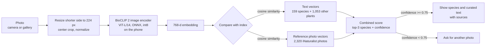

<div align="center">

# SaberIA Plant ID

**Offline identification of medicinal plants of the Brazilian Caatinga, on a mid-range Android phone.**

**English** · [Português (Brasil)](README.pt-BR.md)

[](LICENSE)
[](#how-it-works)
[](https://onnxruntime.ai)
[](examples/predict.py)
[](https://huggingface.co/andessonIF/saberia-plant-id)
[](https://github.com/Andessonreis/saberia-plant-id/releases/latest)


<sub>Real screens of the SaberIA app (Redmi 12, airplane mode). Left: home. Right: a photo of <i>Astronium urundeuva</i> bark that the app refused to name because confidence was too low. Photo: Thomaz Ricardo Favreto Sinani, <a href="https://www.inaturalist.org/observations/354557278">iNaturalist 354557278</a>, CC BY.</sub>

</div>

---

SaberIA is an Android app, developed as an undergraduate research project (PIBITI) at IFBA Campus Irecê, that helps communities of the Brazilian semi-arid region record and check traditional knowledge about medicinal plants. This repository holds the **plant recognition part**: the on-device model, the comparison index, the curated species base, the evaluation, and a reference implementation in Python.

You take a photo. The phone computes an embedding with a quantized [BioCLIP 2](https://huggingface.co/imageomics/bioclip-2) image encoder, compares it with an index of 159 species, and shows a description that was **written in advance from cited sources**. No text is generated at inference time, nothing is sent to a server, and when the model is not confident, the app says so instead of guessing.

## Contents

- [Why](#why)
- [How it works](#how-it-works)
- [Results](#results)
- [Limitations](#limitations)
- [Quick start (Python)](#quick-start-python)
- [Methodology and reproducibility](#methodology-and-reproducibility)
- [Species in the base](#species-in-the-base)
- [Licenses and attribution](#licenses-and-attribution)
- [Citation](#citation)
- [Acknowledgements and contact](#acknowledgements-and-contact)

## Why

The Caatinga is a biome found only in Brazil, and its communities hold a large body of knowledge about medicinal plants: which part to use, how to prepare it, what it is used for. That knowledge is passed on mostly by word of mouth and is being lost with urbanization and the lack of written records.

The first version of the app identified plants with a general-purpose multimodal model in the cloud and asked it to write the description. That had three problems in the field:

| Problem | Consequence |
|---|---|
| Native Caatinga species are rare in the training data of general models | Wrong names for exactly the plants that matter most |
| Free-form generated text | Plausible but unverifiable health claims |
| Needs internet | Rural areas of the semi-arid often have weak or no signal |

This repository replaces that step with a closed-set classifier that runs on the phone and a species base where every statement has a source.

The project relates to the UN Sustainable Development Goals 3 (good health and well-being), 11.4 (safeguard cultural heritage) and 15 (life on land).

## How it works



1. **Encoder.** The image tower of BioCLIP 2 (ViT-L/14, trained on [TreeOfLife-200M](https://huggingface.co/datasets/imageomics/TreeOfLife-200M), about 200 million images of organisms), exported to ONNX with dynamic int8 quantization of the matrix multiplications. No fine-tuning: the weights are the original ones.
2. **Text vectors.** For each label, BioCLIP 2's text encoder embeds the scientific name and synonyms, with and without the GBIF taxonomic path (kingdom to family). Besides the 159 species of the base, the index has 1,053 other plants (PlantNet-300K species and common Brazilian ornamentals, crops and weeds). They are never shown as answers; they are there to estimate whether the photo belongs to the base at all.
3. **Reference vectors.** Up to 15 research-grade iNaturalist photos per species, observed up to 2024-12-31, embedded with the same int8 model. Only the vectors ship; the photos do not.
4. **Score.** For each species of the base: `text_similarity + 1.0 × mean(top-3 reference similarities)`, then a softmax. Confidence is `P(top-1) × P(photo is a species of the base)`. Below 0.75 the app does not name the plant.
5. **Text.** The result screen reads the entry from [`data/caatinga_species.json`](data/caatinga_species.json): popular names, family, origin, traditional uses, precautions, and links to Flora e Funga do Brasil, GBIF, Agra et al. (2008), RENISUS and the Brazilian Pharmacopoeia herbal formulary.

The model (308 MB) is downloaded once, its SHA-256 is checked, and from then on identification works in airplane mode.

## Results

Test set: **194 photos of 25 species of the base**, research-grade iNaturalist observations **from 2025 onward**, so none of them overlaps with the reference photos (all up to 2024). Plus 74 photos of 12 plants that are **not** in the base, to measure false answers. Licenses and links for every test photo are in [`eval/data/test_photos.csv`](eval/data/test_photos.csv).

### Shipped model

| Metric | Value |
|---|---|
| Top-1 accuracy (no confidence gate) | **75.8%** (147/194) |
| Top-3 accuracy | **92.3%** (179/194) |
| Photos answered at confidence >= 0.75 | 63% (122/194) |
| Accuracy among answered photos | **91.8%** (112/122) |
| Out-of-base photos wrongly given a name | 1 of 74 |
| Time per photo, Redmi 12 (CPU, ONNX Runtime) | ~3.3 s |
| Model size | 308 MB (int8) + 5.5 MB index |

Running [`examples/predict.py`](examples/predict.py) with the files from the [release](https://github.com/Andessonreis/saberia-plant-id/releases/tag/v1.0.0) over the same photos gave 76.8% top-1, 92.3% top-3, 60% answered, 94.0% accuracy among answered and 1/74 false answers. Scoring the stored evaluation embeddings with the same script gives exactly 75.8%; the gap comes from run-to-run numerical variation of ONNX Runtime's int8 CPU kernels (cosine 0.994 to 1.0 between runs), which flips a few borderline photos. Expect similar small variations on other devices.

### Variants compared

Same 194 + 74 photos, same int8 quantization, threshold 0.75.

| Variant | Top-1 | Top-3 | Answered | Acc. when answered | Out-of-base answered |
|---|---:|---:|---:|---:|---:|
| BioCLIP (v1), names only | 44.8% | 62.4% | 40% | 73.1% | 6/74 |
| BioCLIP (v1), names + reference photos | 59.8% | 76.8% | 41% | 88.6% | 5/74 |
| BioCLIP 2, names only | 68.0% | 88.1% | 55% | 85.8% | 3/74 |
| BioCLIP 2, names + reference photos, bicubic resize | 77.3% | 93.3% | 61% | 93.2% | 1/74 |
| **BioCLIP 2, names + reference photos, bilinear resize (shipped)** | **75.8%** | **92.3%** | **63%** | **91.8%** | **1/74** |

The shipped variant uses bilinear resizing because that is what Android's `Bitmap.createScaledBitmap` does. The bicubic row scores slightly higher on a PC, but the bilinear row is what the phone actually sees.

### Against a general-purpose local model

Before choosing this approach, the app's earlier prompt ("answer only with the scientific name") was run with **Qwen3-VL-2B** (Q4_K_M, llama.cpp) on the first 64 test photos (8 species x 8 photos).

| Model | Correct species | Time per photo on the phone |
|---|---:|---:|
| Qwen3-VL-2B, generative | 6/64 (9.4%) | 2 to 3.5 min |
| SaberIA (BioCLIP 2 + index), same 64 photos | 45/64 (70.3%) top-1 | ~3.3 s |

Qwen often answered with real species from other regions (*Carnegiea gigantea*, the saguaro, for 6 of the 8 *mandacaru* photos) or with "Não sei" ("I don't know"). Raw answers: [`eval/data/qwen_results.txt`](eval/data/qwen_results.txt).

### Per species

<details>
<summary>Top-1, top-3 and answered-and-correct for each of the 25 tested species</summary>

| Species | Photos | Top-1 | Top-3 | Correct and answered (>= 0.75) |
|---|---:|---:|---:|---:|
| *Aloe vera* (babosa) | 8 | 8 | 8 | 8 |
| *Amburana cearensis* (umburana-de-cheiro) | 8 | 6 | 8 | 5 |
| *Anadenanthera colubrina* (angico) | 8 | 6 | 8 | 3 |
| *Astronium urundeuva* (aroeira-do-sertão) | 8 | 3 | 4 | 3 |
| *Cenostigma pyramidale* (catingueira) | 8 | 7 | 8 | 5 |
| *Cereus jamacaru* (mandacaru) | 8 | 7 | 8 | 4 |
| *Coleus barbatus* (boldo) | 8 | 8 | 8 | 6 |
| *Commiphora leptophloeos* (umburana-de-cambão) | 8 | 2 | 8 | 1 |
| *Cymbopogon citratus* (capim-santo) | 8 | 8 | 8 | 8 |
| *Erythrina velutina* (mulungu) | 8 | 2 | 5 | 2 |
| *Handroanthus impetiginosus* (ipê-roxo) | 8 | 6 | 7 | 6 |
| *Hymenaea courbaril* (jatobá) | 8 | 3 | 5 | 2 |
| *Jatropha mollissima* (pinhão-bravo) | 8 | 7 | 7 | 4 |
| *Libidibia ferrea* (jucá) | 8 | 5 | 8 | 1 |
| *Lippia alba* (erva-cidreira) | 8 | 8 | 8 | 7 |
| *Melocactus zehntneri* (coroa-de-frade) | 8 | 8 | 8 | 8 |
| *Mentha spicata* (hortelã) | 7 | 6 | 7 | 5 |
| *Mimosa tenuiflora* (jurema-preta) | 8 | 6 | 8 | 2 |
| *Opuntia ficus-indica* (palma) | 8 | 6 | 8 | 5 |
| *Sarcomphalus joazeiro* (juazeiro) | 8 | 7 | 7 | 6 |
| *Schinopsis brasiliensis* (baraúna) | 3 | 2 | 3 | 1 |
| *Sideroxylon obtusifolium* (quixabeira) | 8 | 7 | 8 | 7 |
| *Spondias tuberosa* (umbuzeiro) | 8 | 5 | 8 | 3 |
| *Ximenia americana* (ameixa-do-mato) | 8 | 7 | 7 | 3 |
| *Xiquexique gounellei* (xique-xique) | 8 | 7 | 7 | 7 |

</details>

## Limitations

| Limitation | Detail |
|---|---|
| Closed set | Only the 159 species of the base can be named. A plant outside the base gets, at best, a refusal; without the confidence gate it would always receive the name of some species of the base (74 of 74 out-of-base photos did). |
| Refusals | At the 0.75 threshold, 37% of photos of species that *are* in the base get no answer. For 61 of those 72, the right species was among the top 3. |
| Hard species | *Astronium urundeuva* (aroeira-do-sertão): 3/8 top-1. *Erythrina velutina* (mulungu): 2/8. *Commiphora leptophloeos* (umburana-de-cambão): 2/8 top-1 but 8/8 top-3. *Hymenaea courbaril* (jatobá): 3/8. Bark-only or leafless trees are the main failure mode. |
| Out-of-base test is optimistic | 11 of the 12 out-of-base test species are also among the 1,053 "other plant" labels of the index, which makes them easy to reject. The single false answer came from the one species that is not (*Croton urucurana*, named *Croton blanchetianus* at confidence 0.76; two other photos scored 0.66 and 0.73). For plants missing from both lists, expect more false answers than 1/74. |
| Small test set | 194 photos, 25 of 159 species, at most 8 photos per species (3 for *Schinopsis brasiliensis*). Treat per-species numbers as indicative. 134 species have reference photos but no test photos. |
| Photo domain | Test photos are from iNaturalist, mostly taken by people who know what they are photographing. Field photos by app users may be worse framed. |
| Not medical advice | Identification and texts support, but do not replace, validation by a botanist and guidance from a health professional. The app keeps a human validation step for community records. |

## Quick start (Python)

Download the model, the index and the species base from the [release](https://github.com/Andessonreis/saberia-plant-id/releases/tag/v1.0.0) (or from [Hugging Face](https://huggingface.co/andessonIF/saberia-plant-id)) and check the hashes:

```bash
pip install onnxruntime numpy pillow
BASE=https://github.com/Andessonreis/saberia-plant-id/releases/download/v1.0.0
for f in plant-classifier-int8.onnx plant-index.bin caatinga_species.json SHA256SUMS; do
  curl -LO "$BASE/$f"
done
sha256sum -c SHA256SUMS
```

Then run [`examples/predict.py`](examples/predict.py), which reproduces the app's scoring (`PlantClassifier.kt`):

```bash
python examples/predict.py my_photo.jpg
```

```text
my_photo.jpg: confidence 0.86
  -> Cereus jamacaru (mandacaru, cardeiro)
     source: https://www.scielo.br/j/rbfar/a/fC7snvLkwzzFsMv3mfVRGNc/
```

The core of it, if you want to embed it in your own code:

```python
import json, struct
import numpy as np, onnxruntime as ort
from PIL import Image

# index: int32 header size, JSON header, float16 vectors (one per label, then one per reference photo)
with open("plant-index.bin", "rb") as f:
    h = json.loads(f.read(struct.unpack("<i", f.read(4))[0]))
    v = np.frombuffer(f.read(), "<f2").astype(np.float32).reshape(-1, h["dim"])
text, refs = v[: len(h["labels"])], v[len(h["labels"]):]

def preprocess(path):  # shorter side -> 224 (bilinear), center crop, CLIP normalization
    im = Image.open(path).convert("RGB"); s = 224 / min(im.size)
    im = im.resize((max(224, round(im.width * s)), max(224, round(im.height * s))), Image.BILINEAR)
    l, t = (im.width - 224) // 2, (im.height - 224) // 2
    x = (np.asarray(im.crop((l, t, l + 224, t + 224)), np.float32) / 255 - h["mean"]) / h["std"]
    return x.transpose(2, 0, 1)[None].astype(np.float32)

session = ort.InferenceSession("plant-classifier-int8.onnx")
x = session.run(None, {"pixel_values": preprocess("my_photo.jpg")})[0][0]  # 768-d, L2-normalized

def softmax(z, scale): e = np.exp((z - z.max()) * scale); return e / e.sum()
catalog = [i for i, label in enumerate(h["labels"]) if "id" in label]   # the 159 species of the base
owner = np.array(h["refs"])                                              # label index of each reference photo
t = text @ x
p_in_base = softmax(t, h["scale"])[catalog].sum()
visual = [np.sort(refs[owner == i] @ x)[-h["k"]:].mean() for i in catalog]
prob = softmax(t[catalog] + h["weight"] * np.array(visual), h["scale"] / (1 + h["weight"]))
best = int(prob.argmax())
confidence = prob[best] * p_in_base
print(h["labels"][catalog[best]]["name"], round(float(confidence), 2),
      "answer" if confidence >= h["threshold"] else "not sure")
```

Model input and output:

| | |
|---|---|
| Input `pixel_values` | `float32 [1, 3, 224, 224]`, RGB, mean `0.48145466, 0.4578275, 0.40821073`, std `0.26862954, 0.26130258, 0.27577711` |
| Output `embedding` | `float32 [1, 768]`, L2-normalized |
| Index parameters | `scale` 100, `weight` 1.0, `k` 3, `threshold` 0.75 (read from the index header) |

## Methodology and reproducibility

The [`eval/`](eval/) folder has the scripts used to build and evaluate the model, and [`eval/README.md`](eval/README.md) lists the order to run them. In short:

1. `build_labels.py`: label list (159 species + 1,053 other plants) with GBIF taxonomy.
2. `fetch_refs.py`: up to 15 reference photos per species from iNaturalist, observed up to 2024-12-31, Brazil first.
3. `fetch_photos.py`: test photos, research grade, observed from 2025-01-01.
4. `export_onnx.py`: export BioCLIP 2's image encoder to ONNX and quantize to int8.
5. `embed.py` and `embed_onnx.py`: text vectors (PyTorch/OpenCLIP) and image vectors (ONNX int8, bilinear resize).
6. `evaluate.py`: top-1/top-3 and the confidence-threshold table.
7. `build_index.py`: write `plant-index.bin`.

Photos are not redistributed: most are CC BY-NC. The CSV files in [`eval/data/`](eval/data/) list every observation ID, license and author, so the same photos can be downloaded again from iNaturalist.

## Species in the base

159 species: 99 native (24 endemic to Brazil) and 60 exotic species that are cultivated or naturalized and widely used in the region. 47 are on RENISUS, the Brazilian Ministry of Health list of medicinal plants of interest to the public health system. The "Tested" column marks the 25 species in the test set.

Source keys: **Flora** = Flora e Funga do Brasil (JBRJ), **GBIF** = GBIF Backbone Taxonomy, **Agra 2008** = Agra et al., *Survey of medicinal plants used in the region Northeast of Brazil*, Rev. Bras. Farmacogn. 18(3), **RENISUS** = Ministry of Health, **FFFB** = ANVISA, *Formulário de Fitoterápicos da Farmacopeia Brasileira*, **art.** = specific scientific article.

<details>
<summary>Show all 159 species</summary>

| # | Scientific name | Popular names | Family | Origin | Ref. photos | Tested | Sources |
|---:|---|---|---|---|---:|:---:|---|
| 1 | *Acanthospermum hispidum* | espinho-de-cigano, carrapicho, retirante | Asteraceae | native | 15 |  | [Agra 2008](https://www.scielo.br/j/rbfar/a/fC7snvLkwzzFsMv3mfVRGNc/) · [Flora](https://floradobrasil.jbrj.gov.br/FB103232) · [GBIF](https://www.gbif.org/species/3100375) |
| 2 | *Ageratum conyzoides* | mentrasto, catinga-de-bode | Asteraceae | native | 15 |  | [Agra 2008](https://www.scielo.br/j/rbfar/a/fC7snvLkwzzFsMv3mfVRGNc/) · [Flora](https://floradobrasil.jbrj.gov.br/FB15934) · [GBIF](https://www.gbif.org/species/5401673) |
| 3 | *Allium cepa* | cebola | Amaryllidaceae | exotic, cultivated | 15 |  | [Agra 2008](https://www.scielo.br/j/rbfar/a/fC7snvLkwzzFsMv3mfVRGNc/) · [Flora](https://floradobrasil.jbrj.gov.br/FB611758) · [GBIF](https://www.gbif.org/species/2857697) |
| 4 | *Allium sativum* | alho | Amaryllidaceae | exotic, cultivated | 15 |  | [FFFB](https://bibliotecadigital.anvisa.gov.br/jspui/handle/anvisa/21045) · [RENISUS](https://www.gov.br/saude/pt-br/composicao/sectics/plantas-medicinais-e-fitoterapicos/ppnpmf/arquivos/2014/renisus.pdf) · [Agra 2008](https://www.scielo.br/j/rbfar/a/fC7snvLkwzzFsMv3mfVRGNc/) · [Flora](https://floradobrasil.jbrj.gov.br/FB611763) · [GBIF](https://www.gbif.org/species/2856681) |
| 5 | *Aloe vera* | babosa | Asphodelaceae | exotic, cultivated | 15 | yes | [FFFB](https://bibliotecadigital.anvisa.gov.br/jspui/handle/anvisa/21045) · [RENISUS](https://www.gov.br/saude/pt-br/composicao/sectics/plantas-medicinais-e-fitoterapicos/ppnpmf/arquivos/2014/renisus.pdf) · [Agra 2008](https://www.scielo.br/j/rbfar/a/fC7snvLkwzzFsMv3mfVRGNc/) · [Flora](https://floradobrasil.jbrj.gov.br/FB609263) · [GBIF](https://www.gbif.org/species/2777724) |
| 6 | *Alpinia zerumbet* | colônia, gengibre-concha | Zingiberaceae | exotic, cultivated | 15 |  | [FFFB](https://bibliotecadigital.anvisa.gov.br/jspui/handle/anvisa/21045) · [RENISUS](https://www.gov.br/saude/pt-br/composicao/sectics/plantas-medicinais-e-fitoterapicos/ppnpmf/arquivos/2014/renisus.pdf) · [Agra 2008](https://www.scielo.br/j/rbfar/a/fC7snvLkwzzFsMv3mfVRGNc/) · [Flora](https://floradobrasil.jbrj.gov.br/FB110703) · [GBIF](https://www.gbif.org/species/5301979) |
| 7 | *Alternanthera brasiliana* | terramicina, perpétua-do-brasil, penicilina | Amaranthaceae | native | 15 |  | [FFFB](https://bibliotecadigital.anvisa.gov.br/jspui/handle/anvisa/21045) · [Agra 2008](https://www.scielo.br/j/rbfar/a/fC7snvLkwzzFsMv3mfVRGNc/) · [Flora](https://floradobrasil.jbrj.gov.br/FB4302) · [GBIF](https://www.gbif.org/species/3084934) |
| 8 | *Amburana cearensis* | umburana-de-cheiro, cumaru, amburana | Fabaceae | native | 15 | yes | [Agra 2008](https://www.scielo.br/j/rbfar/a/fC7snvLkwzzFsMv3mfVRGNc/) · [Flora](https://floradobrasil.jbrj.gov.br/FB22781) · [GBIF](https://www.gbif.org/species/2945821) |
| 9 | *Anacardium occidentale* | cajueiro, caju | Anacardiaceae | native | 15 |  | [FFFB](https://bibliotecadigital.anvisa.gov.br/jspui/handle/anvisa/21045) · [RENISUS](https://www.gov.br/saude/pt-br/composicao/sectics/plantas-medicinais-e-fitoterapicos/ppnpmf/arquivos/2014/renisus.pdf) · [Agra 2008](https://www.scielo.br/j/rbfar/a/fC7snvLkwzzFsMv3mfVRGNc/) · [Flora](https://floradobrasil.jbrj.gov.br/FB4381) · [GBIF](https://www.gbif.org/species/5421368) |
| 10 | *Anadenanthera colubrina* | angico, angico-vermelho, angico-de-caroço | Fabaceae | native | 15 | yes | [Agra 2008](https://www.scielo.br/j/rbfar/a/fC7snvLkwzzFsMv3mfVRGNc/) · [Flora](https://floradobrasil.jbrj.gov.br/FB18071) · [GBIF](https://www.gbif.org/species/2952823) |
| 11 | *Ananas comosus* | abacaxi, ananás | Bromeliaceae | native | 15 |  | [Agra 2008](https://www.scielo.br/j/rbfar/a/fC7snvLkwzzFsMv3mfVRGNc/) · [RENISUS](https://www.gov.br/saude/pt-br/composicao/sectics/plantas-medicinais-e-fitoterapicos/ppnpmf/arquivos/2014/renisus.pdf) · [Flora](https://floradobrasil.jbrj.gov.br/FB16574) · [GBIF](https://www.gbif.org/species/5288819) |
| 12 | *Annona squamosa* | pinha, ata, fruta-do-conde | Annonaceae | exotic, naturalized | 15 |  | [Agra 2008](https://www.scielo.br/j/rbfar/a/fC7snvLkwzzFsMv3mfVRGNc/) · [Flora](https://floradobrasil.jbrj.gov.br/FB117273) · [GBIF](https://www.gbif.org/species/5407099) |
| 13 | *Artemisia absinthium* | losna, absinto, erva-dos-vermes | Asteraceae | exotic, cultivated | 15 |  | [Agra 2008](https://www.scielo.br/j/rbfar/a/fC7snvLkwzzFsMv3mfVRGNc/) · [RENISUS](https://www.gov.br/saude/pt-br/composicao/sectics/plantas-medicinais-e-fitoterapicos/ppnpmf/arquivos/2014/renisus.pdf) · [Flora](https://floradobrasil.jbrj.gov.br/FB612129) · [GBIF](https://www.gbif.org/species/3121319) |
| 14 | *Aspidosperma pyrifolium* | pereiro, pau-pereiro | Apocynaceae | native | 15 |  | [Agra 2008](https://www.scielo.br/j/rbfar/a/fC7snvLkwzzFsMv3mfVRGNc/) · [Flora](https://floradobrasil.jbrj.gov.br/FB15551) · [GBIF](https://www.gbif.org/species/7316881) |
| 15 | *Astronium urundeuva* | aroeira-do-sertão, aroeira, urundeúva | Anacardiaceae | native | 14 | yes | [FFFB](https://bibliotecadigital.anvisa.gov.br/jspui/handle/anvisa/21045) · [Agra 2008](https://www.scielo.br/j/rbfar/a/fC7snvLkwzzFsMv3mfVRGNc/) · [Flora](https://floradobrasil.jbrj.gov.br/FB115185) · [GBIF](https://www.gbif.org/species/3660652) |
| 16 | *Attalea speciosa* | babaçu, coco-palmeira | Arecaceae | native, endemic to Brazil | 15 |  | [Agra 2008](https://www.scielo.br/j/rbfar/a/fC7snvLkwzzFsMv3mfVRGNc/) · [RENISUS](https://www.gov.br/saude/pt-br/composicao/sectics/plantas-medicinais-e-fitoterapicos/ppnpmf/arquivos/2014/renisus.pdf) · [Flora](https://floradobrasil.jbrj.gov.br/FB15686) · [GBIF](https://www.gbif.org/species/2732877) |
| 17 | *Bauhinia cheilantha* | mororó, pata-de-vaca | Fabaceae | native | 15 |  | [Agra 2008](https://www.scielo.br/j/rbfar/a/fC7snvLkwzzFsMv3mfVRGNc/) · [Flora](https://floradobrasil.jbrj.gov.br/FB82659) · [GBIF](https://www.gbif.org/species/2952938) |
| 18 | *Bauhinia forficata* | pata-de-vaca, mororó | Fabaceae | native | 15 |  | [Agra 2008](https://www.scielo.br/j/rbfar/a/fC7snvLkwzzFsMv3mfVRGNc/) · [RENISUS](https://www.gov.br/saude/pt-br/composicao/sectics/plantas-medicinais-e-fitoterapicos/ppnpmf/arquivos/2014/renisus.pdf) · [Flora](https://floradobrasil.jbrj.gov.br/FB82666) · [GBIF](https://www.gbif.org/species/2953861) |
| 19 | *Bidens pilosa* | picão-preto, picão, carrapicho-de-agulha | Asteraceae | exotic, naturalized | 15 |  | [FFFB](https://bibliotecadigital.anvisa.gov.br/jspui/handle/anvisa/21045) · [RENISUS](https://www.gov.br/saude/pt-br/composicao/sectics/plantas-medicinais-e-fitoterapicos/ppnpmf/arquivos/2014/renisus.pdf) · [Agra 2008](https://www.scielo.br/j/rbfar/a/fC7snvLkwzzFsMv3mfVRGNc/) · [Flora](https://floradobrasil.jbrj.gov.br/FB103749) · [GBIF](https://www.gbif.org/species/5391845) |
| 20 | *Bixa orellana* | urucum, colorau, açafroa | Bixaceae | native | 15 |  | [Agra 2008](https://www.scielo.br/j/rbfar/a/fC7snvLkwzzFsMv3mfVRGNc/) · [Flora](https://floradobrasil.jbrj.gov.br/FB5745) · [GBIF](https://www.gbif.org/species/2874863) |
| 21 | *Bowdichia virgilioides* | sucupira, sucupira-preta | Fabaceae | native | 15 |  | [Agra 2008](https://www.scielo.br/j/rbfar/a/fC7snvLkwzzFsMv3mfVRGNc/) · [Flora](https://floradobrasil.jbrj.gov.br/FB29489) · [GBIF](https://www.gbif.org/species/2975476) |
| 22 | *Bromelia laciniosa* | macambira | Bromeliaceae | native, endemic to Brazil | 15 |  | [Agra 2008](https://www.scielo.br/j/rbfar/a/fC7snvLkwzzFsMv3mfVRGNc/) · [Flora](https://floradobrasil.jbrj.gov.br/FB16578) · [GBIF](https://www.gbif.org/species/5287936) |
| 23 | *Byrsonima crassifolia* | murici, murici-da-praia | Malpighiaceae | native | 15 |  | [Agra 2008](https://www.scielo.br/j/rbfar/a/fC7snvLkwzzFsMv3mfVRGNc/) · [Flora](https://floradobrasil.jbrj.gov.br/FB19419) · [GBIF](https://www.gbif.org/species/3191361) |
| 24 | *Cajanus cajan* | feijão-guandu, guandu, andu | Fabaceae | exotic, naturalized | 15 |  | [Agra 2008](https://www.scielo.br/j/rbfar/a/fC7snvLkwzzFsMv3mfVRGNc/) · [Flora](https://floradobrasil.jbrj.gov.br/FB82709) · [GBIF](https://www.gbif.org/species/7587087) |
| 25 | *Calotropis procera* | algodão-de-seda, flor-de-seda, ciúme | Apocynaceae | exotic, naturalized | 15 |  | [Agra 2008](https://www.scielo.br/j/rbfar/a/fC7snvLkwzzFsMv3mfVRGNc/) · [Flora](https://floradobrasil.jbrj.gov.br/FB80340) · [GBIF](https://www.gbif.org/species/5414566) |
| 26 | *Capraria biflora* | chá-da-calçada, chá-preto, mate | Scrophulariaceae | native | 15 |  | [Agra 2008](https://www.scielo.br/j/rbfar/a/fC7snvLkwzzFsMv3mfVRGNc/) · [Flora](https://floradobrasil.jbrj.gov.br/FB25821) · [GBIF](https://www.gbif.org/species/3171842) |
| 27 | *Carica papaya* | mamão, mamoeiro | Caricaceae | exotic, naturalized | 15 |  | [Agra 2008](https://www.scielo.br/j/rbfar/a/fC7snvLkwzzFsMv3mfVRGNc/) · [Flora](https://floradobrasil.jbrj.gov.br/FB22405) · [GBIF](https://www.gbif.org/species/2874484) |
| 28 | *Casearia sylvestris* | guaçatonga, pau-de-lagarto, língua-de-tiú | Salicaceae | native | 15 |  | [FFFB](https://bibliotecadigital.anvisa.gov.br/jspui/handle/anvisa/21045) · [RENISUS](https://www.gov.br/saude/pt-br/composicao/sectics/plantas-medicinais-e-fitoterapicos/ppnpmf/arquivos/2014/renisus.pdf) · [Agra 2008](https://www.scielo.br/j/rbfar/a/fC7snvLkwzzFsMv3mfVRGNc/) · [Flora](https://floradobrasil.jbrj.gov.br/FB14384) · [GBIF](https://www.gbif.org/species/5331148) |
| 29 | *Ceiba glaziovii* | barriguda, barriguda-de-espinho | Malvaceae | native, endemic to Brazil | 15 |  | [Agra 2008](https://www.scielo.br/j/rbfar/a/fC7snvLkwzzFsMv3mfVRGNc/) · [Flora](https://floradobrasil.jbrj.gov.br/FB9035) · [GBIF](https://www.gbif.org/species/7813916) |
| 30 | *Cenostigma pyramidale* | catingueira, catingueira-verdadeira | Fabaceae | native, endemic to Brazil | 13 | yes | [Agra 2008](https://www.scielo.br/j/rbfar/a/fC7snvLkwzzFsMv3mfVRGNc/) · [Flora](https://floradobrasil.jbrj.gov.br/FB606076) · [GBIF](https://www.gbif.org/species/9462202) |
| 31 | *Cereus jamacaru* | mandacaru, cardeiro, jamacaru | Cactaceae | native, endemic to Brazil | 15 | yes | [Agra 2008](https://www.scielo.br/j/rbfar/a/fC7snvLkwzzFsMv3mfVRGNc/) · [Flora](https://floradobrasil.jbrj.gov.br/FB1447) · [GBIF](https://www.gbif.org/species/7282182) |
| 32 | *Cinnamomum verum* | canela, canela-do-ceilão, caneleira | Lauraceae | exotic, cultivated | 15 |  | [FFFB](https://bibliotecadigital.anvisa.gov.br/jspui/handle/anvisa/21045) · [Agra 2008](https://www.scielo.br/j/rbfar/a/fC7snvLkwzzFsMv3mfVRGNc/) · [Flora](https://floradobrasil.jbrj.gov.br/FB25614) · [GBIF](https://www.gbif.org/species/3033987) |
| 33 | *Cissus verticillata* | insulina, insulina-vegetal, cipó-pucá | Vitaceae | native | 15 |  | [Agra 2008](https://www.scielo.br/j/rbfar/a/fC7snvLkwzzFsMv3mfVRGNc/) · [Flora](https://floradobrasil.jbrj.gov.br/FB15270) · [GBIF](https://www.gbif.org/species/3039173) |
| 34 | *Citrus aurantium* | laranja-da-terra, laranja-amarga, laranja-azeda | Rutaceae | exotic, cultivated | 15 |  | [FFFB](https://bibliotecadigital.anvisa.gov.br/jspui/handle/anvisa/21045) · [Flora](https://floradobrasil.jbrj.gov.br/FB611574) · [GBIF](https://www.gbif.org/species/8077391) |
| 35 | *Cnidoscolus quercifolius* | faveleira, favela, faveleiro | Euphorbiaceae | native, endemic to Brazil | 15 |  | [Agra 2008](https://www.scielo.br/j/rbfar/a/fC7snvLkwzzFsMv3mfVRGNc/) · [Flora](https://floradobrasil.jbrj.gov.br/FB17494) · [GBIF](https://www.gbif.org/species/3073448) |
| 36 | *Cnidoscolus urens* | cansanção, urtiga-branca, urtiga | Euphorbiaceae | native | 15 |  | [Agra 2008](https://www.scielo.br/j/rbfar/a/fC7snvLkwzzFsMv3mfVRGNc/) · [Flora](https://floradobrasil.jbrj.gov.br/FB17495) · [GBIF](https://www.gbif.org/species/3073653) |
| 37 | *Cocos nucifera* | coqueiro, coco, coco-da-baía | Arecaceae | exotic, naturalized | 15 |  | [Agra 2008](https://www.scielo.br/j/rbfar/a/fC7snvLkwzzFsMv3mfVRGNc/) · [Flora](https://floradobrasil.jbrj.gov.br/FB80541) · [GBIF](https://www.gbif.org/species/2735117) |
| 38 | *Coleus amboinicus* | hortelã-graúda, malvarisco, malva | Lamiaceae | exotic, cultivated | 15 |  | [Agra 2008](https://www.scielo.br/j/rbfar/a/fC7snvLkwzzFsMv3mfVRGNc/) · [Flora](https://floradobrasil.jbrj.gov.br/FB23336) · [GBIF](https://www.gbif.org/species/5341313) |
| 39 | *Coleus barbatus* | boldo, boldo-brasileiro, boldo-nacional | Lamiaceae | exotic, cultivated | 15 | yes | [FFFB](https://bibliotecadigital.anvisa.gov.br/jspui/handle/anvisa/21045) · [RENISUS](https://www.gov.br/saude/pt-br/composicao/sectics/plantas-medicinais-e-fitoterapicos/ppnpmf/arquivos/2014/renisus.pdf) · [Agra 2008](https://www.scielo.br/j/rbfar/a/fC7snvLkwzzFsMv3mfVRGNc/) · [Flora](https://floradobrasil.jbrj.gov.br/FB84186) · [GBIF](https://www.gbif.org/species/8030165) |
| 40 | *Coleus comosus* | boldo-gambá, boldo-pequeno, novalgina | Lamiaceae | exotic, cultivated | 10 |  | [art.](https://repositorio.ufc.br/ri/bitstream/riufc/23729/3/2015%20_dis%20_fnavila.pdf) · [Flora](https://floradobrasil.jbrj.gov.br/FB637468) · [GBIF](https://www.gbif.org/species/5605775) |
| 41 | *Combretum leprosum* | mofumbo, mufumbo, pente-de-macaco | Combretaceae | native | 15 |  | [Agra 2008](https://www.scielo.br/j/rbfar/a/fC7snvLkwzzFsMv3mfVRGNc/) · [Flora](https://floradobrasil.jbrj.gov.br/FB6906) · [GBIF](https://www.gbif.org/species/3698829) |
| 42 | *Commiphora leptophloeos* | umburana-de-cambão, imburana, imburana-de-cambão | Burseraceae | native | 15 | yes | [Agra 2008](https://www.scielo.br/j/rbfar/a/fC7snvLkwzzFsMv3mfVRGNc/) · [Flora](https://floradobrasil.jbrj.gov.br/FB16657) · [GBIF](https://www.gbif.org/species/3993388) |
| 43 | *Copaifera langsdorffii* | copaíba, pau-d'óleo | Fabaceae | native | 15 |  | [Agra 2008](https://www.scielo.br/j/rbfar/a/fC7snvLkwzzFsMv3mfVRGNc/) · [RENISUS](https://www.gov.br/saude/pt-br/composicao/sectics/plantas-medicinais-e-fitoterapicos/ppnpmf/arquivos/2014/renisus.pdf) · [Flora](https://floradobrasil.jbrj.gov.br/FB22896) · [GBIF](https://www.gbif.org/species/2978171) |
| 44 | *Copernicia prunifera* | carnaúba, carnaubeira | Arecaceae | native, endemic to Brazil | 15 |  | [Agra 2008](https://www.scielo.br/j/rbfar/a/fC7snvLkwzzFsMv3mfVRGNc/) · [Flora](https://floradobrasil.jbrj.gov.br/FB15706) · [GBIF](https://www.gbif.org/species/2738262) |
| 45 | *Cordia oncocalyx* | pau-branco | Cordiaceae | native, endemic to Brazil | 10 |  | [Agra 2008](https://www.scielo.br/j/rbfar/a/fC7snvLkwzzFsMv3mfVRGNc/) · [Flora](https://floradobrasil.jbrj.gov.br/FB127463) · [GBIF](https://www.gbif.org/species/5661249) |
| 46 | *Coriandrum sativum* | coentro | Apiaceae | exotic, cultivated | 15 |  | [Agra 2008](https://www.scielo.br/j/rbfar/a/fC7snvLkwzzFsMv3mfVRGNc/) · [Flora](https://floradobrasil.jbrj.gov.br/FB111826) · [GBIF](https://www.gbif.org/species/3034871) |
| 47 | *Croton blanchetianus* | marmeleiro, marmeleiro-da-caatinga | Euphorbiaceae | native, endemic to Brazil | 15 |  | [Agra 2008](https://www.scielo.br/j/rbfar/a/fC7snvLkwzzFsMv3mfVRGNc/) · [Flora](https://floradobrasil.jbrj.gov.br/FB25478) · [GBIF](https://www.gbif.org/species/3059075) |
| 48 | *Croton grewioides* | canela-de-cunhã, canelinha, alecrim-de-cabocla | Euphorbiaceae | native | 4 |  | [Agra 2008](https://www.scielo.br/j/rbfar/a/fC7snvLkwzzFsMv3mfVRGNc/) · [RENISUS](https://www.gov.br/saude/pt-br/composicao/sectics/plantas-medicinais-e-fitoterapicos/ppnpmf/arquivos/2014/renisus.pdf) · [Flora](https://floradobrasil.jbrj.gov.br/FB17516) · [GBIF](https://www.gbif.org/species/3058458) |
| 49 | *Croton heliotropiifolius* | velame, velaminho, velame-de-cheiro | Euphorbiaceae | native | 15 |  | [art.](https://www.alice.cnptia.embrapa.br/alice/bitstream/doc/935899/1/AnaValeria14.pdf) · [Flora](https://floradobrasil.jbrj.gov.br/FB17517) · [GBIF](https://www.gbif.org/species/3060038) |
| 50 | *Curcuma longa* | açafrão-da-terra, cúrcuma, açafrão | Zingiberaceae | exotic, cultivated | 15 |  | [FFFB](https://bibliotecadigital.anvisa.gov.br/jspui/handle/anvisa/21045) · [RENISUS](https://www.gov.br/saude/pt-br/composicao/sectics/plantas-medicinais-e-fitoterapicos/ppnpmf/arquivos/2014/renisus.pdf) · [Agra 2008](https://www.scielo.br/j/rbfar/a/fC7snvLkwzzFsMv3mfVRGNc/) · [GBIF](https://www.gbif.org/species/2757624) |
| 51 | *Cymbopogon citratus* | capim-santo, capim-limão, capim-cidreira | Poaceae | exotic, naturalized | 15 | yes | [FFFB](https://bibliotecadigital.anvisa.gov.br/jspui/handle/anvisa/21045) · [Agra 2008](https://www.scielo.br/j/rbfar/a/fC7snvLkwzzFsMv3mfVRGNc/) · [Flora](https://floradobrasil.jbrj.gov.br/FB24285) · [GBIF](https://www.gbif.org/species/2705275) |
| 52 | *Dysphania ambrosioides* | mastruz, mastruço, erva-de-santa-maria | Amaranthaceae | exotic, naturalized | 15 |  | [Agra 2008](https://www.scielo.br/j/rbfar/a/fC7snvLkwzzFsMv3mfVRGNc/) · [RENISUS](https://www.gov.br/saude/pt-br/composicao/sectics/plantas-medicinais-e-fitoterapicos/ppnpmf/arquivos/2014/renisus.pdf) · [Flora](https://floradobrasil.jbrj.gov.br/FB139867) · [GBIF](https://www.gbif.org/species/5568446) |
| 53 | *Egletes viscosa* | macela, macela-da-terra, macela-do-campo | Asteraceae | native | 15 |  | [Agra 2008](https://www.scielo.br/j/rbfar/a/fC7snvLkwzzFsMv3mfVRGNc/) · [Flora](https://floradobrasil.jbrj.gov.br/FB16094) · [GBIF](https://www.gbif.org/species/3118721) |
| 54 | *Erythrina mulungu* | mulungu | Fabaceae | native | 15 |  | [FFFB](https://bibliotecadigital.anvisa.gov.br/jspui/handle/anvisa/21045) · [RENISUS](https://www.gov.br/saude/pt-br/composicao/sectics/plantas-medicinais-e-fitoterapicos/ppnpmf/arquivos/2014/renisus.pdf) · [Flora](https://floradobrasil.jbrj.gov.br/FB105155) · [GBIF](https://www.gbif.org/species/5349691) |
| 55 | *Erythrina velutina* | mulungu, mulungu-da-caatinga | Fabaceae | native | 15 | yes | [Agra 2008](https://www.scielo.br/j/rbfar/a/fC7snvLkwzzFsMv3mfVRGNc/) · [Flora](https://floradobrasil.jbrj.gov.br/FB29679) · [GBIF](https://www.gbif.org/species/5349685) |
| 56 | *Eugenia uniflora* | pitangueira, pitanga | Myrtaceae | native | 15 |  | [FFFB](https://bibliotecadigital.anvisa.gov.br/jspui/handle/anvisa/21045) · [RENISUS](https://www.gov.br/saude/pt-br/composicao/sectics/plantas-medicinais-e-fitoterapicos/ppnpmf/arquivos/2014/renisus.pdf) · [Agra 2008](https://www.scielo.br/j/rbfar/a/fC7snvLkwzzFsMv3mfVRGNc/) · [Flora](https://floradobrasil.jbrj.gov.br/FB10560) · [GBIF](https://www.gbif.org/species/5416458) |
| 57 | *Euphorbia tirucalli* | avelós, aveloz, pau-pelado | Euphorbiaceae | exotic, cultivated | 15 |  | [Agra 2008](https://www.scielo.br/j/rbfar/a/fC7snvLkwzzFsMv3mfVRGNc/) · [Flora](https://floradobrasil.jbrj.gov.br/FB609672) · [GBIF](https://www.gbif.org/species/3069353) |
| 58 | *Foeniculum vulgare* | funcho, erva-doce | Apiaceae | exotic, cultivated | 15 |  | [FFFB](https://bibliotecadigital.anvisa.gov.br/jspui/handle/anvisa/21045) · [RENISUS](https://www.gov.br/saude/pt-br/composicao/sectics/plantas-medicinais-e-fitoterapicos/ppnpmf/arquivos/2014/renisus.pdf) · [Agra 2008](https://www.scielo.br/j/rbfar/a/fC7snvLkwzzFsMv3mfVRGNc/) · [Flora](https://floradobrasil.jbrj.gov.br/FB21886) · [GBIF](https://www.gbif.org/species/3034922) |
| 59 | *Genipa americana* | jenipapo, jenipapeiro | Rubiaceae | native | 15 |  | [Agra 2008](https://www.scielo.br/j/rbfar/a/fC7snvLkwzzFsMv3mfVRGNc/) · [Flora](https://floradobrasil.jbrj.gov.br/FB14045) · [GBIF](https://www.gbif.org/species/2895593) |
| 60 | *Gossypium barbadense* | algodoeiro, algodão | Malvaceae | exotic, naturalized | 15 |  | [Agra 2008](https://www.scielo.br/j/rbfar/a/fC7snvLkwzzFsMv3mfVRGNc/) · [Flora](https://floradobrasil.jbrj.gov.br/FB19517) · [GBIF](https://www.gbif.org/species/3152666) |
| 61 | *Gymnanthemum amygdalinum* | boldo-baiano, alumã, boldo | Asteraceae | exotic, naturalized | 15 |  | [Agra 2008](https://www.scielo.br/j/rbfar/a/fC7snvLkwzzFsMv3mfVRGNc/) · [RENISUS](https://www.gov.br/saude/pt-br/composicao/sectics/plantas-medicinais-e-fitoterapicos/ppnpmf/arquivos/2014/renisus.pdf) · [Flora](https://floradobrasil.jbrj.gov.br/FB22218) · [GBIF](https://www.gbif.org/species/3130899) |
| 62 | *Hancornia speciosa* | mangabeira, mangaba | Apocynaceae | native | 15 |  | [Agra 2008](https://www.scielo.br/j/rbfar/a/fC7snvLkwzzFsMv3mfVRGNc/) · [Flora](https://floradobrasil.jbrj.gov.br/FB15558) · [GBIF](https://www.gbif.org/species/3169679) |
| 63 | *Handroanthus impetiginosus* | ipê-roxo, pau-d'arco-roxo, pau-d'arco | Bignoniaceae | native | 15 | yes | [Agra 2008](https://www.scielo.br/j/rbfar/a/fC7snvLkwzzFsMv3mfVRGNc/) · [RENISUS](https://www.gov.br/saude/pt-br/composicao/sectics/plantas-medicinais-e-fitoterapicos/ppnpmf/arquivos/2014/renisus.pdf) · [Flora](https://floradobrasil.jbrj.gov.br/FB114086) · [GBIF](https://www.gbif.org/species/4092242) |
| 64 | *Handroanthus serratifolius* | pau-d'arco-amarelo, ipê-amarelo | Bignoniaceae | native | 15 |  | [Agra 2008](https://www.scielo.br/j/rbfar/a/fC7snvLkwzzFsMv3mfVRGNc/) · [Flora](https://floradobrasil.jbrj.gov.br/FB117466) · [GBIF](https://www.gbif.org/species/4092017) |
| 65 | *Harrisia adscendens* | rabo-de-raposa, cacto-rabo-de-raposa | Cactaceae | native, endemic to Brazil | 15 |  | [Agra 2008](https://www.scielo.br/j/rbfar/a/fC7snvLkwzzFsMv3mfVRGNc/) · [Flora](https://floradobrasil.jbrj.gov.br/FB1540) · [GBIF](https://www.gbif.org/species/5622072) |
| 66 | *Heliotropium indicum* | crista-de-galo, fedegoso, crista-de-peru | Heliotropiaceae | native | 15 |  | [Agra 2008](https://www.scielo.br/j/rbfar/a/fC7snvLkwzzFsMv3mfVRGNc/) · [Flora](https://floradobrasil.jbrj.gov.br/FB16545) · [GBIF](https://www.gbif.org/species/2925788) |
| 67 | *Hymenaea courbaril* | jatobá | Fabaceae | native | 15 | yes | [Agra 2008](https://www.scielo.br/j/rbfar/a/fC7snvLkwzzFsMv3mfVRGNc/) · [Flora](https://floradobrasil.jbrj.gov.br/FB22972) · [GBIF](https://www.gbif.org/species/2950750) |
| 68 | *Hymenaea martiana* | jatobá | Fabaceae | native | 6 |  | [Agra 2008](https://www.scielo.br/j/rbfar/a/fC7snvLkwzzFsMv3mfVRGNc/) · [Flora](https://floradobrasil.jbrj.gov.br/FB83203) · [GBIF](https://www.gbif.org/species/2950768) |
| 69 | *Hymenaea stigonocarpa* | jatobá, jatobá-do-cerrado, jatobá-da-casca-fina | Fabaceae | native | 15 |  | [Agra 2008](https://www.scielo.br/j/rbfar/a/fC7snvLkwzzFsMv3mfVRGNc/) · [Flora](https://floradobrasil.jbrj.gov.br/FB83206) · [GBIF](https://www.gbif.org/species/2950722) |
| 70 | *Ipomoea asarifolia* | salsa, salsa-brava, batata-brava | Convolvulaceae | native | 15 |  | [Agra 2008](https://www.scielo.br/j/rbfar/a/fC7snvLkwzzFsMv3mfVRGNc/) · [Flora](https://floradobrasil.jbrj.gov.br/FB7026) · [GBIF](https://www.gbif.org/species/2928595) |
| 71 | *Jatropha curcas* | pinhão-manso, pinhão, pinhão-branco | Euphorbiaceae | exotic, naturalized | 15 |  | [Agra 2008](https://www.scielo.br/j/rbfar/a/fC7snvLkwzzFsMv3mfVRGNc/) · [Flora](https://floradobrasil.jbrj.gov.br/FB22713) · [GBIF](https://www.gbif.org/species/3072953) |
| 72 | *Jatropha gossypiifolia* | pinhão-roxo | Euphorbiaceae | native | 15 |  | [Agra 2008](https://www.scielo.br/j/rbfar/a/fC7snvLkwzzFsMv3mfVRGNc/) · [RENISUS](https://www.gov.br/saude/pt-br/composicao/sectics/plantas-medicinais-e-fitoterapicos/ppnpmf/arquivos/2014/renisus.pdf) · [Flora](https://floradobrasil.jbrj.gov.br/FB17581) · [GBIF](https://www.gbif.org/species/3072900) |
| 73 | *Jatropha mollissima* | pinhão-bravo, pinhão-roxo, pinhão-vermelho | Euphorbiaceae | native | 15 | yes | [art.](https://ojs.uel.br/revistas/uel/index.php/semagrarias/article/view/33642) · [art.](https://www.uece.br/cecitecwp/wp-content/uploads/sites/42/2016/12/1516-0572-rbpm-18-2-s1-0582.pdf) · [Flora](https://floradobrasil.jbrj.gov.br/FB17582) · [GBIF](https://www.gbif.org/species/3073075) |
| 74 | *Justicia pectoralis* | chambá, anador | Acanthaceae | native | 15 |  | [FFFB](https://bibliotecadigital.anvisa.gov.br/jspui/handle/anvisa/21045) · [RENISUS](https://www.gov.br/saude/pt-br/composicao/sectics/plantas-medicinais-e-fitoterapicos/ppnpmf/arquivos/2014/renisus.pdf) · [Agra 2008](https://www.scielo.br/j/rbfar/a/fC7snvLkwzzFsMv3mfVRGNc/) · [Flora](https://floradobrasil.jbrj.gov.br/FB21673) · [GBIF](https://www.gbif.org/species/7624130) |
| 75 | *Kalanchoe crenata* | saião, coirama-branca, folha-grossa | Crassulaceae | exotic, naturalized | 14 |  | [Agra 2008](https://www.scielo.br/j/rbfar/a/fC7snvLkwzzFsMv3mfVRGNc/) · [Flora](https://floradobrasil.jbrj.gov.br/FB102470) · [GBIF](https://www.gbif.org/species/6441622) |
| 76 | *Kalanchoe pinnata* | folha-da-fortuna, saião, folha-da-costa | Crassulaceae | exotic, naturalized | 15 |  | [Agra 2008](https://www.scielo.br/j/rbfar/a/fC7snvLkwzzFsMv3mfVRGNc/) · [RENISUS](https://www.gov.br/saude/pt-br/composicao/sectics/plantas-medicinais-e-fitoterapicos/ppnpmf/arquivos/2014/renisus.pdf) · [Flora](https://floradobrasil.jbrj.gov.br/FB22581) · [GBIF](https://www.gbif.org/species/2985930) |
| 77 | *Lantana camara* | camará, chumbinho, cambará | Verbenaceae | exotic, naturalized | 15 |  | [Agra 2008](https://www.scielo.br/j/rbfar/a/fC7snvLkwzzFsMv3mfVRGNc/) · [Flora](https://floradobrasil.jbrj.gov.br/FB15164) · [GBIF](https://www.gbif.org/species/2925303) |
| 78 | *Leonotis nepetifolia* | cordão-de-frade, cordão-de-são-francisco, rubim | Lamiaceae | exotic, naturalized | 15 |  | [Agra 2008](https://www.scielo.br/j/rbfar/a/fC7snvLkwzzFsMv3mfVRGNc/) · [Flora](https://floradobrasil.jbrj.gov.br/FB17909) · [GBIF](https://www.gbif.org/species/4924659) |
| 79 | *Libidibia ferrea* | jucá, pau-ferro | Fabaceae | native, endemic to Brazil | 15 | yes | [FFFB](https://bibliotecadigital.anvisa.gov.br/jspui/handle/anvisa/21045) · [RENISUS](https://www.gov.br/saude/pt-br/composicao/sectics/plantas-medicinais-e-fitoterapicos/ppnpmf/arquivos/2014/renisus.pdf) · [Agra 2008](https://www.scielo.br/j/rbfar/a/fC7snvLkwzzFsMv3mfVRGNc/) · [Flora](https://floradobrasil.jbrj.gov.br/FB109828) · [GBIF](https://www.gbif.org/species/5832783) |
| 80 | *Lippia alba* | erva-cidreira, cidreira, erva-cidreira-de-arbusto | Verbenaceae | native | 15 | yes | [FFFB](https://bibliotecadigital.anvisa.gov.br/jspui/handle/anvisa/21045) · [Agra 2008](https://www.scielo.br/j/rbfar/a/fC7snvLkwzzFsMv3mfVRGNc/) · [Flora](https://floradobrasil.jbrj.gov.br/FB15171) · [GBIF](https://www.gbif.org/species/2925385) |
| 81 | *Lippia grata* | alecrim-pimenta, alecrim-de-serrote, alecrim-da-chapada | Verbenaceae | native | 4 |  | [Agra 2008](https://www.scielo.br/j/rbfar/a/fC7snvLkwzzFsMv3mfVRGNc/) · [Flora](https://floradobrasil.jbrj.gov.br/FB21441) · [GBIF](https://www.gbif.org/species/4084112) |
| 82 | *Lippia origanoides* | alecrim-pimenta, alecrim-do-mato, alecrim-de-tabuleiro | Verbenaceae | native | 15 |  | [FFFB](https://bibliotecadigital.anvisa.gov.br/jspui/handle/anvisa/21045) · [RENISUS](https://www.gov.br/saude/pt-br/composicao/sectics/plantas-medicinais-e-fitoterapicos/ppnpmf/arquivos/2014/renisus.pdf) · [Agra 2008](https://www.scielo.br/j/rbfar/a/fC7snvLkwzzFsMv3mfVRGNc/) · [Flora](https://floradobrasil.jbrj.gov.br/FB21449) · [GBIF](https://www.gbif.org/species/7297353) |
| 83 | *Luffa operculata* | cabacinha, buchinha, buchinha-do-norte | Cucurbitaceae | native | 13 |  | [Agra 2008](https://www.scielo.br/j/rbfar/a/fC7snvLkwzzFsMv3mfVRGNc/) · [Flora](https://floradobrasil.jbrj.gov.br/FB17091) · [GBIF](https://www.gbif.org/species/2874603) |
| 84 | *Malpighia emarginata* | acerola, aceroleira | Malpighiaceae | exotic, cultivated | 15 |  | [Agra 2008](https://www.scielo.br/j/rbfar/a/fC7snvLkwzzFsMv3mfVRGNc/) · [Flora](https://floradobrasil.jbrj.gov.br/FB617494) · [GBIF](https://www.gbif.org/species/5421427) |
| 85 | *Mangifera indica* | mangueira, manga | Anacardiaceae | exotic, cultivated | 15 |  | [Agra 2008](https://www.scielo.br/j/rbfar/a/fC7snvLkwzzFsMv3mfVRGNc/) · [Flora](https://floradobrasil.jbrj.gov.br/FB80029) · [GBIF](https://www.gbif.org/species/3190638) |
| 86 | *Manihot glaziovii* | maniçoba | Euphorbiaceae | native, endemic to Brazil | 15 |  | [Agra 2008](https://www.scielo.br/j/rbfar/a/fC7snvLkwzzFsMv3mfVRGNc/) · [Flora](https://floradobrasil.jbrj.gov.br/FB17601) · [GBIF](https://www.gbif.org/species/6709094) |
| 87 | *Marsypianthes chamaedrys* | hortelã-do-mato, betônica-brava | Lamiaceae | native | 15 |  | [Agra 2008](https://www.scielo.br/j/rbfar/a/fC7snvLkwzzFsMv3mfVRGNc/) · [Flora](https://floradobrasil.jbrj.gov.br/FB8272) · [GBIF](https://www.gbif.org/species/2926970) |
| 88 | *Matricaria chamomilla* | camomila, camomila-vulgar, maçanilha | Asteraceae | exotic, cultivated | 15 |  | [FFFB](https://bibliotecadigital.anvisa.gov.br/jspui/handle/anvisa/21045) · [RENISUS](https://www.gov.br/saude/pt-br/composicao/sectics/plantas-medicinais-e-fitoterapicos/ppnpmf/arquivos/2014/renisus.pdf) · [Agra 2008](https://www.scielo.br/j/rbfar/a/fC7snvLkwzzFsMv3mfVRGNc/) · [Flora](https://floradobrasil.jbrj.gov.br/FB80681) · [GBIF](https://www.gbif.org/species/8370958) |
| 89 | *Melissa officinalis* | melissa, erva-cidreira, cidreira-verdadeira | Lamiaceae | exotic, cultivated | 15 |  | [FFFB](https://bibliotecadigital.anvisa.gov.br/jspui/handle/anvisa/21045) · [Flora](https://floradobrasil.jbrj.gov.br/FB84196) · [GBIF](https://www.gbif.org/species/5341501) |
| 90 | *Melocactus zehntneri* | coroa-de-frade, cabeça-de-frade | Cactaceae | native, endemic to Brazil | 15 | yes | [Agra 2008](https://www.scielo.br/j/rbfar/a/fC7snvLkwzzFsMv3mfVRGNc/) · [Flora](https://floradobrasil.jbrj.gov.br/FB1595) · [GBIF](https://www.gbif.org/species/8127764) |
| 91 | *Mentha pulegium* | poejo | Lamiaceae | exotic, cultivated | 15 |  | [Agra 2008](https://www.scielo.br/j/rbfar/a/fC7snvLkwzzFsMv3mfVRGNc/) · [RENISUS](https://www.gov.br/saude/pt-br/composicao/sectics/plantas-medicinais-e-fitoterapicos/ppnpmf/arquivos/2014/renisus.pdf) · [Flora](https://floradobrasil.jbrj.gov.br/FB23330) · [GBIF](https://www.gbif.org/species/2927189) |
| 92 | *Mentha spicata* | hortelã, hortelã-rasteira, hortelã-verde | Lamiaceae | exotic, naturalized | 15 | yes | [Agra 2008](https://www.scielo.br/j/rbfar/a/fC7snvLkwzzFsMv3mfVRGNc/) · [RENISUS](https://www.gov.br/saude/pt-br/composicao/sectics/plantas-medicinais-e-fitoterapicos/ppnpmf/arquivos/2014/renisus.pdf) · [Flora](https://floradobrasil.jbrj.gov.br/FB36582) · [GBIF](https://www.gbif.org/species/2927175) |
| 93 | *Mentha × piperita* | hortelã-pimenta, menta | Lamiaceae | exotic, cultivated | 15 |  | [FFFB](https://bibliotecadigital.anvisa.gov.br/jspui/handle/anvisa/21045) · [RENISUS](https://www.gov.br/saude/pt-br/composicao/sectics/plantas-medicinais-e-fitoterapicos/ppnpmf/arquivos/2014/renisus.pdf) · [Agra 2008](https://www.scielo.br/j/rbfar/a/fC7snvLkwzzFsMv3mfVRGNc/) · [Flora](https://floradobrasil.jbrj.gov.br/FB59167) · [GBIF](https://www.gbif.org/species/8707933) |
| 94 | *Mentha × villosa* | hortelã-da-folha-miúda, hortelã-rasteira, hortelã | Lamiaceae | exotic, cultivated | 15 |  | [Agra 2008](https://www.scielo.br/j/rbfar/a/fC7snvLkwzzFsMv3mfVRGNc/) · [RENISUS](https://www.gov.br/saude/pt-br/composicao/sectics/plantas-medicinais-e-fitoterapicos/ppnpmf/arquivos/2014/renisus.pdf) · [GBIF](https://www.gbif.org/species/8004895) |
| 95 | *Mesosphaerum pectinatum* | sambacaitá, alfazema-brava, betônica | Lamiaceae | native | 15 |  | [Agra 2008](https://www.scielo.br/j/rbfar/a/fC7snvLkwzzFsMv3mfVRGNc/) · [Flora](https://floradobrasil.jbrj.gov.br/FB59379) · [GBIF](https://www.gbif.org/species/3889976) |
| 96 | *Mesosphaerum suaveolens* | alfazema-de-caboclo, bamburral, alfavaca-brava | Lamiaceae | native | 15 |  | [Agra 2008](https://www.scielo.br/j/rbfar/a/fC7snvLkwzzFsMv3mfVRGNc/) · [Flora](https://floradobrasil.jbrj.gov.br/FB59418) · [GBIF](https://www.gbif.org/species/3889017) |
| 97 | *Microdesmia rigida* | oiticica | Chrysobalanaceae | native, endemic to Brazil | 15 |  | [Agra 2008](https://www.scielo.br/j/rbfar/a/fC7snvLkwzzFsMv3mfVRGNc/) · [Flora](https://floradobrasil.jbrj.gov.br/FB605408) · [GBIF](https://www.gbif.org/species/10039120) |
| 98 | *Mikania glomerata* | guaco | Asteraceae | native | 11 |  | [FFFB](https://bibliotecadigital.anvisa.gov.br/jspui/handle/anvisa/21045) · [RENISUS](https://www.gov.br/saude/pt-br/composicao/sectics/plantas-medicinais-e-fitoterapicos/ppnpmf/arquivos/2014/renisus.pdf) · [Agra 2008](https://www.scielo.br/j/rbfar/a/fC7snvLkwzzFsMv3mfVRGNc/) · [Flora](https://floradobrasil.jbrj.gov.br/FB5378) · [GBIF](https://www.gbif.org/species/7337157) |
| 99 | *Mimosa caesalpiniifolia* | sabiá, unha-de-gato | Fabaceae | native, endemic to Brazil | 15 |  | [Agra 2008](https://www.scielo.br/j/rbfar/a/fC7snvLkwzzFsMv3mfVRGNc/) · [Flora](https://floradobrasil.jbrj.gov.br/FB18776) · [GBIF](https://www.gbif.org/species/2970230) |
| 100 | *Mimosa tenuiflora* | jurema-preta, jurema | Fabaceae | native | 15 | yes | [Agra 2008](https://www.scielo.br/j/rbfar/a/fC7snvLkwzzFsMv3mfVRGNc/) · [Flora](https://floradobrasil.jbrj.gov.br/FB18874) · [GBIF](https://www.gbif.org/species/2969531) |
| 101 | *Momordica charantia* | melão-de-são-caetano, melão-de-sabiá, erva-de-são-caetano | Cucurbitaceae | exotic, naturalized | 15 |  | [Agra 2008](https://www.scielo.br/j/rbfar/a/fC7snvLkwzzFsMv3mfVRGNc/) · [RENISUS](https://www.gov.br/saude/pt-br/composicao/sectics/plantas-medicinais-e-fitoterapicos/ppnpmf/arquivos/2014/renisus.pdf) · [Flora](https://floradobrasil.jbrj.gov.br/FB17098) · [GBIF](https://www.gbif.org/species/2874581) |
| 102 | *Moringa oleifera* | moringa, lírio-branco, acácia-branca | Moringaceae | exotic, cultivated | 15 |  | [Agra 2008](https://www.scielo.br/j/rbfar/a/fC7snvLkwzzFsMv3mfVRGNc/) · [Flora](https://floradobrasil.jbrj.gov.br/FB598022) · [GBIF](https://www.gbif.org/species/3054181) |
| 103 | *Neoglaziovia variegata* | caroá, caruá, gravatá | Bromeliaceae | native, endemic to Brazil | 15 |  | [art.](https://www.alice.cnptia.embrapa.br/handle/doc/1171858) · [art.](https://pesquisa.bvsalud.org/bvsvs/resource/pt/mdl-34425057) · [Flora](https://floradobrasil.jbrj.gov.br/FB16612) · [GBIF](https://www.gbif.org/species/2699414) |
| 104 | *Ocimum basilicum* | manjericão, alfavaca, manjericão-de-molho | Lamiaceae | exotic, cultivated | 15 |  | [Agra 2008](https://www.scielo.br/j/rbfar/a/fC7snvLkwzzFsMv3mfVRGNc/) · [Flora](https://floradobrasil.jbrj.gov.br/FB117019) · [GBIF](https://www.gbif.org/species/2927096) |
| 105 | *Ocimum gratissimum* | alfavaca, alfavacão, alfavaca-de-cheiro | Lamiaceae | exotic, naturalized | 15 |  | [Agra 2008](https://www.scielo.br/j/rbfar/a/fC7snvLkwzzFsMv3mfVRGNc/) · [RENISUS](https://www.gov.br/saude/pt-br/composicao/sectics/plantas-medicinais-e-fitoterapicos/ppnpmf/arquivos/2014/renisus.pdf) · [Flora](https://floradobrasil.jbrj.gov.br/FB23332) · [GBIF](https://www.gbif.org/species/2927094) |
| 106 | *Operculina hamiltonii* | batata-de-purga, batatão | Convolvulaceae | native | 15 |  | [Agra 2008](https://www.scielo.br/j/rbfar/a/fC7snvLkwzzFsMv3mfVRGNc/) · [Flora](https://floradobrasil.jbrj.gov.br/FB28445) · [GBIF](https://www.gbif.org/species/7323899) |
| 107 | *Operculina macrocarpa* | batata-de-purga, jalapa, batatão | Convolvulaceae | native | 15 |  | [Agra 2008](https://www.scielo.br/j/rbfar/a/fC7snvLkwzzFsMv3mfVRGNc/) · [Flora](https://floradobrasil.jbrj.gov.br/FB7108) · [GBIF](https://www.gbif.org/species/5548777) |
| 108 | *Opuntia ficus-indica* | palma, palma-gigante, figo-da-índia | Cactaceae | exotic, naturalized | 15 | yes | [Agra 2008](https://www.scielo.br/j/rbfar/a/fC7snvLkwzzFsMv3mfVRGNc/) · [Flora](https://floradobrasil.jbrj.gov.br/FB1614) · [GBIF](https://www.gbif.org/species/5384064) |
| 109 | *Parkinsonia aculeata* | turco, cina-cina, espinho-de-jerusalém | Fabaceae | native | 15 |  | [Agra 2008](https://www.scielo.br/j/rbfar/a/fC7snvLkwzzFsMv3mfVRGNc/) · [Flora](https://floradobrasil.jbrj.gov.br/FB83555) · [GBIF](https://www.gbif.org/species/5357217) |
| 110 | *Passiflora cincinnata* | maracujá-do-mato, maracujá-mochila | Passifloraceae | native | 15 |  | [Agra 2008](https://www.scielo.br/j/rbfar/a/fC7snvLkwzzFsMv3mfVRGNc/) · [Flora](https://floradobrasil.jbrj.gov.br/FB12518) · [GBIF](https://www.gbif.org/species/2874200) |
| 111 | *Passiflora edulis* | maracujá, maracujazeiro | Passifloraceae | native | 15 |  | [Agra 2008](https://www.scielo.br/j/rbfar/a/fC7snvLkwzzFsMv3mfVRGNc/) · [RENISUS](https://www.gov.br/saude/pt-br/composicao/sectics/plantas-medicinais-e-fitoterapicos/ppnpmf/arquivos/2014/renisus.pdf) · [Flora](https://floradobrasil.jbrj.gov.br/FB12523) · [GBIF](https://www.gbif.org/species/2874190) |
| 112 | *Persea americana* | abacateiro, abacate | Lauraceae | exotic, cultivated | 15 |  | [FFFB](https://bibliotecadigital.anvisa.gov.br/jspui/handle/anvisa/21045) · [RENISUS](https://www.gov.br/saude/pt-br/composicao/sectics/plantas-medicinais-e-fitoterapicos/ppnpmf/arquivos/2014/renisus.pdf) · [Agra 2008](https://www.scielo.br/j/rbfar/a/fC7snvLkwzzFsMv3mfVRGNc/) · [Flora](https://floradobrasil.jbrj.gov.br/FB25622) · [GBIF](https://www.gbif.org/species/3034046) |
| 113 | *Petiveria alliacea* | tipi, guiné, erva-guiné | Phytolaccaceae | exotic, naturalized | 15 |  | [Agra 2008](https://www.scielo.br/j/rbfar/a/fC7snvLkwzzFsMv3mfVRGNc/) · [Flora](https://floradobrasil.jbrj.gov.br/FB24174) · [GBIF](https://www.gbif.org/species/3084012) |
| 114 | *Petroselinum crispum* | salsa, salsinha, cheiro-verde | Apiaceae | exotic, cultivated | 15 |  | [RENISUS](https://www.gov.br/saude/pt-br/composicao/sectics/plantas-medicinais-e-fitoterapicos/ppnpmf/arquivos/2014/renisus.pdf) · [art.](https://www.ncbi.nlm.nih.gov/pmc/articles/PMC3637085/) · [Flora](https://floradobrasil.jbrj.gov.br/FB597718) · [GBIF](https://www.gbif.org/species/7828157) |
| 115 | *Phyllanthus amarus* | quebra-pedra, erva-pombinha | Phyllanthaceae | native | 15 |  | [RENISUS](https://www.gov.br/saude/pt-br/composicao/sectics/plantas-medicinais-e-fitoterapicos/ppnpmf/arquivos/2014/renisus.pdf) · [art.](https://www.infoteca.cnptia.embrapa.br/infoteca/bitstream/doc/1177844/1/BDP-387-roberto.pdf) · [Flora](https://floradobrasil.jbrj.gov.br/FB632874) · [GBIF](https://www.gbif.org/species/5382589) |
| 116 | *Phyllanthus niruri* | quebra-pedra | Phyllanthaceae | native | 15 |  | [FFFB](https://bibliotecadigital.anvisa.gov.br/jspui/handle/anvisa/21045) · [Agra 2008](https://www.scielo.br/j/rbfar/a/fC7snvLkwzzFsMv3mfVRGNc/) · [Flora](https://floradobrasil.jbrj.gov.br/FB24168) · [GBIF](https://www.gbif.org/species/5381945) |
| 117 | *Pilosocereus pachycladus* | facheiro, facheiro-azul, mandacaru-de-facho | Cactaceae | native, endemic to Brazil | 15 |  | [art.](https://scielo.br/j/rbfar/a/m4bzmgQgH6fZVmYNWHwMBrN/?lang=en) · [Flora](https://floradobrasil.jbrj.gov.br/FB1668) · [GBIF](https://www.gbif.org/species/7284328) |
| 118 | *Pimpinella anisum* | erva-doce, anis | Apiaceae | exotic, cultivated | 1 |  | [FFFB](https://bibliotecadigital.anvisa.gov.br/jspui/handle/anvisa/21045) · [Agra 2008](https://www.scielo.br/j/rbfar/a/fC7snvLkwzzFsMv3mfVRGNc/) · [Flora](https://floradobrasil.jbrj.gov.br/FB599054) · [GBIF](https://www.gbif.org/species/8080300) |
| 119 | *Pityrocarpa moniliformis* | catanduva, angico-de-bezerro, quipé | Fabaceae | native, endemic to Brazil | 15 |  | [art.](https://periodicos.uem.br/ojs/index.php/ActaSciBiolSci/article/view/75753) · [Flora](https://floradobrasil.jbrj.gov.br/FB116640) · [GBIF](https://www.gbif.org/species/3795607) |
| 120 | *Plantago major* | tanchagem, transagem, tansagem | Plantaginaceae | exotic, naturalized | 15 |  | [FFFB](https://bibliotecadigital.anvisa.gov.br/jspui/handle/anvisa/21045) · [RENISUS](https://www.gov.br/saude/pt-br/composicao/sectics/plantas-medicinais-e-fitoterapicos/ppnpmf/arquivos/2014/renisus.pdf) · [Agra 2008](https://www.scielo.br/j/rbfar/a/fC7snvLkwzzFsMv3mfVRGNc/) · [Flora](https://floradobrasil.jbrj.gov.br/FB128310) · [GBIF](https://www.gbif.org/species/3189767) |
| 121 | *Plumbago scandens* | louco, erva-do-diabo, caataia | Plumbaginaceae | native | 15 |  | [Agra 2008](https://www.scielo.br/j/rbfar/a/fC7snvLkwzzFsMv3mfVRGNc/) · [Flora](https://floradobrasil.jbrj.gov.br/FB12940) · [GBIF](https://www.gbif.org/species/3082282) |
| 122 | *Portulaca oleracea* | beldroega, bredo | Portulacaceae | exotic, naturalized | 15 |  | [Agra 2008](https://www.scielo.br/j/rbfar/a/fC7snvLkwzzFsMv3mfVRGNc/) · [Flora](https://floradobrasil.jbrj.gov.br/FB20624) · [GBIF](https://www.gbif.org/species/3084719) |
| 123 | *Prosopis juliflora* | algaroba, algarobeira | Fabaceae | exotic, naturalized | 15 |  | [Agra 2008](https://www.scielo.br/j/rbfar/a/fC7snvLkwzzFsMv3mfVRGNc/) · [Flora](https://floradobrasil.jbrj.gov.br/FB18991) · [GBIF](https://www.gbif.org/species/5358460) |
| 124 | *Psidium guajava* | goiabeira, goiaba | Myrtaceae | exotic, naturalized | 15 |  | [FFFB](https://bibliotecadigital.anvisa.gov.br/jspui/handle/anvisa/21045) · [RENISUS](https://www.gov.br/saude/pt-br/composicao/sectics/plantas-medicinais-e-fitoterapicos/ppnpmf/arquivos/2014/renisus.pdf) · [Agra 2008](https://www.scielo.br/j/rbfar/a/fC7snvLkwzzFsMv3mfVRGNc/) · [Flora](https://floradobrasil.jbrj.gov.br/FB24034) · [GBIF](https://www.gbif.org/species/5420380) |
| 125 | *Punica granatum* | romã, romãzeira | Lythraceae | exotic, cultivated | 15 |  | [FFFB](https://bibliotecadigital.anvisa.gov.br/jspui/handle/anvisa/21045) · [RENISUS](https://www.gov.br/saude/pt-br/composicao/sectics/plantas-medicinais-e-fitoterapicos/ppnpmf/arquivos/2014/renisus.pdf) · [Agra 2008](https://www.scielo.br/j/rbfar/a/fC7snvLkwzzFsMv3mfVRGNc/) · [Flora](https://floradobrasil.jbrj.gov.br/FB594110) · [GBIF](https://www.gbif.org/species/5420901) |
| 126 | *Ricinus communis* | mamona, carrapateira, rícino | Euphorbiaceae | exotic, naturalized | 15 |  | [Agra 2008](https://www.scielo.br/j/rbfar/a/fC7snvLkwzzFsMv3mfVRGNc/) · [Flora](https://floradobrasil.jbrj.gov.br/FB17659) · [GBIF](https://www.gbif.org/species/5380041) |
| 127 | *Ruta graveolens* | arruda | Rutaceae | exotic, cultivated | 15 |  | [Agra 2008](https://www.scielo.br/j/rbfar/a/fC7snvLkwzzFsMv3mfVRGNc/) · [RENISUS](https://www.gov.br/saude/pt-br/composicao/sectics/plantas-medicinais-e-fitoterapicos/ppnpmf/arquivos/2014/renisus.pdf) · [Flora](https://floradobrasil.jbrj.gov.br/FB991) · [GBIF](https://www.gbif.org/species/3190382) |
| 128 | *Salvia rosmarinus* | alecrim, alecrim-verdadeiro | Lamiaceae | exotic, cultivated | 15 |  | [FFFB](https://bibliotecadigital.anvisa.gov.br/jspui/handle/anvisa/21045) · [Agra 2008](https://www.scielo.br/j/rbfar/a/fC7snvLkwzzFsMv3mfVRGNc/) · [Flora](https://floradobrasil.jbrj.gov.br/FB633987) · [GBIF](https://www.gbif.org/species/10902460) |
| 129 | *Sarcomphalus joazeiro* | juazeiro, juá, joá | Rhamnaceae | native | 15 | yes | [Agra 2008](https://www.scielo.br/j/rbfar/a/fC7snvLkwzzFsMv3mfVRGNc/) · [Flora](https://floradobrasil.jbrj.gov.br/FB622196) · [GBIF](https://www.gbif.org/species/8910944) |
| 130 | *Schinopsis brasiliensis* | baraúna, braúna | Anacardiaceae | native | 15 | yes | [Agra 2008](https://www.scielo.br/j/rbfar/a/fC7snvLkwzzFsMv3mfVRGNc/) · [Flora](https://floradobrasil.jbrj.gov.br/FB4396) · [GBIF](https://www.gbif.org/species/7321861) |
| 131 | *Schinus terebinthifolia* | aroeira-vermelha, aroeira-da-praia, aroeira-mansa | Anacardiaceae | native | 15 |  | [Agra 2008](https://www.scielo.br/j/rbfar/a/fC7snvLkwzzFsMv3mfVRGNc/) · [RENISUS](https://www.gov.br/saude/pt-br/composicao/sectics/plantas-medicinais-e-fitoterapicos/ppnpmf/arquivos/2014/renisus.pdf) · [Flora](https://floradobrasil.jbrj.gov.br/FB4401) · [GBIF](https://www.gbif.org/species/3660419) |
| 132 | *Scoparia dulcis* | vassourinha, vassoura-de-botão | Plantaginaceae | native | 15 |  | [Agra 2008](https://www.scielo.br/j/rbfar/a/fC7snvLkwzzFsMv3mfVRGNc/) · [Flora](https://floradobrasil.jbrj.gov.br/FB12920) · [GBIF](https://www.gbif.org/species/3171787) |
| 133 | *Selaginella convoluta* | jericó, mão-fechada, mão-de-papagaio | Selaginellaceae | native | 15 |  | [Agra 2008](https://www.scielo.br/j/rbfar/a/fC7snvLkwzzFsMv3mfVRGNc/) · [Flora](https://floradobrasil.jbrj.gov.br/FB92067) · [GBIF](https://www.gbif.org/species/7723170) |
| 134 | *Senna obtusifolia* | mata-pasto, fedegoso | Fabaceae | native | 15 |  | [Agra 2008](https://www.scielo.br/j/rbfar/a/fC7snvLkwzzFsMv3mfVRGNc/) · [Flora](https://floradobrasil.jbrj.gov.br/FB23161) · [GBIF](https://www.gbif.org/species/2957408) |
| 135 | *Senna occidentalis* | fedegoso, mata-pasto, manjerioba | Fabaceae | native | 15 |  | [Agra 2008](https://www.scielo.br/j/rbfar/a/fC7snvLkwzzFsMv3mfVRGNc/) · [Flora](https://floradobrasil.jbrj.gov.br/FB23162) · [GBIF](https://www.gbif.org/species/2957966) |
| 136 | *Senna spectabilis* | canafístula, cássia-do-nordeste | Fabaceae | native | 15 |  | [Agra 2008](https://www.scielo.br/j/rbfar/a/fC7snvLkwzzFsMv3mfVRGNc/) · [Flora](https://floradobrasil.jbrj.gov.br/FB23172) · [GBIF](https://www.gbif.org/species/2957438) |
| 137 | *Sida cordifolia* | malva-branca, malva, malva-veludo | Malvaceae | native | 15 |  | [Agra 2008](https://www.scielo.br/j/rbfar/a/fC7snvLkwzzFsMv3mfVRGNc/) · [Flora](https://floradobrasil.jbrj.gov.br/FB9212) · [GBIF](https://www.gbif.org/species/5406755) |
| 138 | *Sideroxylon obtusifolium* | quixabeira, quixaba, rompe-gibão | Sapotaceae | native | 15 | yes | [Agra 2008](https://www.scielo.br/j/rbfar/a/fC7snvLkwzzFsMv3mfVRGNc/) · [Flora](https://floradobrasil.jbrj.gov.br/FB21028) · [GBIF](https://www.gbif.org/species/2887108) |
| 139 | *Solanum paniculatum* | jurubeba, jurubeba-roxa | Solanaceae | native | 15 |  | [Agra 2008](https://www.scielo.br/j/rbfar/a/fC7snvLkwzzFsMv3mfVRGNc/) · [RENISUS](https://www.gov.br/saude/pt-br/composicao/sectics/plantas-medicinais-e-fitoterapicos/ppnpmf/arquivos/2014/renisus.pdf) · [Flora](https://floradobrasil.jbrj.gov.br/FB14821) · [GBIF](https://www.gbif.org/species/2932547) |
| 140 | *Spondias mombin* | cajá, cajazeira, taperebá | Anacardiaceae | native | 15 |  | [Agra 2008](https://www.scielo.br/j/rbfar/a/fC7snvLkwzzFsMv3mfVRGNc/) · [Flora](https://floradobrasil.jbrj.gov.br/FB4404) · [GBIF](https://www.gbif.org/species/8185571) |
| 141 | *Spondias purpurea* | siriguela, seriguela, ciriguela | Anacardiaceae | exotic, cultivated | 15 |  | [Agra 2008](https://www.scielo.br/j/rbfar/a/fC7snvLkwzzFsMv3mfVRGNc/) · [Flora](https://floradobrasil.jbrj.gov.br/FB21762) · [GBIF](https://www.gbif.org/species/3190598) |
| 142 | *Spondias tuberosa* | umbuzeiro, umbu, imbuzeiro | Anacardiaceae | native, endemic to Brazil | 15 | yes | [Agra 2008](https://www.scielo.br/j/rbfar/a/fC7snvLkwzzFsMv3mfVRGNc/) · [Flora](https://floradobrasil.jbrj.gov.br/FB4405) · [GBIF](https://www.gbif.org/species/8230360) |
| 143 | *Stachytarpheta cayennensis* | gervão, rinchão | Verbenaceae | native | 15 |  | [Agra 2008](https://www.scielo.br/j/rbfar/a/fC7snvLkwzzFsMv3mfVRGNc/) · [Flora](https://floradobrasil.jbrj.gov.br/FB21466) · [GBIF](https://www.gbif.org/species/2925454) |
| 144 | *Stryphnodendron adstringens* | barbatimão, casca-da-virgindade | Fabaceae | native, endemic to Brazil | 15 |  | [FFFB](https://bibliotecadigital.anvisa.gov.br/jspui/handle/anvisa/21045) · [RENISUS](https://www.gov.br/saude/pt-br/composicao/sectics/plantas-medicinais-e-fitoterapicos/ppnpmf/arquivos/2014/renisus.pdf) · [Agra 2008](https://www.scielo.br/j/rbfar/a/fC7snvLkwzzFsMv3mfVRGNc/) · [Flora](https://floradobrasil.jbrj.gov.br/FB19133) · [GBIF](https://www.gbif.org/species/2951737) |
| 145 | *Syagrus coronata* | licuri, ouricuri | Arecaceae | native, endemic to Brazil | 15 |  | [Agra 2008](https://www.scielo.br/j/rbfar/a/fC7snvLkwzzFsMv3mfVRGNc/) · [Flora](https://floradobrasil.jbrj.gov.br/FB15736) · [GBIF](https://www.gbif.org/species/5293875) |
| 146 | *Syzygium cumini* | jambolão, azeitona-roxa, jamelão | Myrtaceae | exotic, naturalized | 15 |  | [Agra 2008](https://www.scielo.br/j/rbfar/a/fC7snvLkwzzFsMv3mfVRGNc/) · [RENISUS](https://www.gov.br/saude/pt-br/composicao/sectics/plantas-medicinais-e-fitoterapicos/ppnpmf/arquivos/2014/renisus.pdf) · [Flora](https://floradobrasil.jbrj.gov.br/FB86017) · [GBIF](https://www.gbif.org/species/3183840) |
| 147 | *Tabebuia aurea* | craibeira, caraibeira, ipê-amarelo | Bignoniaceae | native | 15 |  | [Agra 2008](https://www.scielo.br/j/rbfar/a/fC7snvLkwzzFsMv3mfVRGNc/) · [Flora](https://floradobrasil.jbrj.gov.br/FB114257) · [GBIF](https://www.gbif.org/species/4091191) |
| 148 | *Tacinga inamoena* | quipá, palmatória, palmatória-miúda | Cactaceae | native, endemic to Brazil | 15 |  | [art.](https://scielo.br/j/bjps/a/K5LsHZwSqgy6KGFKHQYCKKj/?lang=en) · [Flora](https://floradobrasil.jbrj.gov.br/FB1753) · [GBIF](https://www.gbif.org/species/7284042) |
| 149 | *Tagetes erecta* | cravo-de-defunto, cravo-africano | Asteraceae | exotic, naturalized | 15 |  | [Agra 2008](https://www.scielo.br/j/rbfar/a/fC7snvLkwzzFsMv3mfVRGNc/) · [Flora](https://floradobrasil.jbrj.gov.br/FB22240) · [GBIF](https://www.gbif.org/species/3088488) |
| 150 | *Talisia esculenta* | pitombeira, pitomba | Sapindaceae | native | 15 |  | [Agra 2008](https://www.scielo.br/j/rbfar/a/fC7snvLkwzzFsMv3mfVRGNc/) · [Flora](https://floradobrasil.jbrj.gov.br/FB20984) · [GBIF](https://www.gbif.org/species/3788345) |
| 151 | *Tamarindus indica* | tamarindo, tamarindeiro | Fabaceae | exotic, cultivated | 15 |  | [Agra 2008](https://www.scielo.br/j/rbfar/a/fC7snvLkwzzFsMv3mfVRGNc/) · [Flora](https://floradobrasil.jbrj.gov.br/FB23201) · [GBIF](https://www.gbif.org/species/2975768) |
| 152 | *Terminalia catappa* | castanhola, amendoeira, chapéu-de-sol | Combretaceae | exotic, naturalized | 15 |  | [Agra 2008](https://www.scielo.br/j/rbfar/a/fC7snvLkwzzFsMv3mfVRGNc/) · [Flora](https://floradobrasil.jbrj.gov.br/FB22511) · [GBIF](https://www.gbif.org/species/3189394) |
| 153 | *Turnera subulata* | chanana, boa-noite, onze-horas | Turneraceae | native | 15 |  | [Agra 2008](https://www.scielo.br/j/rbfar/a/fC7snvLkwzzFsMv3mfVRGNc/) · [Flora](https://floradobrasil.jbrj.gov.br/FB21354) · [GBIF](https://www.gbif.org/species/4161154) |
| 154 | *Varronia curassavica* | erva-baleeira, maria-milagrosa | Cordiaceae | native | 15 |  | [FFFB](https://bibliotecadigital.anvisa.gov.br/jspui/handle/anvisa/21045) · [RENISUS](https://www.gov.br/saude/pt-br/composicao/sectics/plantas-medicinais-e-fitoterapicos/ppnpmf/arquivos/2014/renisus.pdf) · [Flora](https://floradobrasil.jbrj.gov.br/FB105435) · [GBIF](https://www.gbif.org/species/4060951) |
| 155 | *Varronia leucocephala* | moleque-duro, negro-duro | Cordiaceae | native, endemic to Brazil | 15 |  | [Agra 2008](https://www.scielo.br/j/rbfar/a/fC7snvLkwzzFsMv3mfVRGNc/) · [Flora](https://floradobrasil.jbrj.gov.br/FB105425) · [GBIF](https://www.gbif.org/species/4060181) |
| 156 | *Waltheria indica* | malva, malva-branca, douradinha | Malvaceae | native | 15 |  | [Agra 2008](https://www.scielo.br/j/rbfar/a/fC7snvLkwzzFsMv3mfVRGNc/) · [Flora](https://floradobrasil.jbrj.gov.br/FB136634) · [GBIF](https://www.gbif.org/species/5406665) |
| 157 | *Ximenia americana* | ameixa-do-mato, ameixa, ameixa-brava | Ximeniaceae | native | 15 | yes | [Agra 2008](https://www.scielo.br/j/rbfar/a/fC7snvLkwzzFsMv3mfVRGNc/) · [Flora](https://floradobrasil.jbrj.gov.br/FB10971) · [GBIF](https://www.gbif.org/species/2889811) |
| 158 | *Xiquexique gounellei* | xique-xique | Cactaceae | native, endemic to Brazil | 15 | yes | [Agra 2008](https://www.scielo.br/j/rbfar/a/fC7snvLkwzzFsMv3mfVRGNc/) · [Flora](https://floradobrasil.jbrj.gov.br/FB617411) · [GBIF](https://www.gbif.org/species/10965911) |
| 159 | *Zingiber officinale* | gengibre | Zingiberaceae | exotic, cultivated | 15 |  | [FFFB](https://bibliotecadigital.anvisa.gov.br/jspui/handle/anvisa/21045) · [RENISUS](https://www.gov.br/saude/pt-br/composicao/sectics/plantas-medicinais-e-fitoterapicos/ppnpmf/arquivos/2014/renisus.pdf) · [Agra 2008](https://www.scielo.br/j/rbfar/a/fC7snvLkwzzFsMv3mfVRGNc/) · [Flora](https://floradobrasil.jbrj.gov.br/FB110731) · [GBIF](https://www.gbif.org/species/2757280) |

</details>

The texts are in Portuguese and are for traditional and educational use. They do not replace a physician, pharmacist or other health professional.

## Licenses and attribution

| Item | License |
|---|---|
| Code, model files (`plant-classifier-int8.onnx`, `plant-index.bin`) | [MIT](LICENSE) |
| BioCLIP 2 weights the model is derived from | MIT, Copyright (c) 2023-2026 Imageomics Institute and others ([full text](LICENSE-BIOCLIP2)) |
| Reference vectors in `plant-index.bin` | Computed from iNaturalist photos under CC0, CC BY, CC BY-SA, CC BY-NC and CC BY-NC-SA; authors listed in [`eval/data/reference_photos.csv`](eval/data/reference_photos.csv) |
| Test photos | Not redistributed; links, licenses and authors in [`eval/data/test_photos.csv`](eval/data/test_photos.csv) |
| Species texts | Written for this project from the sources linked in each entry |

Most reference and test photos are CC BY-NC. The index contains only numeric vectors derived from them, not the images. If you plan commercial use, review whether that is compatible with your use case. Three reference photos (*Genipa americana*, *Pityrocarpa moniliformis*, *Spondias mombin*, one each) turned out to be "all rights reserved" on their first image and will be removed in the next index version.

## Citation

```bibtex
@software{matos_2026_saberia_plant_id,
  author  = {Matos, Andesson dos Reis and Souza, Leandro Oliveira de},
  title   = {{SaberIA Plant ID}: offline identification of medicinal plants of the Caatinga},
  year    = {2026},
  version = {1.0.0},
  url     = {https://github.com/Andessonreis/saberia-plant-id},
  note    = {Instituto Federal da Bahia (IFBA), Campus Irecê}
}
```

Please also cite BioCLIP 2:

```bibtex
@inproceedings{gu2025bioclip2,
  author    = {Gu, Jianyang and Stevens, Sam and Campolongo, Elizabeth and Thompson, Matthew and Zhang, Net and Wu, Jiaman and Kopanev, Andrei and Mai, Zheda and White, Alexander and Balhoff, James and Dahdul, Wasila and Rubenstein, Daniel and Lapp, Hilmar and Berger-Wolf, Tanya and Chao, Wei-Lun and Su, Yu},
  title     = {{BioCLIP 2}: Emergent Properties from Scaling Hierarchical Contrastive Learning},
  booktitle = {Advances in Neural Information Processing Systems},
  volume    = {38},
  pages     = {102778--102811},
  year      = {2025}
}

@software{Gu_BioCLIP_2_model,
  author    = {Gu, Jianyang and Stevens, Samuel and Campolongo, Elizabeth G. and Thompson, Matthew J. and Zhang, Net and Wu, Jiaman and Kopanev, Andrei and Mai, Zheda and White, Alexander E. and Balhoff, James and Dahdul, Wasila M. and Rubenstein, Daniel and Lapp, Hilmar and Berger-Wolf, Tanya and Chao, Wei-Lun and Su, Yu},
  title     = {{BioCLIP 2}},
  version   = {1.0.0},
  doi       = {10.57967/hf/5765},
  publisher = {Hugging Face},
  year      = {2025}
}
```

## Acknowledgements and contact

- **Author:** Andesson dos Reis Matos, Instituto Federal da Bahia (IFBA), Campus Irecê. andesson.reis@ifba.edu.br · [GitHub](https://github.com/Andessonreis) · [Hugging Face](https://huggingface.co/andessonIF)
- **Advisor:** Prof. Leandro Oliveira de Souza (IFBA)
- Undergraduate research project (PIBITI/IFBA 2025-2026), presented at the XXIII SICTI / VII CPPGI.
- Thanks to the [Imageomics Institute](https://imageomics.osu.edu) for releasing BioCLIP 2 under an open license, to the iNaturalist observers whose photos made the reference index and the test set possible, and to the community members who tested the app in the workshops.
