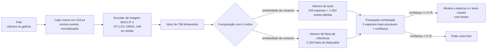

<div align="center">

# SaberIA Plant ID

**Identificação de plantas medicinais da Caatinga sem internet, em um celular Android intermediário.**

[English](README.md) · **Português (Brasil)**

[](LICENSE)
[](#como-funciona)
[](https://onnxruntime.ai)
[](examples/predict.py)
[](https://huggingface.co/andessonIF/saberia-plant-id)
[](https://github.com/Andessonreis/saberia-plant-id/releases/latest)


<sub>Telas reais do SaberIA (Redmi 12, modo avião). Da esquerda para a direita: início, resultado do <i>juazeiro</i>, resultado do <i>mandacaru</i> e uma foto que o app não nomeou porque a confiança ficou baixa.</sub>

</div>

---

O SaberIA é um aplicativo Android, desenvolvido em um projeto de Iniciação Científica (PIBITI) no IFBA Campus Irecê, que ajuda comunidades do Semiárido a registrar e conferir o conhecimento tradicional sobre plantas medicinais. Este repositório guarda a **parte de reconhecimento de plantas**: o modelo que roda no celular, o índice de comparação, a base curada de espécies, a avaliação e uma implementação de referência em Python.

Você tira uma foto. O celular calcula um vetor (embedding) com o encoder de imagem do [BioCLIP 2](https://huggingface.co/imageomics/bioclip-2) quantizado, compara com um índice de 159 espécies e mostra uma descrição **escrita antes, a partir de fontes citadas**. Nenhum texto é gerado na hora, nada é enviado para servidor, e quando o modelo não tem segurança o app diz isso em vez de chutar.

## Sumário

- [Por quê](#por-quê)
- [Como funciona](#como-funciona)
- [Resultados](#resultados)
- [Limitações](#limitações)
- [Uso rápido (Python)](#uso-rápido-python)
- [Metodologia e reprodutibilidade](#metodologia-e-reprodutibilidade)
- [Espécies da base](#espécies-da-base)
- [Licenças e atribuições](#licenças-e-atribuições)
- [Como citar](#como-citar)
- [Agradecimentos e contato](#agradecimentos-e-contato)

## Por quê

A Caatinga é um bioma exclusivamente brasileiro, e suas comunidades guardam um conhecimento amplo sobre plantas medicinais: que parte usar, como preparar, para que serve. Esse saber passa de geração em geração principalmente pela oralidade e vem se perdendo com a urbanização e a falta de registros.

A primeira versão do app identificava a planta com um modelo multimodal de uso geral na nuvem e pedia a ele que escrevesse a descrição. Em campo, isso trouxe três problemas:

| Problema | Consequência |
|---|---|
| Espécies nativas da Caatinga aparecem pouco nos dados de treino dos modelos gerais | Nome errado justamente para as plantas que mais importam |
| Texto livre gerado pelo modelo | Afirmações sobre saúde plausíveis, mas sem como verificar |
| Depende de internet | Zonas rurais do Semiárido muitas vezes têm sinal fraco ou nenhum |

Este repositório substitui essa etapa por um classificador de conjunto fechado que roda no celular e por uma base de espécies em que cada afirmação tem fonte.

O projeto se relaciona com os Objetivos de Desenvolvimento Sustentável 3 (saúde e bem-estar), 11.4 (proteger o patrimônio cultural) e 15 (vida terrestre).

## Como funciona



1. **Encoder.** A parte de imagem do BioCLIP 2 (ViT-L/14, treinado no [TreeOfLife-200M](https://huggingface.co/datasets/imageomics/TreeOfLife-200M), cerca de 200 milhões de imagens de organismos), exportada para ONNX com quantização dinâmica int8 das multiplicações de matriz. Sem novo treino: os pesos são os originais.
2. **Vetores de texto.** Para cada rótulo, o encoder de texto do BioCLIP 2 codifica o nome científico e os sinônimos, com e sem a classificação taxonômica do GBIF (reino a família). Além das 159 espécies da base, o índice tem 1.053 outras plantas (espécies do PlantNet-300K e ornamentais, cultivos e plantas espontâneas comuns no Brasil). Elas nunca aparecem como resposta; servem para estimar se a foto é de alguma espécie da base.
3. **Vetores de referência.** Até 15 fotos de grau de pesquisa do iNaturalist por espécie, observadas até 31/12/2024, codificadas com o mesmo modelo int8. Só os vetores são distribuídos; as fotos, não.
4. **Pontuação.** Para cada espécie da base: `similaridade_texto + 1,0 × média(3 maiores similaridades com fotos de referência)`, seguida de softmax. A confiança é `P(1º lugar) × P(a foto é de uma espécie da base)`. Abaixo de 0,75 o app não nomeia a planta.
5. **Texto.** A tela de resultado lê a ficha em [`data/caatinga_species.json`](data/caatinga_species.json): nomes populares, família, origem, usos tradicionais, cuidados e links para Flora e Funga do Brasil, GBIF, Agra et al. (2008), RENISUS e Formulário de Fitoterápicos da Farmacopeia Brasileira.

O modelo (308 MB) é baixado uma vez, o SHA-256 é conferido, e a partir daí a identificação funciona em modo avião.

## Resultados

Conjunto de teste: **194 fotos de 25 espécies da base**, observações de grau de pesquisa do iNaturalist **feitas a partir de 2025**, portanto sem sobreposição com as fotos de referência (todas até 2024). Mais 74 fotos de 12 plantas que **não** estão na base, para medir respostas falsas. Licença e link de cada foto de teste estão em [`eval/data/test_photos.csv`](eval/data/test_photos.csv).

### Modelo publicado

| Métrica | Valor |
|---|---|
| Acerto top-1 (sem filtro de confiança) | **75,8%** (147/194) |
| Acerto top-3 | **92,3%** (179/194) |
| Fotos respondidas com confiança >= 0,75 | 63% (122/194) |
| Acerto entre as fotos respondidas | **91,8%** (112/122) |
| Fotos de fora da base que receberam um nome | 1 de 74 |
| Tempo por foto, Redmi 12 (CPU, ONNX Runtime) | ~3,3 s |
| Tamanho | 308 MB (int8) + índice de 5,5 MB |

Rodando [`examples/predict.py`](examples/predict.py) com os arquivos da [release](https://github.com/Andessonreis/saberia-plant-id/releases/tag/v1.0.0) nas mesmas fotos, o resultado foi 76,8% top-1, 92,3% top-3, 60% respondidas, 94,0% de acerto entre as respondidas e 1/74 resposta falsa. Pontuando os embeddings guardados da avaliação com o mesmo script, o resultado é exatamente 75,8%; a diferença vem da variação numérica entre execuções dos kernels int8 do ONNX Runtime em CPU (cosseno de 0,994 a 1,0 entre execuções), que muda o resultado de algumas fotos no limite. Espere variações pequenas parecidas em outros aparelhos.

### Variantes comparadas

Mesmas 194 + 74 fotos, mesma quantização int8, limiar 0,75.

| Variante | Top-1 | Top-3 | Respondidas | Acerto quando responde | Fora da base respondidas |
|---|---:|---:|---:|---:|---:|
| BioCLIP (v1), só nomes | 44,8% | 62,4% | 40% | 73,1% | 6/74 |
| BioCLIP (v1), nomes + fotos de referência | 59,8% | 76,8% | 41% | 88,6% | 5/74 |
| BioCLIP 2, só nomes | 68,0% | 88,1% | 55% | 85,8% | 3/74 |
| BioCLIP 2, nomes + fotos de referência, redimensionamento bicúbico | 77,3% | 93,3% | 61% | 93,2% | 1/74 |
| **BioCLIP 2, nomes + fotos de referência, redimensionamento bilinear (publicado)** | **75,8%** | **92,3%** | **63%** | **91,8%** | **1/74** |

A variante publicada usa redimensionamento bilinear porque é o que o `Bitmap.createScaledBitmap` do Android faz. A linha bicúbica pontua um pouco mais no PC, mas a bilinear é o que o celular realmente enxerga.

### Comparação com um modelo local de uso geral

Antes de escolher essa abordagem, o prompt da versão anterior do app ("responda só com o nome científico") foi rodado com o **Qwen3-VL-2B** (Q4_K_M, llama.cpp) nas primeiras 64 fotos de teste (8 espécies x 8 fotos).

| Modelo | Espécie correta | Tempo por foto no celular |
|---|---:|---:|
| Qwen3-VL-2B, generativo | 6/64 (9,4%) | 2 a 3,5 min |
| SaberIA (BioCLIP 2 + índice), mesmas 64 fotos | 45/64 (70,3%) top-1 | ~3,3 s |

O Qwen muitas vezes respondeu com espécies reais de outras regiões (*Carnegiea gigantea*, o saguaro, em 6 das 8 fotos de *mandacaru*) ou com "Não sei". Respostas brutas: [`eval/data/qwen_results.txt`](eval/data/qwen_results.txt).

### Por espécie

<details>
<summary>Top-1, top-3 e acerto com resposta para cada uma das 25 espécies testadas</summary>

| Espécie | Fotos | Top-1 | Top-3 | Certas e respondidas (>= 0,75) |
|---|---:|---:|---:|---:|
| *Aloe vera* (babosa) | 8 | 8 | 8 | 8 |
| *Amburana cearensis* (umburana-de-cheiro) | 8 | 6 | 8 | 5 |
| *Anadenanthera colubrina* (angico) | 8 | 6 | 8 | 3 |
| *Astronium urundeuva* (aroeira-do-sertão) | 8 | 3 | 4 | 3 |
| *Cenostigma pyramidale* (catingueira) | 8 | 7 | 8 | 5 |
| *Cereus jamacaru* (mandacaru) | 8 | 7 | 8 | 4 |
| *Coleus barbatus* (boldo) | 8 | 8 | 8 | 6 |
| *Commiphora leptophloeos* (umburana-de-cambão) | 8 | 2 | 8 | 1 |
| *Cymbopogon citratus* (capim-santo) | 8 | 8 | 8 | 8 |
| *Erythrina velutina* (mulungu) | 8 | 2 | 5 | 2 |
| *Handroanthus impetiginosus* (ipê-roxo) | 8 | 6 | 7 | 6 |
| *Hymenaea courbaril* (jatobá) | 8 | 3 | 5 | 2 |
| *Jatropha mollissima* (pinhão-bravo) | 8 | 7 | 7 | 4 |
| *Libidibia ferrea* (jucá) | 8 | 5 | 8 | 1 |
| *Lippia alba* (erva-cidreira) | 8 | 8 | 8 | 7 |
| *Melocactus zehntneri* (coroa-de-frade) | 8 | 8 | 8 | 8 |
| *Mentha spicata* (hortelã) | 7 | 6 | 7 | 5 |
| *Mimosa tenuiflora* (jurema-preta) | 8 | 6 | 8 | 2 |
| *Opuntia ficus-indica* (palma) | 8 | 6 | 8 | 5 |
| *Sarcomphalus joazeiro* (juazeiro) | 8 | 7 | 7 | 6 |
| *Schinopsis brasiliensis* (baraúna) | 3 | 2 | 3 | 1 |
| *Sideroxylon obtusifolium* (quixabeira) | 8 | 7 | 8 | 7 |
| *Spondias tuberosa* (umbuzeiro) | 8 | 5 | 8 | 3 |
| *Ximenia americana* (ameixa-do-mato) | 8 | 7 | 7 | 3 |
| *Xiquexique gounellei* (xique-xique) | 8 | 7 | 7 | 7 |

</details>

## Limitações

| Limitação | Detalhe |
|---|---|
| Conjunto fechado | Só as 159 espécies da base podem ser nomeadas. Uma planta de fora recebe, no melhor caso, uma recusa; sem o filtro de confiança ela sempre receberia o nome de alguma espécie da base (aconteceu com 74 de 74 fotos de fora). |
| Recusas | Com limiar 0,75, 37% das fotos de espécies que *estão* na base ficam sem resposta. Em 61 dessas 72, a espécie certa estava entre as 3 primeiras. |
| Espécies difíceis | *Astronium urundeuva* (aroeira-do-sertão): 3/8 no top-1. *Erythrina velutina* (mulungu): 2/8. *Commiphora leptophloeos* (umburana-de-cambão): 2/8 no top-1, mas 8/8 no top-3. *Hymenaea courbaril* (jatobá): 3/8. Fotos só do tronco ou de árvores sem folhas são a principal causa de erro. |
| Teste de fora da base é otimista | 11 das 12 espécies de fora da base usadas no teste também estão entre os 1.053 rótulos de "outras plantas" do índice, o que facilita a recusa. A única resposta falsa veio justamente da espécie que não está (*Croton urucurana*, nomeada como *Croton blanchetianus* com confiança 0,76; outras duas fotos ficaram em 0,66 e 0,73). Para plantas ausentes das duas listas, espere mais respostas falsas do que 1/74. |
| Teste pequeno | 194 fotos, 25 de 159 espécies, no máximo 8 fotos por espécie (3 para *Schinopsis brasiliensis*). Os números por espécie são indicativos. 134 espécies têm fotos de referência, mas nenhuma foto de teste. |
| Tipo de foto | As fotos de teste vêm do iNaturalist, quase sempre tiradas por quem sabe o que está fotografando. Fotos de campo feitas por usuários do app podem vir mais mal enquadradas. |
| Não é orientação médica | A identificação e os textos apoiam, mas não substituem, a validação por botânico e a orientação de profissional de saúde. O app mantém uma etapa de validação humana para os registros da comunidade. |

## Uso rápido (Python)

Baixe o modelo, o índice e a base de espécies da [release](https://github.com/Andessonreis/saberia-plant-id/releases/tag/v1.0.0) (ou do [Hugging Face](https://huggingface.co/andessonIF/saberia-plant-id)) e confira os hashes:

```bash
pip install onnxruntime numpy pillow
BASE=https://github.com/Andessonreis/saberia-plant-id/releases/download/v1.0.0
for f in plant-classifier-int8.onnx plant-index.bin caatinga_species.json SHA256SUMS; do
  curl -LO "$BASE/$f"
done
sha256sum -c SHA256SUMS
```

Depois rode [`examples/predict.py`](examples/predict.py), que reproduz a pontuação do app (`PlantClassifier.kt`):

```bash
python examples/predict.py minha_foto.jpg
```

```text
minha_foto.jpg: confidence 0.86
  -> Cereus jamacaru (mandacaru, cardeiro)
     source: https://www.scielo.br/j/rbfar/a/fC7snvLkwzzFsMv3mfVRGNc/
```

O essencial, para usar no seu próprio código:

```python
import json, struct
import numpy as np, onnxruntime as ort
from PIL import Image

# índice: int32 com o tamanho do cabeçalho, cabeçalho JSON, vetores float16 (um por rótulo, depois um por foto de referência)
with open("plant-index.bin", "rb") as f:
    h = json.loads(f.read(struct.unpack("<i", f.read(4))[0]))
    v = np.frombuffer(f.read(), "<f2").astype(np.float32).reshape(-1, h["dim"])
text, refs = v[: len(h["labels"])], v[len(h["labels"]):]

def preprocess(path):  # lado menor -> 224 (bilinear), recorte central, normalização do CLIP
    im = Image.open(path).convert("RGB"); s = 224 / min(im.size)
    im = im.resize((max(224, round(im.width * s)), max(224, round(im.height * s))), Image.BILINEAR)
    l, t = (im.width - 224) // 2, (im.height - 224) // 2
    x = (np.asarray(im.crop((l, t, l + 224, t + 224)), np.float32) / 255 - h["mean"]) / h["std"]
    return x.transpose(2, 0, 1)[None].astype(np.float32)

session = ort.InferenceSession("plant-classifier-int8.onnx")
x = session.run(None, {"pixel_values": preprocess("minha_foto.jpg")})[0][0]  # 768-d, normalizado

def softmax(z, scale): e = np.exp((z - z.max()) * scale); return e / e.sum()
catalog = [i for i, label in enumerate(h["labels"]) if "id" in label]   # as 159 espécies da base
owner = np.array(h["refs"])                                              # rótulo de cada foto de referência
t = text @ x
p_in_base = softmax(t, h["scale"])[catalog].sum()
visual = [np.sort(refs[owner == i] @ x)[-h["k"]:].mean() for i in catalog]
prob = softmax(t[catalog] + h["weight"] * np.array(visual), h["scale"] / (1 + h["weight"]))
best = int(prob.argmax())
confidence = prob[best] * p_in_base
print(h["labels"][catalog[best]]["name"], round(float(confidence), 2),
      "answer" if confidence >= h["threshold"] else "not sure")
```

Entrada e saída do modelo:

| | |
|---|---|
| Entrada `pixel_values` | `float32 [1, 3, 224, 224]`, RGB, média `0.48145466, 0.4578275, 0.40821073`, desvio `0.26862954, 0.26130258, 0.27577711` |
| Saída `embedding` | `float32 [1, 768]`, normalizado (L2) |
| Parâmetros do índice | `scale` 100, `weight` 1,0, `k` 3, `threshold` 0,75 (lidos do cabeçalho do índice) |

## Metodologia e reprodutibilidade

A pasta [`eval/`](eval/) tem os scripts usados para construir e avaliar o modelo, e o [`eval/README.md`](eval/README.md) mostra a ordem de execução. Em resumo:

1. `build_labels.py`: lista de rótulos (159 espécies + 1.053 outras plantas) com taxonomia do GBIF.
2. `fetch_refs.py`: até 15 fotos de referência por espécie do iNaturalist, observadas até 31/12/2024, priorizando o Brasil.
3. `fetch_photos.py`: fotos de teste, grau de pesquisa, observadas a partir de 01/01/2025.
4. `export_onnx.py`: exporta o encoder de imagem do BioCLIP 2 para ONNX e quantiza em int8.
5. `embed.py` e `embed_onnx.py`: vetores de texto (PyTorch/OpenCLIP) e de imagem (ONNX int8, redimensionamento bilinear).
6. `evaluate.py`: top-1/top-3 e a tabela por limiar de confiança.
7. `build_index.py`: grava o `plant-index.bin`.

As fotos não são redistribuídas: a maioria tem licença CC BY-NC. Os CSVs em [`eval/data/`](eval/data/) listam o ID da observação, a licença e o autor de cada uma, para que as mesmas fotos possam ser baixadas de novo do iNaturalist.

## Espécies da base

159 espécies: 99 nativas (24 endêmicas do Brasil) e 60 exóticas cultivadas ou naturalizadas, de uso comum na região. 47 estão na RENISUS, a Relação Nacional de Plantas Medicinais de Interesse ao SUS. A coluna "Testada" marca as 25 espécies do conjunto de teste.

Legenda das fontes: **Flora** = Flora e Funga do Brasil (JBRJ), **GBIF** = GBIF Backbone Taxonomy, **Agra 2008** = Agra et al., *Survey of medicinal plants used in the region Northeast of Brazil*, Rev. Bras. Farmacogn. 18(3), **RENISUS** = Ministério da Saúde, **FFFB** = ANVISA, *Formulário de Fitoterápicos da Farmacopeia Brasileira*, **art.** = artigo científico específico.

<details>
<summary>Ver as 159 espécies</summary>

| # | Nome científico | Nomes populares | Família | Origem | Fotos de ref. | Testada | Fontes |
|---:|---|---|---|---|---:|:---:|---|
| 1 | *Acanthospermum hispidum* | espinho-de-cigano, carrapicho, retirante | Asteraceae | nativa | 15 |  | [Agra 2008](https://www.scielo.br/j/rbfar/a/fC7snvLkwzzFsMv3mfVRGNc/) · [Flora](https://floradobrasil.jbrj.gov.br/FB103232) · [GBIF](https://www.gbif.org/species/3100375) |
| 2 | *Ageratum conyzoides* | mentrasto, catinga-de-bode | Asteraceae | nativa | 15 |  | [Agra 2008](https://www.scielo.br/j/rbfar/a/fC7snvLkwzzFsMv3mfVRGNc/) · [Flora](https://floradobrasil.jbrj.gov.br/FB15934) · [GBIF](https://www.gbif.org/species/5401673) |
| 3 | *Allium cepa* | cebola | Amaryllidaceae | exótica cultivada | 15 |  | [Agra 2008](https://www.scielo.br/j/rbfar/a/fC7snvLkwzzFsMv3mfVRGNc/) · [Flora](https://floradobrasil.jbrj.gov.br/FB611758) · [GBIF](https://www.gbif.org/species/2857697) |
| 4 | *Allium sativum* | alho | Amaryllidaceae | exótica cultivada | 15 |  | [FFFB](https://bibliotecadigital.anvisa.gov.br/jspui/handle/anvisa/21045) · [RENISUS](https://www.gov.br/saude/pt-br/composicao/sectics/plantas-medicinais-e-fitoterapicos/ppnpmf/arquivos/2014/renisus.pdf) · [Agra 2008](https://www.scielo.br/j/rbfar/a/fC7snvLkwzzFsMv3mfVRGNc/) · [Flora](https://floradobrasil.jbrj.gov.br/FB611763) · [GBIF](https://www.gbif.org/species/2856681) |
| 5 | *Aloe vera* | babosa | Asphodelaceae | exótica cultivada | 15 | sim | [FFFB](https://bibliotecadigital.anvisa.gov.br/jspui/handle/anvisa/21045) · [RENISUS](https://www.gov.br/saude/pt-br/composicao/sectics/plantas-medicinais-e-fitoterapicos/ppnpmf/arquivos/2014/renisus.pdf) · [Agra 2008](https://www.scielo.br/j/rbfar/a/fC7snvLkwzzFsMv3mfVRGNc/) · [Flora](https://floradobrasil.jbrj.gov.br/FB609263) · [GBIF](https://www.gbif.org/species/2777724) |
| 6 | *Alpinia zerumbet* | colônia, gengibre-concha | Zingiberaceae | exótica cultivada | 15 |  | [FFFB](https://bibliotecadigital.anvisa.gov.br/jspui/handle/anvisa/21045) · [RENISUS](https://www.gov.br/saude/pt-br/composicao/sectics/plantas-medicinais-e-fitoterapicos/ppnpmf/arquivos/2014/renisus.pdf) · [Agra 2008](https://www.scielo.br/j/rbfar/a/fC7snvLkwzzFsMv3mfVRGNc/) · [Flora](https://floradobrasil.jbrj.gov.br/FB110703) · [GBIF](https://www.gbif.org/species/5301979) |
| 7 | *Alternanthera brasiliana* | terramicina, perpétua-do-brasil, penicilina | Amaranthaceae | nativa | 15 |  | [FFFB](https://bibliotecadigital.anvisa.gov.br/jspui/handle/anvisa/21045) · [Agra 2008](https://www.scielo.br/j/rbfar/a/fC7snvLkwzzFsMv3mfVRGNc/) · [Flora](https://floradobrasil.jbrj.gov.br/FB4302) · [GBIF](https://www.gbif.org/species/3084934) |
| 8 | *Amburana cearensis* | umburana-de-cheiro, cumaru, amburana | Fabaceae | nativa | 15 | sim | [Agra 2008](https://www.scielo.br/j/rbfar/a/fC7snvLkwzzFsMv3mfVRGNc/) · [Flora](https://floradobrasil.jbrj.gov.br/FB22781) · [GBIF](https://www.gbif.org/species/2945821) |
| 9 | *Anacardium occidentale* | cajueiro, caju | Anacardiaceae | nativa | 15 |  | [FFFB](https://bibliotecadigital.anvisa.gov.br/jspui/handle/anvisa/21045) · [RENISUS](https://www.gov.br/saude/pt-br/composicao/sectics/plantas-medicinais-e-fitoterapicos/ppnpmf/arquivos/2014/renisus.pdf) · [Agra 2008](https://www.scielo.br/j/rbfar/a/fC7snvLkwzzFsMv3mfVRGNc/) · [Flora](https://floradobrasil.jbrj.gov.br/FB4381) · [GBIF](https://www.gbif.org/species/5421368) |
| 10 | *Anadenanthera colubrina* | angico, angico-vermelho, angico-de-caroço | Fabaceae | nativa | 15 | sim | [Agra 2008](https://www.scielo.br/j/rbfar/a/fC7snvLkwzzFsMv3mfVRGNc/) · [Flora](https://floradobrasil.jbrj.gov.br/FB18071) · [GBIF](https://www.gbif.org/species/2952823) |
| 11 | *Ananas comosus* | abacaxi, ananás | Bromeliaceae | nativa | 15 |  | [Agra 2008](https://www.scielo.br/j/rbfar/a/fC7snvLkwzzFsMv3mfVRGNc/) · [RENISUS](https://www.gov.br/saude/pt-br/composicao/sectics/plantas-medicinais-e-fitoterapicos/ppnpmf/arquivos/2014/renisus.pdf) · [Flora](https://floradobrasil.jbrj.gov.br/FB16574) · [GBIF](https://www.gbif.org/species/5288819) |
| 12 | *Annona squamosa* | pinha, ata, fruta-do-conde | Annonaceae | exótica naturalizada | 15 |  | [Agra 2008](https://www.scielo.br/j/rbfar/a/fC7snvLkwzzFsMv3mfVRGNc/) · [Flora](https://floradobrasil.jbrj.gov.br/FB117273) · [GBIF](https://www.gbif.org/species/5407099) |
| 13 | *Artemisia absinthium* | losna, absinto, erva-dos-vermes | Asteraceae | exótica cultivada | 15 |  | [Agra 2008](https://www.scielo.br/j/rbfar/a/fC7snvLkwzzFsMv3mfVRGNc/) · [RENISUS](https://www.gov.br/saude/pt-br/composicao/sectics/plantas-medicinais-e-fitoterapicos/ppnpmf/arquivos/2014/renisus.pdf) · [Flora](https://floradobrasil.jbrj.gov.br/FB612129) · [GBIF](https://www.gbif.org/species/3121319) |
| 14 | *Aspidosperma pyrifolium* | pereiro, pau-pereiro | Apocynaceae | nativa | 15 |  | [Agra 2008](https://www.scielo.br/j/rbfar/a/fC7snvLkwzzFsMv3mfVRGNc/) · [Flora](https://floradobrasil.jbrj.gov.br/FB15551) · [GBIF](https://www.gbif.org/species/7316881) |
| 15 | *Astronium urundeuva* | aroeira-do-sertão, aroeira, urundeúva | Anacardiaceae | nativa | 14 | sim | [FFFB](https://bibliotecadigital.anvisa.gov.br/jspui/handle/anvisa/21045) · [Agra 2008](https://www.scielo.br/j/rbfar/a/fC7snvLkwzzFsMv3mfVRGNc/) · [Flora](https://floradobrasil.jbrj.gov.br/FB115185) · [GBIF](https://www.gbif.org/species/3660652) |
| 16 | *Attalea speciosa* | babaçu, coco-palmeira | Arecaceae | nativa (endêmica do Brasil) | 15 |  | [Agra 2008](https://www.scielo.br/j/rbfar/a/fC7snvLkwzzFsMv3mfVRGNc/) · [RENISUS](https://www.gov.br/saude/pt-br/composicao/sectics/plantas-medicinais-e-fitoterapicos/ppnpmf/arquivos/2014/renisus.pdf) · [Flora](https://floradobrasil.jbrj.gov.br/FB15686) · [GBIF](https://www.gbif.org/species/2732877) |
| 17 | *Bauhinia cheilantha* | mororó, pata-de-vaca | Fabaceae | nativa | 15 |  | [Agra 2008](https://www.scielo.br/j/rbfar/a/fC7snvLkwzzFsMv3mfVRGNc/) · [Flora](https://floradobrasil.jbrj.gov.br/FB82659) · [GBIF](https://www.gbif.org/species/2952938) |
| 18 | *Bauhinia forficata* | pata-de-vaca, mororó | Fabaceae | nativa | 15 |  | [Agra 2008](https://www.scielo.br/j/rbfar/a/fC7snvLkwzzFsMv3mfVRGNc/) · [RENISUS](https://www.gov.br/saude/pt-br/composicao/sectics/plantas-medicinais-e-fitoterapicos/ppnpmf/arquivos/2014/renisus.pdf) · [Flora](https://floradobrasil.jbrj.gov.br/FB82666) · [GBIF](https://www.gbif.org/species/2953861) |
| 19 | *Bidens pilosa* | picão-preto, picão, carrapicho-de-agulha | Asteraceae | exótica naturalizada | 15 |  | [FFFB](https://bibliotecadigital.anvisa.gov.br/jspui/handle/anvisa/21045) · [RENISUS](https://www.gov.br/saude/pt-br/composicao/sectics/plantas-medicinais-e-fitoterapicos/ppnpmf/arquivos/2014/renisus.pdf) · [Agra 2008](https://www.scielo.br/j/rbfar/a/fC7snvLkwzzFsMv3mfVRGNc/) · [Flora](https://floradobrasil.jbrj.gov.br/FB103749) · [GBIF](https://www.gbif.org/species/5391845) |
| 20 | *Bixa orellana* | urucum, colorau, açafroa | Bixaceae | nativa | 15 |  | [Agra 2008](https://www.scielo.br/j/rbfar/a/fC7snvLkwzzFsMv3mfVRGNc/) · [Flora](https://floradobrasil.jbrj.gov.br/FB5745) · [GBIF](https://www.gbif.org/species/2874863) |
| 21 | *Bowdichia virgilioides* | sucupira, sucupira-preta | Fabaceae | nativa | 15 |  | [Agra 2008](https://www.scielo.br/j/rbfar/a/fC7snvLkwzzFsMv3mfVRGNc/) · [Flora](https://floradobrasil.jbrj.gov.br/FB29489) · [GBIF](https://www.gbif.org/species/2975476) |
| 22 | *Bromelia laciniosa* | macambira | Bromeliaceae | nativa (endêmica do Brasil) | 15 |  | [Agra 2008](https://www.scielo.br/j/rbfar/a/fC7snvLkwzzFsMv3mfVRGNc/) · [Flora](https://floradobrasil.jbrj.gov.br/FB16578) · [GBIF](https://www.gbif.org/species/5287936) |
| 23 | *Byrsonima crassifolia* | murici, murici-da-praia | Malpighiaceae | nativa | 15 |  | [Agra 2008](https://www.scielo.br/j/rbfar/a/fC7snvLkwzzFsMv3mfVRGNc/) · [Flora](https://floradobrasil.jbrj.gov.br/FB19419) · [GBIF](https://www.gbif.org/species/3191361) |
| 24 | *Cajanus cajan* | feijão-guandu, guandu, andu | Fabaceae | exótica naturalizada | 15 |  | [Agra 2008](https://www.scielo.br/j/rbfar/a/fC7snvLkwzzFsMv3mfVRGNc/) · [Flora](https://floradobrasil.jbrj.gov.br/FB82709) · [GBIF](https://www.gbif.org/species/7587087) |
| 25 | *Calotropis procera* | algodão-de-seda, flor-de-seda, ciúme | Apocynaceae | exótica naturalizada | 15 |  | [Agra 2008](https://www.scielo.br/j/rbfar/a/fC7snvLkwzzFsMv3mfVRGNc/) · [Flora](https://floradobrasil.jbrj.gov.br/FB80340) · [GBIF](https://www.gbif.org/species/5414566) |
| 26 | *Capraria biflora* | chá-da-calçada, chá-preto, mate | Scrophulariaceae | nativa | 15 |  | [Agra 2008](https://www.scielo.br/j/rbfar/a/fC7snvLkwzzFsMv3mfVRGNc/) · [Flora](https://floradobrasil.jbrj.gov.br/FB25821) · [GBIF](https://www.gbif.org/species/3171842) |
| 27 | *Carica papaya* | mamão, mamoeiro | Caricaceae | exótica naturalizada | 15 |  | [Agra 2008](https://www.scielo.br/j/rbfar/a/fC7snvLkwzzFsMv3mfVRGNc/) · [Flora](https://floradobrasil.jbrj.gov.br/FB22405) · [GBIF](https://www.gbif.org/species/2874484) |
| 28 | *Casearia sylvestris* | guaçatonga, pau-de-lagarto, língua-de-tiú | Salicaceae | nativa | 15 |  | [FFFB](https://bibliotecadigital.anvisa.gov.br/jspui/handle/anvisa/21045) · [RENISUS](https://www.gov.br/saude/pt-br/composicao/sectics/plantas-medicinais-e-fitoterapicos/ppnpmf/arquivos/2014/renisus.pdf) · [Agra 2008](https://www.scielo.br/j/rbfar/a/fC7snvLkwzzFsMv3mfVRGNc/) · [Flora](https://floradobrasil.jbrj.gov.br/FB14384) · [GBIF](https://www.gbif.org/species/5331148) |
| 29 | *Ceiba glaziovii* | barriguda, barriguda-de-espinho | Malvaceae | nativa (endêmica do Brasil) | 15 |  | [Agra 2008](https://www.scielo.br/j/rbfar/a/fC7snvLkwzzFsMv3mfVRGNc/) · [Flora](https://floradobrasil.jbrj.gov.br/FB9035) · [GBIF](https://www.gbif.org/species/7813916) |
| 30 | *Cenostigma pyramidale* | catingueira, catingueira-verdadeira | Fabaceae | nativa (endêmica do Brasil) | 13 | sim | [Agra 2008](https://www.scielo.br/j/rbfar/a/fC7snvLkwzzFsMv3mfVRGNc/) · [Flora](https://floradobrasil.jbrj.gov.br/FB606076) · [GBIF](https://www.gbif.org/species/9462202) |
| 31 | *Cereus jamacaru* | mandacaru, cardeiro, jamacaru | Cactaceae | nativa (endêmica do Brasil) | 15 | sim | [Agra 2008](https://www.scielo.br/j/rbfar/a/fC7snvLkwzzFsMv3mfVRGNc/) · [Flora](https://floradobrasil.jbrj.gov.br/FB1447) · [GBIF](https://www.gbif.org/species/7282182) |
| 32 | *Cinnamomum verum* | canela, canela-do-ceilão, caneleira | Lauraceae | exótica cultivada | 15 |  | [FFFB](https://bibliotecadigital.anvisa.gov.br/jspui/handle/anvisa/21045) · [Agra 2008](https://www.scielo.br/j/rbfar/a/fC7snvLkwzzFsMv3mfVRGNc/) · [Flora](https://floradobrasil.jbrj.gov.br/FB25614) · [GBIF](https://www.gbif.org/species/3033987) |
| 33 | *Cissus verticillata* | insulina, insulina-vegetal, cipó-pucá | Vitaceae | nativa | 15 |  | [Agra 2008](https://www.scielo.br/j/rbfar/a/fC7snvLkwzzFsMv3mfVRGNc/) · [Flora](https://floradobrasil.jbrj.gov.br/FB15270) · [GBIF](https://www.gbif.org/species/3039173) |
| 34 | *Citrus aurantium* | laranja-da-terra, laranja-amarga, laranja-azeda | Rutaceae | exótica cultivada | 15 |  | [FFFB](https://bibliotecadigital.anvisa.gov.br/jspui/handle/anvisa/21045) · [Flora](https://floradobrasil.jbrj.gov.br/FB611574) · [GBIF](https://www.gbif.org/species/8077391) |
| 35 | *Cnidoscolus quercifolius* | faveleira, favela, faveleiro | Euphorbiaceae | nativa (endêmica do Brasil) | 15 |  | [Agra 2008](https://www.scielo.br/j/rbfar/a/fC7snvLkwzzFsMv3mfVRGNc/) · [Flora](https://floradobrasil.jbrj.gov.br/FB17494) · [GBIF](https://www.gbif.org/species/3073448) |
| 36 | *Cnidoscolus urens* | cansanção, urtiga-branca, urtiga | Euphorbiaceae | nativa | 15 |  | [Agra 2008](https://www.scielo.br/j/rbfar/a/fC7snvLkwzzFsMv3mfVRGNc/) · [Flora](https://floradobrasil.jbrj.gov.br/FB17495) · [GBIF](https://www.gbif.org/species/3073653) |
| 37 | *Cocos nucifera* | coqueiro, coco, coco-da-baía | Arecaceae | exótica naturalizada | 15 |  | [Agra 2008](https://www.scielo.br/j/rbfar/a/fC7snvLkwzzFsMv3mfVRGNc/) · [Flora](https://floradobrasil.jbrj.gov.br/FB80541) · [GBIF](https://www.gbif.org/species/2735117) |
| 38 | *Coleus amboinicus* | hortelã-graúda, malvarisco, malva | Lamiaceae | exótica cultivada | 15 |  | [Agra 2008](https://www.scielo.br/j/rbfar/a/fC7snvLkwzzFsMv3mfVRGNc/) · [Flora](https://floradobrasil.jbrj.gov.br/FB23336) · [GBIF](https://www.gbif.org/species/5341313) |
| 39 | *Coleus barbatus* | boldo, boldo-brasileiro, boldo-nacional | Lamiaceae | exótica cultivada | 15 | sim | [FFFB](https://bibliotecadigital.anvisa.gov.br/jspui/handle/anvisa/21045) · [RENISUS](https://www.gov.br/saude/pt-br/composicao/sectics/plantas-medicinais-e-fitoterapicos/ppnpmf/arquivos/2014/renisus.pdf) · [Agra 2008](https://www.scielo.br/j/rbfar/a/fC7snvLkwzzFsMv3mfVRGNc/) · [Flora](https://floradobrasil.jbrj.gov.br/FB84186) · [GBIF](https://www.gbif.org/species/8030165) |
| 40 | *Coleus comosus* | boldo-gambá, boldo-pequeno, novalgina | Lamiaceae | exótica cultivada | 10 |  | [art.](https://repositorio.ufc.br/ri/bitstream/riufc/23729/3/2015%20_dis%20_fnavila.pdf) · [Flora](https://floradobrasil.jbrj.gov.br/FB637468) · [GBIF](https://www.gbif.org/species/5605775) |
| 41 | *Combretum leprosum* | mofumbo, mufumbo, pente-de-macaco | Combretaceae | nativa | 15 |  | [Agra 2008](https://www.scielo.br/j/rbfar/a/fC7snvLkwzzFsMv3mfVRGNc/) · [Flora](https://floradobrasil.jbrj.gov.br/FB6906) · [GBIF](https://www.gbif.org/species/3698829) |
| 42 | *Commiphora leptophloeos* | umburana-de-cambão, imburana, imburana-de-cambão | Burseraceae | nativa | 15 | sim | [Agra 2008](https://www.scielo.br/j/rbfar/a/fC7snvLkwzzFsMv3mfVRGNc/) · [Flora](https://floradobrasil.jbrj.gov.br/FB16657) · [GBIF](https://www.gbif.org/species/3993388) |
| 43 | *Copaifera langsdorffii* | copaíba, pau-d'óleo | Fabaceae | nativa | 15 |  | [Agra 2008](https://www.scielo.br/j/rbfar/a/fC7snvLkwzzFsMv3mfVRGNc/) · [RENISUS](https://www.gov.br/saude/pt-br/composicao/sectics/plantas-medicinais-e-fitoterapicos/ppnpmf/arquivos/2014/renisus.pdf) · [Flora](https://floradobrasil.jbrj.gov.br/FB22896) · [GBIF](https://www.gbif.org/species/2978171) |
| 44 | *Copernicia prunifera* | carnaúba, carnaubeira | Arecaceae | nativa (endêmica do Brasil) | 15 |  | [Agra 2008](https://www.scielo.br/j/rbfar/a/fC7snvLkwzzFsMv3mfVRGNc/) · [Flora](https://floradobrasil.jbrj.gov.br/FB15706) · [GBIF](https://www.gbif.org/species/2738262) |
| 45 | *Cordia oncocalyx* | pau-branco | Cordiaceae | nativa (endêmica do Brasil) | 10 |  | [Agra 2008](https://www.scielo.br/j/rbfar/a/fC7snvLkwzzFsMv3mfVRGNc/) · [Flora](https://floradobrasil.jbrj.gov.br/FB127463) · [GBIF](https://www.gbif.org/species/5661249) |
| 46 | *Coriandrum sativum* | coentro | Apiaceae | exótica cultivada | 15 |  | [Agra 2008](https://www.scielo.br/j/rbfar/a/fC7snvLkwzzFsMv3mfVRGNc/) · [Flora](https://floradobrasil.jbrj.gov.br/FB111826) · [GBIF](https://www.gbif.org/species/3034871) |
| 47 | *Croton blanchetianus* | marmeleiro, marmeleiro-da-caatinga | Euphorbiaceae | nativa (endêmica do Brasil) | 15 |  | [Agra 2008](https://www.scielo.br/j/rbfar/a/fC7snvLkwzzFsMv3mfVRGNc/) · [Flora](https://floradobrasil.jbrj.gov.br/FB25478) · [GBIF](https://www.gbif.org/species/3059075) |
| 48 | *Croton grewioides* | canela-de-cunhã, canelinha, alecrim-de-cabocla | Euphorbiaceae | nativa | 4 |  | [Agra 2008](https://www.scielo.br/j/rbfar/a/fC7snvLkwzzFsMv3mfVRGNc/) · [RENISUS](https://www.gov.br/saude/pt-br/composicao/sectics/plantas-medicinais-e-fitoterapicos/ppnpmf/arquivos/2014/renisus.pdf) · [Flora](https://floradobrasil.jbrj.gov.br/FB17516) · [GBIF](https://www.gbif.org/species/3058458) |
| 49 | *Croton heliotropiifolius* | velame, velaminho, velame-de-cheiro | Euphorbiaceae | nativa | 15 |  | [art.](https://www.alice.cnptia.embrapa.br/alice/bitstream/doc/935899/1/AnaValeria14.pdf) · [Flora](https://floradobrasil.jbrj.gov.br/FB17517) · [GBIF](https://www.gbif.org/species/3060038) |
| 50 | *Curcuma longa* | açafrão-da-terra, cúrcuma, açafrão | Zingiberaceae | exótica cultivada | 15 |  | [FFFB](https://bibliotecadigital.anvisa.gov.br/jspui/handle/anvisa/21045) · [RENISUS](https://www.gov.br/saude/pt-br/composicao/sectics/plantas-medicinais-e-fitoterapicos/ppnpmf/arquivos/2014/renisus.pdf) · [Agra 2008](https://www.scielo.br/j/rbfar/a/fC7snvLkwzzFsMv3mfVRGNc/) · [GBIF](https://www.gbif.org/species/2757624) |
| 51 | *Cymbopogon citratus* | capim-santo, capim-limão, capim-cidreira | Poaceae | exótica naturalizada | 15 | sim | [FFFB](https://bibliotecadigital.anvisa.gov.br/jspui/handle/anvisa/21045) · [Agra 2008](https://www.scielo.br/j/rbfar/a/fC7snvLkwzzFsMv3mfVRGNc/) · [Flora](https://floradobrasil.jbrj.gov.br/FB24285) · [GBIF](https://www.gbif.org/species/2705275) |
| 52 | *Dysphania ambrosioides* | mastruz, mastruço, erva-de-santa-maria | Amaranthaceae | exótica naturalizada | 15 |  | [Agra 2008](https://www.scielo.br/j/rbfar/a/fC7snvLkwzzFsMv3mfVRGNc/) · [RENISUS](https://www.gov.br/saude/pt-br/composicao/sectics/plantas-medicinais-e-fitoterapicos/ppnpmf/arquivos/2014/renisus.pdf) · [Flora](https://floradobrasil.jbrj.gov.br/FB139867) · [GBIF](https://www.gbif.org/species/5568446) |
| 53 | *Egletes viscosa* | macela, macela-da-terra, macela-do-campo | Asteraceae | nativa | 15 |  | [Agra 2008](https://www.scielo.br/j/rbfar/a/fC7snvLkwzzFsMv3mfVRGNc/) · [Flora](https://floradobrasil.jbrj.gov.br/FB16094) · [GBIF](https://www.gbif.org/species/3118721) |
| 54 | *Erythrina mulungu* | mulungu | Fabaceae | nativa | 15 |  | [FFFB](https://bibliotecadigital.anvisa.gov.br/jspui/handle/anvisa/21045) · [RENISUS](https://www.gov.br/saude/pt-br/composicao/sectics/plantas-medicinais-e-fitoterapicos/ppnpmf/arquivos/2014/renisus.pdf) · [Flora](https://floradobrasil.jbrj.gov.br/FB105155) · [GBIF](https://www.gbif.org/species/5349691) |
| 55 | *Erythrina velutina* | mulungu, mulungu-da-caatinga | Fabaceae | nativa | 15 | sim | [Agra 2008](https://www.scielo.br/j/rbfar/a/fC7snvLkwzzFsMv3mfVRGNc/) · [Flora](https://floradobrasil.jbrj.gov.br/FB29679) · [GBIF](https://www.gbif.org/species/5349685) |
| 56 | *Eugenia uniflora* | pitangueira, pitanga | Myrtaceae | nativa | 15 |  | [FFFB](https://bibliotecadigital.anvisa.gov.br/jspui/handle/anvisa/21045) · [RENISUS](https://www.gov.br/saude/pt-br/composicao/sectics/plantas-medicinais-e-fitoterapicos/ppnpmf/arquivos/2014/renisus.pdf) · [Agra 2008](https://www.scielo.br/j/rbfar/a/fC7snvLkwzzFsMv3mfVRGNc/) · [Flora](https://floradobrasil.jbrj.gov.br/FB10560) · [GBIF](https://www.gbif.org/species/5416458) |
| 57 | *Euphorbia tirucalli* | avelós, aveloz, pau-pelado | Euphorbiaceae | exótica cultivada | 15 |  | [Agra 2008](https://www.scielo.br/j/rbfar/a/fC7snvLkwzzFsMv3mfVRGNc/) · [Flora](https://floradobrasil.jbrj.gov.br/FB609672) · [GBIF](https://www.gbif.org/species/3069353) |
| 58 | *Foeniculum vulgare* | funcho, erva-doce | Apiaceae | exótica cultivada | 15 |  | [FFFB](https://bibliotecadigital.anvisa.gov.br/jspui/handle/anvisa/21045) · [RENISUS](https://www.gov.br/saude/pt-br/composicao/sectics/plantas-medicinais-e-fitoterapicos/ppnpmf/arquivos/2014/renisus.pdf) · [Agra 2008](https://www.scielo.br/j/rbfar/a/fC7snvLkwzzFsMv3mfVRGNc/) · [Flora](https://floradobrasil.jbrj.gov.br/FB21886) · [GBIF](https://www.gbif.org/species/3034922) |
| 59 | *Genipa americana* | jenipapo, jenipapeiro | Rubiaceae | nativa | 15 |  | [Agra 2008](https://www.scielo.br/j/rbfar/a/fC7snvLkwzzFsMv3mfVRGNc/) · [Flora](https://floradobrasil.jbrj.gov.br/FB14045) · [GBIF](https://www.gbif.org/species/2895593) |
| 60 | *Gossypium barbadense* | algodoeiro, algodão | Malvaceae | exótica naturalizada | 15 |  | [Agra 2008](https://www.scielo.br/j/rbfar/a/fC7snvLkwzzFsMv3mfVRGNc/) · [Flora](https://floradobrasil.jbrj.gov.br/FB19517) · [GBIF](https://www.gbif.org/species/3152666) |
| 61 | *Gymnanthemum amygdalinum* | boldo-baiano, alumã, boldo | Asteraceae | exótica naturalizada | 15 |  | [Agra 2008](https://www.scielo.br/j/rbfar/a/fC7snvLkwzzFsMv3mfVRGNc/) · [RENISUS](https://www.gov.br/saude/pt-br/composicao/sectics/plantas-medicinais-e-fitoterapicos/ppnpmf/arquivos/2014/renisus.pdf) · [Flora](https://floradobrasil.jbrj.gov.br/FB22218) · [GBIF](https://www.gbif.org/species/3130899) |
| 62 | *Hancornia speciosa* | mangabeira, mangaba | Apocynaceae | nativa | 15 |  | [Agra 2008](https://www.scielo.br/j/rbfar/a/fC7snvLkwzzFsMv3mfVRGNc/) · [Flora](https://floradobrasil.jbrj.gov.br/FB15558) · [GBIF](https://www.gbif.org/species/3169679) |
| 63 | *Handroanthus impetiginosus* | ipê-roxo, pau-d'arco-roxo, pau-d'arco | Bignoniaceae | nativa | 15 | sim | [Agra 2008](https://www.scielo.br/j/rbfar/a/fC7snvLkwzzFsMv3mfVRGNc/) · [RENISUS](https://www.gov.br/saude/pt-br/composicao/sectics/plantas-medicinais-e-fitoterapicos/ppnpmf/arquivos/2014/renisus.pdf) · [Flora](https://floradobrasil.jbrj.gov.br/FB114086) · [GBIF](https://www.gbif.org/species/4092242) |
| 64 | *Handroanthus serratifolius* | pau-d'arco-amarelo, ipê-amarelo | Bignoniaceae | nativa | 15 |  | [Agra 2008](https://www.scielo.br/j/rbfar/a/fC7snvLkwzzFsMv3mfVRGNc/) · [Flora](https://floradobrasil.jbrj.gov.br/FB117466) · [GBIF](https://www.gbif.org/species/4092017) |
| 65 | *Harrisia adscendens* | rabo-de-raposa, cacto-rabo-de-raposa | Cactaceae | nativa (endêmica do Brasil) | 15 |  | [Agra 2008](https://www.scielo.br/j/rbfar/a/fC7snvLkwzzFsMv3mfVRGNc/) · [Flora](https://floradobrasil.jbrj.gov.br/FB1540) · [GBIF](https://www.gbif.org/species/5622072) |
| 66 | *Heliotropium indicum* | crista-de-galo, fedegoso, crista-de-peru | Heliotropiaceae | nativa | 15 |  | [Agra 2008](https://www.scielo.br/j/rbfar/a/fC7snvLkwzzFsMv3mfVRGNc/) · [Flora](https://floradobrasil.jbrj.gov.br/FB16545) · [GBIF](https://www.gbif.org/species/2925788) |
| 67 | *Hymenaea courbaril* | jatobá | Fabaceae | nativa | 15 | sim | [Agra 2008](https://www.scielo.br/j/rbfar/a/fC7snvLkwzzFsMv3mfVRGNc/) · [Flora](https://floradobrasil.jbrj.gov.br/FB22972) · [GBIF](https://www.gbif.org/species/2950750) |
| 68 | *Hymenaea martiana* | jatobá | Fabaceae | nativa | 6 |  | [Agra 2008](https://www.scielo.br/j/rbfar/a/fC7snvLkwzzFsMv3mfVRGNc/) · [Flora](https://floradobrasil.jbrj.gov.br/FB83203) · [GBIF](https://www.gbif.org/species/2950768) |
| 69 | *Hymenaea stigonocarpa* | jatobá, jatobá-do-cerrado, jatobá-da-casca-fina | Fabaceae | nativa | 15 |  | [Agra 2008](https://www.scielo.br/j/rbfar/a/fC7snvLkwzzFsMv3mfVRGNc/) · [Flora](https://floradobrasil.jbrj.gov.br/FB83206) · [GBIF](https://www.gbif.org/species/2950722) |
| 70 | *Ipomoea asarifolia* | salsa, salsa-brava, batata-brava | Convolvulaceae | nativa | 15 |  | [Agra 2008](https://www.scielo.br/j/rbfar/a/fC7snvLkwzzFsMv3mfVRGNc/) · [Flora](https://floradobrasil.jbrj.gov.br/FB7026) · [GBIF](https://www.gbif.org/species/2928595) |
| 71 | *Jatropha curcas* | pinhão-manso, pinhão, pinhão-branco | Euphorbiaceae | exótica naturalizada | 15 |  | [Agra 2008](https://www.scielo.br/j/rbfar/a/fC7snvLkwzzFsMv3mfVRGNc/) · [Flora](https://floradobrasil.jbrj.gov.br/FB22713) · [GBIF](https://www.gbif.org/species/3072953) |
| 72 | *Jatropha gossypiifolia* | pinhão-roxo | Euphorbiaceae | nativa | 15 |  | [Agra 2008](https://www.scielo.br/j/rbfar/a/fC7snvLkwzzFsMv3mfVRGNc/) · [RENISUS](https://www.gov.br/saude/pt-br/composicao/sectics/plantas-medicinais-e-fitoterapicos/ppnpmf/arquivos/2014/renisus.pdf) · [Flora](https://floradobrasil.jbrj.gov.br/FB17581) · [GBIF](https://www.gbif.org/species/3072900) |
| 73 | *Jatropha mollissima* | pinhão-bravo, pinhão-roxo, pinhão-vermelho | Euphorbiaceae | nativa | 15 | sim | [art.](https://ojs.uel.br/revistas/uel/index.php/semagrarias/article/view/33642) · [art.](https://www.uece.br/cecitecwp/wp-content/uploads/sites/42/2016/12/1516-0572-rbpm-18-2-s1-0582.pdf) · [Flora](https://floradobrasil.jbrj.gov.br/FB17582) · [GBIF](https://www.gbif.org/species/3073075) |
| 74 | *Justicia pectoralis* | chambá, anador | Acanthaceae | nativa | 15 |  | [FFFB](https://bibliotecadigital.anvisa.gov.br/jspui/handle/anvisa/21045) · [RENISUS](https://www.gov.br/saude/pt-br/composicao/sectics/plantas-medicinais-e-fitoterapicos/ppnpmf/arquivos/2014/renisus.pdf) · [Agra 2008](https://www.scielo.br/j/rbfar/a/fC7snvLkwzzFsMv3mfVRGNc/) · [Flora](https://floradobrasil.jbrj.gov.br/FB21673) · [GBIF](https://www.gbif.org/species/7624130) |
| 75 | *Kalanchoe crenata* | saião, coirama-branca, folha-grossa | Crassulaceae | exótica naturalizada | 14 |  | [Agra 2008](https://www.scielo.br/j/rbfar/a/fC7snvLkwzzFsMv3mfVRGNc/) · [Flora](https://floradobrasil.jbrj.gov.br/FB102470) · [GBIF](https://www.gbif.org/species/6441622) |
| 76 | *Kalanchoe pinnata* | folha-da-fortuna, saião, folha-da-costa | Crassulaceae | exótica naturalizada | 15 |  | [Agra 2008](https://www.scielo.br/j/rbfar/a/fC7snvLkwzzFsMv3mfVRGNc/) · [RENISUS](https://www.gov.br/saude/pt-br/composicao/sectics/plantas-medicinais-e-fitoterapicos/ppnpmf/arquivos/2014/renisus.pdf) · [Flora](https://floradobrasil.jbrj.gov.br/FB22581) · [GBIF](https://www.gbif.org/species/2985930) |
| 77 | *Lantana camara* | camará, chumbinho, cambará | Verbenaceae | exótica naturalizada | 15 |  | [Agra 2008](https://www.scielo.br/j/rbfar/a/fC7snvLkwzzFsMv3mfVRGNc/) · [Flora](https://floradobrasil.jbrj.gov.br/FB15164) · [GBIF](https://www.gbif.org/species/2925303) |
| 78 | *Leonotis nepetifolia* | cordão-de-frade, cordão-de-são-francisco, rubim | Lamiaceae | exótica naturalizada | 15 |  | [Agra 2008](https://www.scielo.br/j/rbfar/a/fC7snvLkwzzFsMv3mfVRGNc/) · [Flora](https://floradobrasil.jbrj.gov.br/FB17909) · [GBIF](https://www.gbif.org/species/4924659) |
| 79 | *Libidibia ferrea* | jucá, pau-ferro | Fabaceae | nativa (endêmica do Brasil) | 15 | sim | [FFFB](https://bibliotecadigital.anvisa.gov.br/jspui/handle/anvisa/21045) · [RENISUS](https://www.gov.br/saude/pt-br/composicao/sectics/plantas-medicinais-e-fitoterapicos/ppnpmf/arquivos/2014/renisus.pdf) · [Agra 2008](https://www.scielo.br/j/rbfar/a/fC7snvLkwzzFsMv3mfVRGNc/) · [Flora](https://floradobrasil.jbrj.gov.br/FB109828) · [GBIF](https://www.gbif.org/species/5832783) |
| 80 | *Lippia alba* | erva-cidreira, cidreira, erva-cidreira-de-arbusto | Verbenaceae | nativa | 15 | sim | [FFFB](https://bibliotecadigital.anvisa.gov.br/jspui/handle/anvisa/21045) · [Agra 2008](https://www.scielo.br/j/rbfar/a/fC7snvLkwzzFsMv3mfVRGNc/) · [Flora](https://floradobrasil.jbrj.gov.br/FB15171) · [GBIF](https://www.gbif.org/species/2925385) |
| 81 | *Lippia grata* | alecrim-pimenta, alecrim-de-serrote, alecrim-da-chapada | Verbenaceae | nativa | 4 |  | [Agra 2008](https://www.scielo.br/j/rbfar/a/fC7snvLkwzzFsMv3mfVRGNc/) · [Flora](https://floradobrasil.jbrj.gov.br/FB21441) · [GBIF](https://www.gbif.org/species/4084112) |
| 82 | *Lippia origanoides* | alecrim-pimenta, alecrim-do-mato, alecrim-de-tabuleiro | Verbenaceae | nativa | 15 |  | [FFFB](https://bibliotecadigital.anvisa.gov.br/jspui/handle/anvisa/21045) · [RENISUS](https://www.gov.br/saude/pt-br/composicao/sectics/plantas-medicinais-e-fitoterapicos/ppnpmf/arquivos/2014/renisus.pdf) · [Agra 2008](https://www.scielo.br/j/rbfar/a/fC7snvLkwzzFsMv3mfVRGNc/) · [Flora](https://floradobrasil.jbrj.gov.br/FB21449) · [GBIF](https://www.gbif.org/species/7297353) |
| 83 | *Luffa operculata* | cabacinha, buchinha, buchinha-do-norte | Cucurbitaceae | nativa | 13 |  | [Agra 2008](https://www.scielo.br/j/rbfar/a/fC7snvLkwzzFsMv3mfVRGNc/) · [Flora](https://floradobrasil.jbrj.gov.br/FB17091) · [GBIF](https://www.gbif.org/species/2874603) |
| 84 | *Malpighia emarginata* | acerola, aceroleira | Malpighiaceae | exótica cultivada | 15 |  | [Agra 2008](https://www.scielo.br/j/rbfar/a/fC7snvLkwzzFsMv3mfVRGNc/) · [Flora](https://floradobrasil.jbrj.gov.br/FB617494) · [GBIF](https://www.gbif.org/species/5421427) |
| 85 | *Mangifera indica* | mangueira, manga | Anacardiaceae | exótica cultivada | 15 |  | [Agra 2008](https://www.scielo.br/j/rbfar/a/fC7snvLkwzzFsMv3mfVRGNc/) · [Flora](https://floradobrasil.jbrj.gov.br/FB80029) · [GBIF](https://www.gbif.org/species/3190638) |
| 86 | *Manihot glaziovii* | maniçoba | Euphorbiaceae | nativa (endêmica do Brasil) | 15 |  | [Agra 2008](https://www.scielo.br/j/rbfar/a/fC7snvLkwzzFsMv3mfVRGNc/) · [Flora](https://floradobrasil.jbrj.gov.br/FB17601) · [GBIF](https://www.gbif.org/species/6709094) |
| 87 | *Marsypianthes chamaedrys* | hortelã-do-mato, betônica-brava | Lamiaceae | nativa | 15 |  | [Agra 2008](https://www.scielo.br/j/rbfar/a/fC7snvLkwzzFsMv3mfVRGNc/) · [Flora](https://floradobrasil.jbrj.gov.br/FB8272) · [GBIF](https://www.gbif.org/species/2926970) |
| 88 | *Matricaria chamomilla* | camomila, camomila-vulgar, maçanilha | Asteraceae | exótica cultivada | 15 |  | [FFFB](https://bibliotecadigital.anvisa.gov.br/jspui/handle/anvisa/21045) · [RENISUS](https://www.gov.br/saude/pt-br/composicao/sectics/plantas-medicinais-e-fitoterapicos/ppnpmf/arquivos/2014/renisus.pdf) · [Agra 2008](https://www.scielo.br/j/rbfar/a/fC7snvLkwzzFsMv3mfVRGNc/) · [Flora](https://floradobrasil.jbrj.gov.br/FB80681) · [GBIF](https://www.gbif.org/species/8370958) |
| 89 | *Melissa officinalis* | melissa, erva-cidreira, cidreira-verdadeira | Lamiaceae | exótica cultivada | 15 |  | [FFFB](https://bibliotecadigital.anvisa.gov.br/jspui/handle/anvisa/21045) · [Flora](https://floradobrasil.jbrj.gov.br/FB84196) · [GBIF](https://www.gbif.org/species/5341501) |
| 90 | *Melocactus zehntneri* | coroa-de-frade, cabeça-de-frade | Cactaceae | nativa (endêmica do Brasil) | 15 | sim | [Agra 2008](https://www.scielo.br/j/rbfar/a/fC7snvLkwzzFsMv3mfVRGNc/) · [Flora](https://floradobrasil.jbrj.gov.br/FB1595) · [GBIF](https://www.gbif.org/species/8127764) |
| 91 | *Mentha pulegium* | poejo | Lamiaceae | exótica cultivada | 15 |  | [Agra 2008](https://www.scielo.br/j/rbfar/a/fC7snvLkwzzFsMv3mfVRGNc/) · [RENISUS](https://www.gov.br/saude/pt-br/composicao/sectics/plantas-medicinais-e-fitoterapicos/ppnpmf/arquivos/2014/renisus.pdf) · [Flora](https://floradobrasil.jbrj.gov.br/FB23330) · [GBIF](https://www.gbif.org/species/2927189) |
| 92 | *Mentha spicata* | hortelã, hortelã-rasteira, hortelã-verde | Lamiaceae | exótica naturalizada | 15 | sim | [Agra 2008](https://www.scielo.br/j/rbfar/a/fC7snvLkwzzFsMv3mfVRGNc/) · [RENISUS](https://www.gov.br/saude/pt-br/composicao/sectics/plantas-medicinais-e-fitoterapicos/ppnpmf/arquivos/2014/renisus.pdf) · [Flora](https://floradobrasil.jbrj.gov.br/FB36582) · [GBIF](https://www.gbif.org/species/2927175) |
| 93 | *Mentha × piperita* | hortelã-pimenta, menta | Lamiaceae | exótica cultivada | 15 |  | [FFFB](https://bibliotecadigital.anvisa.gov.br/jspui/handle/anvisa/21045) · [RENISUS](https://www.gov.br/saude/pt-br/composicao/sectics/plantas-medicinais-e-fitoterapicos/ppnpmf/arquivos/2014/renisus.pdf) · [Agra 2008](https://www.scielo.br/j/rbfar/a/fC7snvLkwzzFsMv3mfVRGNc/) · [Flora](https://floradobrasil.jbrj.gov.br/FB59167) · [GBIF](https://www.gbif.org/species/8707933) |
| 94 | *Mentha × villosa* | hortelã-da-folha-miúda, hortelã-rasteira, hortelã | Lamiaceae | exótica cultivada | 15 |  | [Agra 2008](https://www.scielo.br/j/rbfar/a/fC7snvLkwzzFsMv3mfVRGNc/) · [RENISUS](https://www.gov.br/saude/pt-br/composicao/sectics/plantas-medicinais-e-fitoterapicos/ppnpmf/arquivos/2014/renisus.pdf) · [GBIF](https://www.gbif.org/species/8004895) |
| 95 | *Mesosphaerum pectinatum* | sambacaitá, alfazema-brava, betônica | Lamiaceae | nativa | 15 |  | [Agra 2008](https://www.scielo.br/j/rbfar/a/fC7snvLkwzzFsMv3mfVRGNc/) · [Flora](https://floradobrasil.jbrj.gov.br/FB59379) · [GBIF](https://www.gbif.org/species/3889976) |
| 96 | *Mesosphaerum suaveolens* | alfazema-de-caboclo, bamburral, alfavaca-brava | Lamiaceae | nativa | 15 |  | [Agra 2008](https://www.scielo.br/j/rbfar/a/fC7snvLkwzzFsMv3mfVRGNc/) · [Flora](https://floradobrasil.jbrj.gov.br/FB59418) · [GBIF](https://www.gbif.org/species/3889017) |
| 97 | *Microdesmia rigida* | oiticica | Chrysobalanaceae | nativa (endêmica do Brasil) | 15 |  | [Agra 2008](https://www.scielo.br/j/rbfar/a/fC7snvLkwzzFsMv3mfVRGNc/) · [Flora](https://floradobrasil.jbrj.gov.br/FB605408) · [GBIF](https://www.gbif.org/species/10039120) |
| 98 | *Mikania glomerata* | guaco | Asteraceae | nativa | 11 |  | [FFFB](https://bibliotecadigital.anvisa.gov.br/jspui/handle/anvisa/21045) · [RENISUS](https://www.gov.br/saude/pt-br/composicao/sectics/plantas-medicinais-e-fitoterapicos/ppnpmf/arquivos/2014/renisus.pdf) · [Agra 2008](https://www.scielo.br/j/rbfar/a/fC7snvLkwzzFsMv3mfVRGNc/) · [Flora](https://floradobrasil.jbrj.gov.br/FB5378) · [GBIF](https://www.gbif.org/species/7337157) |
| 99 | *Mimosa caesalpiniifolia* | sabiá, unha-de-gato | Fabaceae | nativa (endêmica do Brasil) | 15 |  | [Agra 2008](https://www.scielo.br/j/rbfar/a/fC7snvLkwzzFsMv3mfVRGNc/) · [Flora](https://floradobrasil.jbrj.gov.br/FB18776) · [GBIF](https://www.gbif.org/species/2970230) |
| 100 | *Mimosa tenuiflora* | jurema-preta, jurema | Fabaceae | nativa | 15 | sim | [Agra 2008](https://www.scielo.br/j/rbfar/a/fC7snvLkwzzFsMv3mfVRGNc/) · [Flora](https://floradobrasil.jbrj.gov.br/FB18874) · [GBIF](https://www.gbif.org/species/2969531) |
| 101 | *Momordica charantia* | melão-de-são-caetano, melão-de-sabiá, erva-de-são-caetano | Cucurbitaceae | exótica naturalizada | 15 |  | [Agra 2008](https://www.scielo.br/j/rbfar/a/fC7snvLkwzzFsMv3mfVRGNc/) · [RENISUS](https://www.gov.br/saude/pt-br/composicao/sectics/plantas-medicinais-e-fitoterapicos/ppnpmf/arquivos/2014/renisus.pdf) · [Flora](https://floradobrasil.jbrj.gov.br/FB17098) · [GBIF](https://www.gbif.org/species/2874581) |
| 102 | *Moringa oleifera* | moringa, lírio-branco, acácia-branca | Moringaceae | exótica cultivada | 15 |  | [Agra 2008](https://www.scielo.br/j/rbfar/a/fC7snvLkwzzFsMv3mfVRGNc/) · [Flora](https://floradobrasil.jbrj.gov.br/FB598022) · [GBIF](https://www.gbif.org/species/3054181) |
| 103 | *Neoglaziovia variegata* | caroá, caruá, gravatá | Bromeliaceae | nativa (endêmica do Brasil) | 15 |  | [art.](https://www.alice.cnptia.embrapa.br/handle/doc/1171858) · [art.](https://pesquisa.bvsalud.org/bvsvs/resource/pt/mdl-34425057) · [Flora](https://floradobrasil.jbrj.gov.br/FB16612) · [GBIF](https://www.gbif.org/species/2699414) |
| 104 | *Ocimum basilicum* | manjericão, alfavaca, manjericão-de-molho | Lamiaceae | exótica cultivada | 15 |  | [Agra 2008](https://www.scielo.br/j/rbfar/a/fC7snvLkwzzFsMv3mfVRGNc/) · [Flora](https://floradobrasil.jbrj.gov.br/FB117019) · [GBIF](https://www.gbif.org/species/2927096) |
| 105 | *Ocimum gratissimum* | alfavaca, alfavacão, alfavaca-de-cheiro | Lamiaceae | exótica naturalizada | 15 |  | [Agra 2008](https://www.scielo.br/j/rbfar/a/fC7snvLkwzzFsMv3mfVRGNc/) · [RENISUS](https://www.gov.br/saude/pt-br/composicao/sectics/plantas-medicinais-e-fitoterapicos/ppnpmf/arquivos/2014/renisus.pdf) · [Flora](https://floradobrasil.jbrj.gov.br/FB23332) · [GBIF](https://www.gbif.org/species/2927094) |
| 106 | *Operculina hamiltonii* | batata-de-purga, batatão | Convolvulaceae | nativa | 15 |  | [Agra 2008](https://www.scielo.br/j/rbfar/a/fC7snvLkwzzFsMv3mfVRGNc/) · [Flora](https://floradobrasil.jbrj.gov.br/FB28445) · [GBIF](https://www.gbif.org/species/7323899) |
| 107 | *Operculina macrocarpa* | batata-de-purga, jalapa, batatão | Convolvulaceae | nativa | 15 |  | [Agra 2008](https://www.scielo.br/j/rbfar/a/fC7snvLkwzzFsMv3mfVRGNc/) · [Flora](https://floradobrasil.jbrj.gov.br/FB7108) · [GBIF](https://www.gbif.org/species/5548777) |
| 108 | *Opuntia ficus-indica* | palma, palma-gigante, figo-da-índia | Cactaceae | exótica naturalizada | 15 | sim | [Agra 2008](https://www.scielo.br/j/rbfar/a/fC7snvLkwzzFsMv3mfVRGNc/) · [Flora](https://floradobrasil.jbrj.gov.br/FB1614) · [GBIF](https://www.gbif.org/species/5384064) |
| 109 | *Parkinsonia aculeata* | turco, cina-cina, espinho-de-jerusalém | Fabaceae | nativa | 15 |  | [Agra 2008](https://www.scielo.br/j/rbfar/a/fC7snvLkwzzFsMv3mfVRGNc/) · [Flora](https://floradobrasil.jbrj.gov.br/FB83555) · [GBIF](https://www.gbif.org/species/5357217) |
| 110 | *Passiflora cincinnata* | maracujá-do-mato, maracujá-mochila | Passifloraceae | nativa | 15 |  | [Agra 2008](https://www.scielo.br/j/rbfar/a/fC7snvLkwzzFsMv3mfVRGNc/) · [Flora](https://floradobrasil.jbrj.gov.br/FB12518) · [GBIF](https://www.gbif.org/species/2874200) |
| 111 | *Passiflora edulis* | maracujá, maracujazeiro | Passifloraceae | nativa | 15 |  | [Agra 2008](https://www.scielo.br/j/rbfar/a/fC7snvLkwzzFsMv3mfVRGNc/) · [RENISUS](https://www.gov.br/saude/pt-br/composicao/sectics/plantas-medicinais-e-fitoterapicos/ppnpmf/arquivos/2014/renisus.pdf) · [Flora](https://floradobrasil.jbrj.gov.br/FB12523) · [GBIF](https://www.gbif.org/species/2874190) |
| 112 | *Persea americana* | abacateiro, abacate | Lauraceae | exótica cultivada | 15 |  | [FFFB](https://bibliotecadigital.anvisa.gov.br/jspui/handle/anvisa/21045) · [RENISUS](https://www.gov.br/saude/pt-br/composicao/sectics/plantas-medicinais-e-fitoterapicos/ppnpmf/arquivos/2014/renisus.pdf) · [Agra 2008](https://www.scielo.br/j/rbfar/a/fC7snvLkwzzFsMv3mfVRGNc/) · [Flora](https://floradobrasil.jbrj.gov.br/FB25622) · [GBIF](https://www.gbif.org/species/3034046) |
| 113 | *Petiveria alliacea* | tipi, guiné, erva-guiné | Phytolaccaceae | exótica naturalizada | 15 |  | [Agra 2008](https://www.scielo.br/j/rbfar/a/fC7snvLkwzzFsMv3mfVRGNc/) · [Flora](https://floradobrasil.jbrj.gov.br/FB24174) · [GBIF](https://www.gbif.org/species/3084012) |
| 114 | *Petroselinum crispum* | salsa, salsinha, cheiro-verde | Apiaceae | exótica cultivada | 15 |  | [RENISUS](https://www.gov.br/saude/pt-br/composicao/sectics/plantas-medicinais-e-fitoterapicos/ppnpmf/arquivos/2014/renisus.pdf) · [art.](https://www.ncbi.nlm.nih.gov/pmc/articles/PMC3637085/) · [Flora](https://floradobrasil.jbrj.gov.br/FB597718) · [GBIF](https://www.gbif.org/species/7828157) |
| 115 | *Phyllanthus amarus* | quebra-pedra, erva-pombinha | Phyllanthaceae | nativa | 15 |  | [RENISUS](https://www.gov.br/saude/pt-br/composicao/sectics/plantas-medicinais-e-fitoterapicos/ppnpmf/arquivos/2014/renisus.pdf) · [art.](https://www.infoteca.cnptia.embrapa.br/infoteca/bitstream/doc/1177844/1/BDP-387-roberto.pdf) · [Flora](https://floradobrasil.jbrj.gov.br/FB632874) · [GBIF](https://www.gbif.org/species/5382589) |
| 116 | *Phyllanthus niruri* | quebra-pedra | Phyllanthaceae | nativa | 15 |  | [FFFB](https://bibliotecadigital.anvisa.gov.br/jspui/handle/anvisa/21045) · [Agra 2008](https://www.scielo.br/j/rbfar/a/fC7snvLkwzzFsMv3mfVRGNc/) · [Flora](https://floradobrasil.jbrj.gov.br/FB24168) · [GBIF](https://www.gbif.org/species/5381945) |
| 117 | *Pilosocereus pachycladus* | facheiro, facheiro-azul, mandacaru-de-facho | Cactaceae | nativa (endêmica do Brasil) | 15 |  | [art.](https://scielo.br/j/rbfar/a/m4bzmgQgH6fZVmYNWHwMBrN/?lang=en) · [Flora](https://floradobrasil.jbrj.gov.br/FB1668) · [GBIF](https://www.gbif.org/species/7284328) |
| 118 | *Pimpinella anisum* | erva-doce, anis | Apiaceae | exótica cultivada | 1 |  | [FFFB](https://bibliotecadigital.anvisa.gov.br/jspui/handle/anvisa/21045) · [Agra 2008](https://www.scielo.br/j/rbfar/a/fC7snvLkwzzFsMv3mfVRGNc/) · [Flora](https://floradobrasil.jbrj.gov.br/FB599054) · [GBIF](https://www.gbif.org/species/8080300) |
| 119 | *Pityrocarpa moniliformis* | catanduva, angico-de-bezerro, quipé | Fabaceae | nativa (endêmica do Brasil) | 15 |  | [art.](https://periodicos.uem.br/ojs/index.php/ActaSciBiolSci/article/view/75753) · [Flora](https://floradobrasil.jbrj.gov.br/FB116640) · [GBIF](https://www.gbif.org/species/3795607) |
| 120 | *Plantago major* | tanchagem, transagem, tansagem | Plantaginaceae | exótica naturalizada | 15 |  | [FFFB](https://bibliotecadigital.anvisa.gov.br/jspui/handle/anvisa/21045) · [RENISUS](https://www.gov.br/saude/pt-br/composicao/sectics/plantas-medicinais-e-fitoterapicos/ppnpmf/arquivos/2014/renisus.pdf) · [Agra 2008](https://www.scielo.br/j/rbfar/a/fC7snvLkwzzFsMv3mfVRGNc/) · [Flora](https://floradobrasil.jbrj.gov.br/FB128310) · [GBIF](https://www.gbif.org/species/3189767) |
| 121 | *Plumbago scandens* | louco, erva-do-diabo, caataia | Plumbaginaceae | nativa | 15 |  | [Agra 2008](https://www.scielo.br/j/rbfar/a/fC7snvLkwzzFsMv3mfVRGNc/) · [Flora](https://floradobrasil.jbrj.gov.br/FB12940) · [GBIF](https://www.gbif.org/species/3082282) |
| 122 | *Portulaca oleracea* | beldroega, bredo | Portulacaceae | exótica naturalizada | 15 |  | [Agra 2008](https://www.scielo.br/j/rbfar/a/fC7snvLkwzzFsMv3mfVRGNc/) · [Flora](https://floradobrasil.jbrj.gov.br/FB20624) · [GBIF](https://www.gbif.org/species/3084719) |
| 123 | *Prosopis juliflora* | algaroba, algarobeira | Fabaceae | exótica naturalizada | 15 |  | [Agra 2008](https://www.scielo.br/j/rbfar/a/fC7snvLkwzzFsMv3mfVRGNc/) · [Flora](https://floradobrasil.jbrj.gov.br/FB18991) · [GBIF](https://www.gbif.org/species/5358460) |
| 124 | *Psidium guajava* | goiabeira, goiaba | Myrtaceae | exótica naturalizada | 15 |  | [FFFB](https://bibliotecadigital.anvisa.gov.br/jspui/handle/anvisa/21045) · [RENISUS](https://www.gov.br/saude/pt-br/composicao/sectics/plantas-medicinais-e-fitoterapicos/ppnpmf/arquivos/2014/renisus.pdf) · [Agra 2008](https://www.scielo.br/j/rbfar/a/fC7snvLkwzzFsMv3mfVRGNc/) · [Flora](https://floradobrasil.jbrj.gov.br/FB24034) · [GBIF](https://www.gbif.org/species/5420380) |
| 125 | *Punica granatum* | romã, romãzeira | Lythraceae | exótica cultivada | 15 |  | [FFFB](https://bibliotecadigital.anvisa.gov.br/jspui/handle/anvisa/21045) · [RENISUS](https://www.gov.br/saude/pt-br/composicao/sectics/plantas-medicinais-e-fitoterapicos/ppnpmf/arquivos/2014/renisus.pdf) · [Agra 2008](https://www.scielo.br/j/rbfar/a/fC7snvLkwzzFsMv3mfVRGNc/) · [Flora](https://floradobrasil.jbrj.gov.br/FB594110) · [GBIF](https://www.gbif.org/species/5420901) |
| 126 | *Ricinus communis* | mamona, carrapateira, rícino | Euphorbiaceae | exótica naturalizada | 15 |  | [Agra 2008](https://www.scielo.br/j/rbfar/a/fC7snvLkwzzFsMv3mfVRGNc/) · [Flora](https://floradobrasil.jbrj.gov.br/FB17659) · [GBIF](https://www.gbif.org/species/5380041) |
| 127 | *Ruta graveolens* | arruda | Rutaceae | exótica cultivada | 15 |  | [Agra 2008](https://www.scielo.br/j/rbfar/a/fC7snvLkwzzFsMv3mfVRGNc/) · [RENISUS](https://www.gov.br/saude/pt-br/composicao/sectics/plantas-medicinais-e-fitoterapicos/ppnpmf/arquivos/2014/renisus.pdf) · [Flora](https://floradobrasil.jbrj.gov.br/FB991) · [GBIF](https://www.gbif.org/species/3190382) |
| 128 | *Salvia rosmarinus* | alecrim, alecrim-verdadeiro | Lamiaceae | exótica cultivada | 15 |  | [FFFB](https://bibliotecadigital.anvisa.gov.br/jspui/handle/anvisa/21045) · [Agra 2008](https://www.scielo.br/j/rbfar/a/fC7snvLkwzzFsMv3mfVRGNc/) · [Flora](https://floradobrasil.jbrj.gov.br/FB633987) · [GBIF](https://www.gbif.org/species/10902460) |
| 129 | *Sarcomphalus joazeiro* | juazeiro, juá, joá | Rhamnaceae | nativa | 15 | sim | [Agra 2008](https://www.scielo.br/j/rbfar/a/fC7snvLkwzzFsMv3mfVRGNc/) · [Flora](https://floradobrasil.jbrj.gov.br/FB622196) · [GBIF](https://www.gbif.org/species/8910944) |
| 130 | *Schinopsis brasiliensis* | baraúna, braúna | Anacardiaceae | nativa | 15 | sim | [Agra 2008](https://www.scielo.br/j/rbfar/a/fC7snvLkwzzFsMv3mfVRGNc/) · [Flora](https://floradobrasil.jbrj.gov.br/FB4396) · [GBIF](https://www.gbif.org/species/7321861) |
| 131 | *Schinus terebinthifolia* | aroeira-vermelha, aroeira-da-praia, aroeira-mansa | Anacardiaceae | nativa | 15 |  | [Agra 2008](https://www.scielo.br/j/rbfar/a/fC7snvLkwzzFsMv3mfVRGNc/) · [RENISUS](https://www.gov.br/saude/pt-br/composicao/sectics/plantas-medicinais-e-fitoterapicos/ppnpmf/arquivos/2014/renisus.pdf) · [Flora](https://floradobrasil.jbrj.gov.br/FB4401) · [GBIF](https://www.gbif.org/species/3660419) |
| 132 | *Scoparia dulcis* | vassourinha, vassoura-de-botão | Plantaginaceae | nativa | 15 |  | [Agra 2008](https://www.scielo.br/j/rbfar/a/fC7snvLkwzzFsMv3mfVRGNc/) · [Flora](https://floradobrasil.jbrj.gov.br/FB12920) · [GBIF](https://www.gbif.org/species/3171787) |
| 133 | *Selaginella convoluta* | jericó, mão-fechada, mão-de-papagaio | Selaginellaceae | nativa | 15 |  | [Agra 2008](https://www.scielo.br/j/rbfar/a/fC7snvLkwzzFsMv3mfVRGNc/) · [Flora](https://floradobrasil.jbrj.gov.br/FB92067) · [GBIF](https://www.gbif.org/species/7723170) |
| 134 | *Senna obtusifolia* | mata-pasto, fedegoso | Fabaceae | nativa | 15 |  | [Agra 2008](https://www.scielo.br/j/rbfar/a/fC7snvLkwzzFsMv3mfVRGNc/) · [Flora](https://floradobrasil.jbrj.gov.br/FB23161) · [GBIF](https://www.gbif.org/species/2957408) |
| 135 | *Senna occidentalis* | fedegoso, mata-pasto, manjerioba | Fabaceae | nativa | 15 |  | [Agra 2008](https://www.scielo.br/j/rbfar/a/fC7snvLkwzzFsMv3mfVRGNc/) · [Flora](https://floradobrasil.jbrj.gov.br/FB23162) · [GBIF](https://www.gbif.org/species/2957966) |
| 136 | *Senna spectabilis* | canafístula, cássia-do-nordeste | Fabaceae | nativa | 15 |  | [Agra 2008](https://www.scielo.br/j/rbfar/a/fC7snvLkwzzFsMv3mfVRGNc/) · [Flora](https://floradobrasil.jbrj.gov.br/FB23172) · [GBIF](https://www.gbif.org/species/2957438) |
| 137 | *Sida cordifolia* | malva-branca, malva, malva-veludo | Malvaceae | nativa | 15 |  | [Agra 2008](https://www.scielo.br/j/rbfar/a/fC7snvLkwzzFsMv3mfVRGNc/) · [Flora](https://floradobrasil.jbrj.gov.br/FB9212) · [GBIF](https://www.gbif.org/species/5406755) |
| 138 | *Sideroxylon obtusifolium* | quixabeira, quixaba, rompe-gibão | Sapotaceae | nativa | 15 | sim | [Agra 2008](https://www.scielo.br/j/rbfar/a/fC7snvLkwzzFsMv3mfVRGNc/) · [Flora](https://floradobrasil.jbrj.gov.br/FB21028) · [GBIF](https://www.gbif.org/species/2887108) |
| 139 | *Solanum paniculatum* | jurubeba, jurubeba-roxa | Solanaceae | nativa | 15 |  | [Agra 2008](https://www.scielo.br/j/rbfar/a/fC7snvLkwzzFsMv3mfVRGNc/) · [RENISUS](https://www.gov.br/saude/pt-br/composicao/sectics/plantas-medicinais-e-fitoterapicos/ppnpmf/arquivos/2014/renisus.pdf) · [Flora](https://floradobrasil.jbrj.gov.br/FB14821) · [GBIF](https://www.gbif.org/species/2932547) |
| 140 | *Spondias mombin* | cajá, cajazeira, taperebá | Anacardiaceae | nativa | 15 |  | [Agra 2008](https://www.scielo.br/j/rbfar/a/fC7snvLkwzzFsMv3mfVRGNc/) · [Flora](https://floradobrasil.jbrj.gov.br/FB4404) · [GBIF](https://www.gbif.org/species/8185571) |
| 141 | *Spondias purpurea* | siriguela, seriguela, ciriguela | Anacardiaceae | exótica cultivada | 15 |  | [Agra 2008](https://www.scielo.br/j/rbfar/a/fC7snvLkwzzFsMv3mfVRGNc/) · [Flora](https://floradobrasil.jbrj.gov.br/FB21762) · [GBIF](https://www.gbif.org/species/3190598) |
| 142 | *Spondias tuberosa* | umbuzeiro, umbu, imbuzeiro | Anacardiaceae | nativa (endêmica do Brasil) | 15 | sim | [Agra 2008](https://www.scielo.br/j/rbfar/a/fC7snvLkwzzFsMv3mfVRGNc/) · [Flora](https://floradobrasil.jbrj.gov.br/FB4405) · [GBIF](https://www.gbif.org/species/8230360) |
| 143 | *Stachytarpheta cayennensis* | gervão, rinchão | Verbenaceae | nativa | 15 |  | [Agra 2008](https://www.scielo.br/j/rbfar/a/fC7snvLkwzzFsMv3mfVRGNc/) · [Flora](https://floradobrasil.jbrj.gov.br/FB21466) · [GBIF](https://www.gbif.org/species/2925454) |
| 144 | *Stryphnodendron adstringens* | barbatimão, casca-da-virgindade | Fabaceae | nativa (endêmica do Brasil) | 15 |  | [FFFB](https://bibliotecadigital.anvisa.gov.br/jspui/handle/anvisa/21045) · [RENISUS](https://www.gov.br/saude/pt-br/composicao/sectics/plantas-medicinais-e-fitoterapicos/ppnpmf/arquivos/2014/renisus.pdf) · [Agra 2008](https://www.scielo.br/j/rbfar/a/fC7snvLkwzzFsMv3mfVRGNc/) · [Flora](https://floradobrasil.jbrj.gov.br/FB19133) · [GBIF](https://www.gbif.org/species/2951737) |
| 145 | *Syagrus coronata* | licuri, ouricuri | Arecaceae | nativa (endêmica do Brasil) | 15 |  | [Agra 2008](https://www.scielo.br/j/rbfar/a/fC7snvLkwzzFsMv3mfVRGNc/) · [Flora](https://floradobrasil.jbrj.gov.br/FB15736) · [GBIF](https://www.gbif.org/species/5293875) |
| 146 | *Syzygium cumini* | jambolão, azeitona-roxa, jamelão | Myrtaceae | exótica naturalizada | 15 |  | [Agra 2008](https://www.scielo.br/j/rbfar/a/fC7snvLkwzzFsMv3mfVRGNc/) · [RENISUS](https://www.gov.br/saude/pt-br/composicao/sectics/plantas-medicinais-e-fitoterapicos/ppnpmf/arquivos/2014/renisus.pdf) · [Flora](https://floradobrasil.jbrj.gov.br/FB86017) · [GBIF](https://www.gbif.org/species/3183840) |
| 147 | *Tabebuia aurea* | craibeira, caraibeira, ipê-amarelo | Bignoniaceae | nativa | 15 |  | [Agra 2008](https://www.scielo.br/j/rbfar/a/fC7snvLkwzzFsMv3mfVRGNc/) · [Flora](https://floradobrasil.jbrj.gov.br/FB114257) · [GBIF](https://www.gbif.org/species/4091191) |
| 148 | *Tacinga inamoena* | quipá, palmatória, palmatória-miúda | Cactaceae | nativa (endêmica do Brasil) | 15 |  | [art.](https://scielo.br/j/bjps/a/K5LsHZwSqgy6KGFKHQYCKKj/?lang=en) · [Flora](https://floradobrasil.jbrj.gov.br/FB1753) · [GBIF](https://www.gbif.org/species/7284042) |
| 149 | *Tagetes erecta* | cravo-de-defunto, cravo-africano | Asteraceae | exótica naturalizada | 15 |  | [Agra 2008](https://www.scielo.br/j/rbfar/a/fC7snvLkwzzFsMv3mfVRGNc/) · [Flora](https://floradobrasil.jbrj.gov.br/FB22240) · [GBIF](https://www.gbif.org/species/3088488) |
| 150 | *Talisia esculenta* | pitombeira, pitomba | Sapindaceae | nativa | 15 |  | [Agra 2008](https://www.scielo.br/j/rbfar/a/fC7snvLkwzzFsMv3mfVRGNc/) · [Flora](https://floradobrasil.jbrj.gov.br/FB20984) · [GBIF](https://www.gbif.org/species/3788345) |
| 151 | *Tamarindus indica* | tamarindo, tamarindeiro | Fabaceae | exótica cultivada | 15 |  | [Agra 2008](https://www.scielo.br/j/rbfar/a/fC7snvLkwzzFsMv3mfVRGNc/) · [Flora](https://floradobrasil.jbrj.gov.br/FB23201) · [GBIF](https://www.gbif.org/species/2975768) |
| 152 | *Terminalia catappa* | castanhola, amendoeira, chapéu-de-sol | Combretaceae | exótica naturalizada | 15 |  | [Agra 2008](https://www.scielo.br/j/rbfar/a/fC7snvLkwzzFsMv3mfVRGNc/) · [Flora](https://floradobrasil.jbrj.gov.br/FB22511) · [GBIF](https://www.gbif.org/species/3189394) |
| 153 | *Turnera subulata* | chanana, boa-noite, onze-horas | Turneraceae | nativa | 15 |  | [Agra 2008](https://www.scielo.br/j/rbfar/a/fC7snvLkwzzFsMv3mfVRGNc/) · [Flora](https://floradobrasil.jbrj.gov.br/FB21354) · [GBIF](https://www.gbif.org/species/4161154) |
| 154 | *Varronia curassavica* | erva-baleeira, maria-milagrosa | Cordiaceae | nativa | 15 |  | [FFFB](https://bibliotecadigital.anvisa.gov.br/jspui/handle/anvisa/21045) · [RENISUS](https://www.gov.br/saude/pt-br/composicao/sectics/plantas-medicinais-e-fitoterapicos/ppnpmf/arquivos/2014/renisus.pdf) · [Flora](https://floradobrasil.jbrj.gov.br/FB105435) · [GBIF](https://www.gbif.org/species/4060951) |
| 155 | *Varronia leucocephala* | moleque-duro, negro-duro | Cordiaceae | nativa (endêmica do Brasil) | 15 |  | [Agra 2008](https://www.scielo.br/j/rbfar/a/fC7snvLkwzzFsMv3mfVRGNc/) · [Flora](https://floradobrasil.jbrj.gov.br/FB105425) · [GBIF](https://www.gbif.org/species/4060181) |
| 156 | *Waltheria indica* | malva, malva-branca, douradinha | Malvaceae | nativa | 15 |  | [Agra 2008](https://www.scielo.br/j/rbfar/a/fC7snvLkwzzFsMv3mfVRGNc/) · [Flora](https://floradobrasil.jbrj.gov.br/FB136634) · [GBIF](https://www.gbif.org/species/5406665) |
| 157 | *Ximenia americana* | ameixa-do-mato, ameixa, ameixa-brava | Ximeniaceae | nativa | 15 | sim | [Agra 2008](https://www.scielo.br/j/rbfar/a/fC7snvLkwzzFsMv3mfVRGNc/) · [Flora](https://floradobrasil.jbrj.gov.br/FB10971) · [GBIF](https://www.gbif.org/species/2889811) |
| 158 | *Xiquexique gounellei* | xique-xique | Cactaceae | nativa (endêmica do Brasil) | 15 | sim | [Agra 2008](https://www.scielo.br/j/rbfar/a/fC7snvLkwzzFsMv3mfVRGNc/) · [Flora](https://floradobrasil.jbrj.gov.br/FB617411) · [GBIF](https://www.gbif.org/species/10965911) |
| 159 | *Zingiber officinale* | gengibre | Zingiberaceae | exótica cultivada | 15 |  | [FFFB](https://bibliotecadigital.anvisa.gov.br/jspui/handle/anvisa/21045) · [RENISUS](https://www.gov.br/saude/pt-br/composicao/sectics/plantas-medicinais-e-fitoterapicos/ppnpmf/arquivos/2014/renisus.pdf) · [Agra 2008](https://www.scielo.br/j/rbfar/a/fC7snvLkwzzFsMv3mfVRGNc/) · [Flora](https://floradobrasil.jbrj.gov.br/FB110731) · [GBIF](https://www.gbif.org/species/2757280) |

</details>

Os textos são para uso tradicional e educativo e não substituem a orientação de médico, farmacêutico ou outro profissional de saúde.

## Licenças e atribuições

| Item | Licença |
|---|---|
| Código e arquivos do modelo (`plant-classifier-int8.onnx`, `plant-index.bin`) | [MIT](LICENSE) |
| Pesos do BioCLIP 2, dos quais o modelo deriva | MIT, Copyright (c) 2023-2026 Imageomics Institute e outros ([texto completo](LICENSE-BIOCLIP2)) |
| Vetores de referência no `plant-index.bin` | Calculados a partir de fotos do iNaturalist com licenças CC0, CC BY, CC BY-SA, CC BY-NC e CC BY-NC-SA; autores em [`eval/data/reference_photos.csv`](eval/data/reference_photos.csv) |
| Fotos de teste | Não redistribuídas; links, licenças e autores em [`eval/data/test_photos.csv`](eval/data/test_photos.csv) |
| Textos das espécies | Escritos para este projeto a partir das fontes indicadas em cada ficha |

A maior parte das fotos de referência e de teste é CC BY-NC. O índice contém só vetores numéricos derivados delas, não as imagens. Para uso comercial, avalie se isso é compatível com o seu caso. Três fotos de referência (*Genipa americana*, *Pityrocarpa moniliformis* e *Spondias mombin*, uma de cada) se revelaram "todos os direitos reservados" na primeira imagem da observação e serão retiradas na próxima versão do índice.

## Como citar

```bibtex
@software{matos_2026_saberia_plant_id,
  author  = {Matos, Andesson dos Reis and Souza, Leandro Oliveira de},
  title   = {{SaberIA Plant ID}: offline identification of medicinal plants of the Caatinga},
  year    = {2026},
  version = {1.0.0},
  url     = {https://github.com/Andessonreis/saberia-plant-id},
  note    = {Instituto Federal da Bahia (IFBA), Campus Irecê}
}
```

Cite também o BioCLIP 2:

```bibtex
@inproceedings{gu2025bioclip2,
  author    = {Gu, Jianyang and Stevens, Sam and Campolongo, Elizabeth and Thompson, Matthew and Zhang, Net and Wu, Jiaman and Kopanev, Andrei and Mai, Zheda and White, Alexander and Balhoff, James and Dahdul, Wasila and Rubenstein, Daniel and Lapp, Hilmar and Berger-Wolf, Tanya and Chao, Wei-Lun and Su, Yu},
  title     = {{BioCLIP 2}: Emergent Properties from Scaling Hierarchical Contrastive Learning},
  booktitle = {Advances in Neural Information Processing Systems},
  volume    = {38},
  pages     = {102778--102811},
  year      = {2025}
}

@software{Gu_BioCLIP_2_model,
  author    = {Gu, Jianyang and Stevens, Samuel and Campolongo, Elizabeth G. and Thompson, Matthew J. and Zhang, Net and Wu, Jiaman and Kopanev, Andrei and Mai, Zheda and White, Alexander E. and Balhoff, James and Dahdul, Wasila M. and Rubenstein, Daniel and Lapp, Hilmar and Berger-Wolf, Tanya and Chao, Wei-Lun and Su, Yu},
  title     = {{BioCLIP 2}},
  version   = {1.0.0},
  doi       = {10.57967/hf/5765},
  publisher = {Hugging Face},
  year      = {2025}
}
```

## Agradecimentos e contato

- **Autor:** Andesson dos Reis Matos, Instituto Federal da Bahia (IFBA), Campus Irecê. andesson.reis@ifba.edu.br · [GitHub](https://github.com/Andessonreis) · [Hugging Face](https://huggingface.co/andessonIF)
- **Orientador:** Prof. Leandro Oliveira de Souza (IFBA)
- Projeto de Iniciação Científica (PIBITI/IFBA 2025-2026), apresentado no XXIII SICTI / VII CPPGI.
- Agradecimentos ao [Imageomics Institute](https://imageomics.osu.edu) por publicar o BioCLIP 2 com licença aberta, aos observadores do iNaturalist cujas fotos tornaram possíveis o índice de referência e o conjunto de teste, e às pessoas da comunidade que testaram o app nas oficinas.
