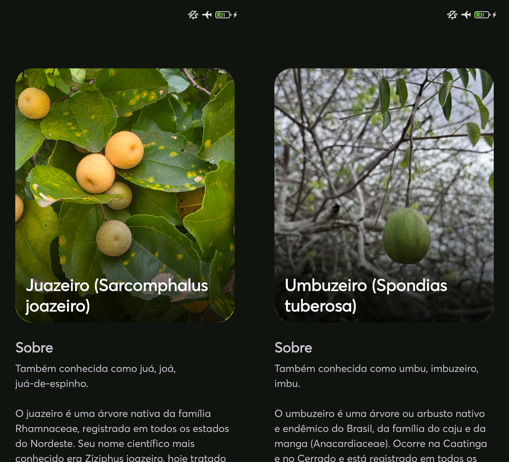
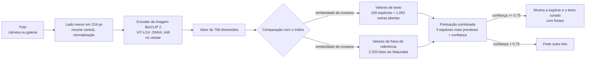

<div align="center">

# SaberIA Plant ID

**Identificação de plantas medicinais da Caatinga sem internet, em um celular Android intermediário.**

[English](README.md) · **Português (Brasil)**

[](LICENSE)
[](#como-funciona)
[](https://onnxruntime.ai)
[](examples/predict.py)
[](https://huggingface.co/andessonIF/saberia-plant-id)
[](https://github.com/Andessonreis/saberia-plant-id/releases/latest)



<sub>Telas reais do SaberIA em um celular Android em modo avião. À esquerda, juazeiro (<i>Sarcomphalus joazeiro</i>), confiança 1,00. À direita, umbuzeiro (<i>Spondias tuberosa</i>), confiança 0,97. Cerca de 3 s por foto. Fotos do iNaturalist: <a href="https://www.inaturalist.org/observations/386235537">386235537</a>, de marcello_ofiologia (CC BY), e <a href="https://www.inaturalist.org/observations/364868810">364868810</a>, de taize (CC0).</sub>

</div>

---

O SaberIA é um aplicativo Android, desenvolvido em um projeto de Iniciação Científica (PIBITI) no IFBA Campus Irecê, que ajuda comunidades do Semiárido a registrar e conferir o conhecimento tradicional sobre plantas medicinais. Este repositório guarda a **parte de reconhecimento de plantas**: o modelo que roda no celular, o índice de comparação, a base curada de espécies, a avaliação e uma implementação de referência em Python.

Você tira uma foto. O celular calcula um vetor (embedding) com o encoder de imagem do [BioCLIP 2](https://huggingface.co/imageomics/bioclip-2) quantizado, compara com um índice de 159 espécies e mostra uma descrição **escrita antes, a partir de fontes citadas**. Nenhum texto é gerado na hora, nada é enviado para servidor, e quando o modelo não tem segurança o app diz isso em vez de chutar.

## Destaques

- **88,8% de acerto na 1ª opção e 96,2% entre as 3 primeiras**, em 5.791 fotos do iNaturalist de 157 espécies, nenhuma usada como referência do índice (IC 95%: 88,0–89,6% e 95,7–96,7%).
- **97,2% de acerto quando responde.** Com confiança ≥ 0,75, o app nomeia a planta em 76,1% das fotos; nas outras, pede uma nova foto em vez de chutar.
- **Funciona sem internet.** Modelo de 308 MB e índice de 5,5 MB baixados uma vez; depois, tudo roda no celular, em modo avião.
- **Cerca de 3 s por foto** em um celular intermediário (Redmi 12, mediana de 3,3 s).
- **159 espécies com fontes públicas.** Cada ficha cita Flora e Funga do Brasil, GBIF, Agra et al. (2008), RENISUS ou o Formulário de Fitoterápicos da Farmacopeia Brasileira.
- **Nenhum texto inventado.** As descrições foram escritas antes, a partir dessas fontes; o modelo só escolhe a espécie.
- **Sem sinal de inflação pelo pré-treino.** Nas 5.155 fotos criadas no iNaturalist depois do corte dos dados de treino do BioCLIP 2, o top-1 é 90,6%.
- **Avaliação aberta.** IDs, licenças e autores de todas as fotos de teste, scripts e resultados por espécie estão em [`eval/scale/`](eval/scale/).

## Sumário

- [Por quê](#por-quê)
- [Como funciona](#como-funciona)
- [Resultados](#resultados)
- [Limitações e validade](#limitações-e-validade)
- [Uso rápido (Python)](#uso-rápido-python)
- [Metodologia e reprodutibilidade](#metodologia-e-reprodutibilidade)
- [Espécies da base](#espécies-da-base)
- [Licenças e atribuições](#licenças-e-atribuições)
- [Como citar](#como-citar)
- [Agradecimentos e contato](#agradecimentos-e-contato)

## Por quê

A Caatinga é um bioma exclusivamente brasileiro, e suas comunidades guardam um conhecimento amplo sobre plantas medicinais: que parte usar, como preparar, para que serve. Esse saber passa de geração em geração principalmente pela oralidade e vem se perdendo com a urbanização e a falta de registros.

A primeira versão do app identificava a planta com um modelo multimodal de uso geral na nuvem e pedia a ele que escrevesse a descrição. Em campo, isso trouxe três problemas:

| Problema | Consequência |
|---|---|
| Espécies nativas da Caatinga aparecem pouco nos dados de treino dos modelos gerais | Nome errado justamente para as plantas que mais importam |
| Texto livre gerado pelo modelo | Afirmações sobre saúde plausíveis, mas sem como verificar |
| Depende de internet | Zonas rurais do Semiárido muitas vezes têm sinal fraco ou nenhum |

Este repositório substitui essa etapa por um classificador de conjunto fechado que roda no celular e por uma base de espécies em que cada afirmação tem fonte.

O projeto se relaciona com os Objetivos de Desenvolvimento Sustentável 3 (saúde e bem-estar), 11.4 (proteger o patrimônio cultural) e 15 (vida terrestre).

## Como funciona



1. **Encoder.** A parte de imagem do BioCLIP 2 (ViT-L/14, treinado no [TreeOfLife-200M](https://huggingface.co/datasets/imageomics/TreeOfLife-200M), cerca de 200 milhões de imagens de organismos), exportada para ONNX com quantização dinâmica int8 das multiplicações de matriz. Sem novo treino: os pesos são os originais.
2. **Vetores de texto.** Para cada rótulo, o encoder de texto do BioCLIP 2 codifica o nome científico e os sinônimos, com e sem a classificação taxonômica do GBIF (reino a família). Além das 159 espécies da base, o índice tem 1.053 outras plantas (espécies do PlantNet-300K e ornamentais, cultivos e plantas espontâneas comuns no Brasil). Elas nunca aparecem como resposta; servem para estimar se a foto é de alguma espécie da base.
3. **Vetores de referência.** Até 15 fotos de grau de pesquisa do iNaturalist por espécie, observadas até 31/12/2024, codificadas com o mesmo modelo int8. Só os vetores são distribuídos; as fotos, não. O [índice v1.0.1](#índice-v101) acrescenta 70 fotos de licença livre para três espécies.
4. **Pontuação.** Para cada espécie da base: `similaridade_texto + 1,0 × média(3 maiores similaridades com fotos de referência)`, seguida de softmax. A confiança é `P(1º lugar) × P(a foto é de uma espécie da base)`. Abaixo de 0,75 o app não nomeia a planta.
5. **Texto.** A tela de resultado lê a ficha em [`data/caatinga_species.json`](data/caatinga_species.json): nomes populares, família, origem, usos tradicionais, cuidados e links para Flora e Funga do Brasil, GBIF, Agra et al. (2008), RENISUS e Formulário de Fitoterápicos da Farmacopeia Brasileira.

O modelo (308 MB) é baixado uma vez, o SHA-256 é conferido, e a partir daí a identificação funciona em modo avião.

## Resultados

A avaliação principal foi feita em 31/10/2026 com **5.791 fotos do iNaturalist de 157 das 159 espécies da base**, nenhuma delas usada como referência do índice. Foram usados os mesmos arquivos que o app baixa (modelo e índice conferidos por SHA-256), com o pré-processamento e a pontuação do app reproduzidos em Python. Relatório completo em [`eval/scale/RESULTS.pt-BR.md`](eval/scale/RESULTS.pt-BR.md) ([English](eval/scale/RESULTS.md)), tabelas por espécie em [`eval/scale/tabelas.md`](eval/scale/tabelas.md) e números brutos em [`eval/scale/resultados.json`](eval/scale/resultados.json).

### Visão geral

Limiar de confiança do app: 0,75. Intervalos de confiança de 95% (IC) de Wilson.

| Recorte | Fotos | Top-1 (IC 95%) | Top-3 (IC 95%) | Respondidas no limiar | Acerto entre as respondidas |
|---|---:|---|---|---:|---|
| **Todas as espécies** | 5.791 | **88,8%** (88,0–89,6%) | **96,2%** (95,7–96,7%) | 76,1% | **97,2%** (96,7–97,7%) |
| 22 espécies-chave | 1.986 | 84,3% (82,7–85,9%) | 94,2% (93,1–95,2%) | 67,9% | 96,1% (94,9–97,0%) |
| Demais 135 espécies | 3.805 | 91,1% (90,2–92,0%) | 97,3% (96,7–97,7%) | 80,3% | 97,8% (97,2–98,2%) |

- **Top-1** é a espécie certa na 1ª opção; **top-3**, entre as 3 primeiras. As duas colunas não usam o limiar.
- **Respondidas no limiar** é a parte das fotos em que a confiança passou de 0,75 e o app nomeou a planta. Nas outras, ele pede uma nova foto.
- **Média por espécie**, com o mesmo peso para cada uma das 157: top-1 88,3% (IC 95% por bootstrap: 87,5–89,2%) e top-3 96,0% (95,4–96,7%).

### No celular

| Medida | Valor |
|---|---|
| Tempo do modelo por foto (Redmi 12, MediaTek Helio G88, 4 threads) | mediana **3,3 s** (3,0 a 4,8 s; 16 identificações reais) |
| Leitura e preparo da foto | mediana 55 ms |
| Primeira carga do modelo, uma vez por sessão | mediana 8,6 s (7,4 a 11,6 s; n = 6) |
| Modelo (`plant-classifier-int8.onnx`) | 308 MB, ONNX int8 |
| Índice (`plant-index.bin`) | 5,5 MB: 159 espécies, 1.212 rótulos de texto, 2.320 vetores de referência (v1.0.0); 5,6 MB e 2.387 vetores no [v1.0.1](#índice-v101) |
| Internet | só no download inicial; depois, modo avião |

Os tempos vêm do registro do próprio app no aparelho.

### Como a avaliação foi montada

- **Fotos.** Observações de grau "pesquisa" do iNaturalist (identificação confirmada pela comunidade), no tamanho "medium" (lado maior de 500 px). Por espécie: 1 foto por observação e **no máximo 1 observação por observador**, para não contar várias vezes a mesma planta ou o mesmo fotógrafo.
- **Tamanho.** Alvo de 100 fotos para as 22 espécies-chave e 30 para as demais. Quando não havia fotos elegíveis suficientes, ficou o n real (catingueira tem só 7). 146 espécies têm n ≥ 20. *Citrus aurantium* e *Pimpinella anisum* ficaram sem foto elegível. Foram priorizadas observações de 2025 em diante (5.012 fotos); as anteriores (779) só entraram para completar.
- **Separação das referências, por ID.** Ficaram de fora todas as observações das 2.320 fotos de referência do índice e as do conjunto de desenvolvimento, 2.647 ao todo.
- **Separação das referências, por conteúdo.** Cada foto de teste foi comparada com as referências e com as outras fotos de teste por hash perceptual (dHash de 64 bits, até 6 bits de diferença) e por cosseno dos vetores (≥ 0,99). Saíram 5 fotos, todas repetidas dentro do próprio teste. Nenhuma era cópia de uma referência.
- **O mesmo sistema do app.** Pré-processamento do `PlantClassifier.kt` (orientação EXIF, redução por potência de 2, redimensionamento bilinear como o `Bitmap.createScaledBitmap`, recorte central de 224×224), mesma pontuação e mesmo limiar.
- **Estatística.** IC 95% de Wilson para cada taxa. Para a média por espécie, bootstrap estratificado com 2.000 reamostragens (semente 20251105).
- **Sensibilidade por observador.** Quando o fotógrafo também tem foto nas referências (1.250 fotos), o top-1 é 87,0% (85,0–88,7%). Quando é um observador novo (4.541 fotos), 89,3% (88,4–90,2%). Conhecer o fotógrafo não infla o resultado.
- **Reprodutível.** [`eval/scale/amostra_ids.csv`](eval/scale/amostra_ids.csv) lista cada observação e foto usada, com espécie, data, licença e crédito. Os scripts estão em [`eval/scale/scripts/`](eval/scale/scripts/). As fotos não são redistribuídas.

### Contaminação do pré-treino

O encoder vem do BioCLIP 2, pré-treinado no TreeOfLife-200M, que inclui fotos do iNaturalist. As fotos de teste não foram usadas como referência do índice, mas parte delas pode ter passado pelo pré-treino. Segundo o cartão do dataset, os dados vêm de um instantâneo do GBIF de **1º/05/2024** e do EOL acessado em **agosto de 2024**. Para cada foto de teste foi baixada a data de criação da observação no iNaturalist:

| Data de criação da observação | Fotos | Top-1 (IC 95%) | Top-3 (IC 95%) |
|---|---:|---|---|
| A partir de 1º/09/2024: com certeza fora do pré-treino | 5.155 | **90,6%** (89,8–91,4%) | 96,9% (96,4–97,3%) |
| De 1º/05 a 31/08/2024: só poderia ter entrado pelo EOL | 56 | 71,4% (58,5–81,6%) | 92,9% (83,0–97,2%) |
| Antes de 1º/05/2024: pode estar no pré-treino | 580 | 74,3% (70,6–77,7%) | 90,9% (88,2–93,0%) |

As fotos que com certeza ficaram fora do pré-treino acertam **mais**, não menos. A diferença bruta vem da mistura de espécies: fotos antigas só entraram nas espécies com poucas fotos recentes, que são as árvores nativas mais difíceis. Dentro das mesmas 39 espécies com fotos dos dois períodos, com a mesma mistura de espécies, as fotos novas acertam 77,8% e as antigas 74,1% (n = 946 e 636). Não há sinal de que o pré-treino infle o resultado.

### Fotos fora do grau "pesquisa" (mini teste)

Um teste à parte, com 99 observações das espécies-chave em grau "casual" ou "precisa de ID" (criadas a partir de 1º/09/2024, com pelo menos 2 identificadores concordando), deu **88,9%** de top-1 (IC 95%: 81,2–93,7%) e 96,0% de top-3. Nas mesmas espécies, o teste principal dá 87,8%. Esse resultado mede pouco: 88 das 99 fotos são "casual" porque a planta é cultivada, não porque a foto é ruim, e faltaram justamente árvores nativas difíceis (pinhão-bravo, jurema-preta e quixabeira ficaram sem foto). Ele não substitui um teste com fotos de campo de usuários leigos.

### Espécies-chave

Ordenadas pelo top-1. Com 100 fotos, o IC de uma espécie fica entre ±5 e ±10 pontos percentuais; com menos fotos, ele é mais largo.

| Espécie | Nome popular | n | Top-1 (IC 95%) | Top-3 | Respondidas no limiar | Certas entre as respondidas | Confusão mais comum |
|---|---|---:|---|---:|---:|---:|---|
| *Aloe vera* | babosa | 100 | **100,0%** (96,3–100,0%) | 100,0% | 97/100 | 97/97 | – |
| *Melocactus zehntneri* | coroa-de-frade | 99 | **100,0%** (96,3–100,0%) | 100,0% | 97/99 | 97/97 | – |
| *Cymbopogon citratus* | capim-santo | 100 | **99,0%** (94,5–99,8%) | 100,0% | 92/100 | 92/92 | *Zingiber officinale* (1) |
| *Opuntia ficus-indica* | palma | 100 | **99,0%** (94,5–99,8%) | 100,0% | 93/100 | 93/93 | *Xiquexique gounellei* (1) |
| *Schinus terebinthifolia* | aroeira-vermelha | 100 | **99,0%** (94,5–99,8%) | 99,0% | 94/100 | 94/94 | *Cnidoscolus quercifolius* (1) |
| *Lippia alba* | erva-cidreira | 99 | **97,0%** (91,5–99,0%) | 99,0% | 92/99 | 91/92 | *Lippia origanoides* (2) |
| *Xiquexique gounellei* | xique-xique | 100 | **95,0%** (88,8–97,9%) | 98,0% | 90/100 | 90/90 | *Cereus jamacaru* (3) |
| *Coleus barbatus* | boldo | 100 | **94,0%** (87,5–97,2%) | 99,0% | 77/100 | 76/77 | *Coleus amboinicus* (5) |
| *Sarcomphalus joazeiro* | juazeiro | 91 | **91,2%** (83,6–95,5%) | 97,8% | 61/91 | 60/61 | *Microdesmia rigida* (2) |
| *Cereus jamacaru* | mandacaru | 100 | **90,0%** (82,6–94,5%) | 99,0% | 23/100 | 23/23 | *Pilosocereus pachycladus* (6) |
| *Jatropha mollissima* | pinhão-bravo | 100 | **90,0%** (82,6–94,5%) | 94,0% | 83/100 | 79/83 | *Amburana cearensis* (3) |
| *Handroanthus impetiginosus* | ipê-roxo | 100 | **87,0%** (79,0–92,2%) | 94,0% | 64/100 | 64/64 | *Handroanthus serratifolius* (3) |
| *Libidibia ferrea* | jucá | 100 | **79,0%** (70,0–85,8%) | 97,0% | 58/100 | 52/58 | *Hymenaea courbaril* (6) |
| *Mimosa tenuiflora* | jurema-preta | 100 | **76,0%** (66,8–83,3%) | 95,0% | 35/100 | 33/35 | *Prosopis juliflora* (7) |
| *Sideroxylon obtusifolium* | quixabeira | 100 | **73,0%** (63,6–80,7%) | 86,0% | 53/100 | 51/53 | *Spondias mombin* (4) |
| *Spondias tuberosa* | umbuzeiro | 65 | **72,3%** (60,4–81,7%) | 90,8% | 36/65 | 33/36 | *Commiphora leptophloeos* (9) |
| *Commiphora leptophloeos* | umburana-de-cambão | 95 | **69,5%** (59,6–77,8%) | 97,9% | 52/95 | 40/52 | *Amburana cearensis* (20) |
| *Anadenanthera colubrina* | angico | 100 | **65,0%** (55,2–73,6%) | 96,0% | 40/100 | 35/40 | *Spondias mombin* (12) |
| *Amburana cearensis* | umburana-de-cheiro | 53 | **60,4%** (46,9–72,4%) | 81,1% | 25/53 | 23/25 | *Cenostigma pyramidale* (6) |
| *Erythrina velutina* | mulungu | 100 | **59,0%** (49,2–68,1%) | 76,0% | 48/100 | 36/48 | *Ceiba glaziovii* (9) |
| *Cenostigma pyramidale* | catingueira | 7 | **57,1%** (25,1–84,2%) | 85,7% | 4/7 | 4/4 | *Tabebuia aurea* (1) |
| *Astronium urundeuva* | aroeira-do-sertão | 77 | **55,8%** (44,7–66,4%) | 66,2% | 34/77 | 32/34 | *Amburana cearensis* (8) |

As outras 135 espécies aparecem na coluna "Top-1 (n)" da [tabela de espécies](#espécies-da-base) e, com IC, em [`eval/scale/tabelas.md`](eval/scale/tabelas.md). Em 40 delas o top-1 foi de 100%.

### Índice v1.0.1

O v1.0.1 reforça as três espécies-chave mais fracas (aroeira-do-sertão, mulungu e umburana-de-cambão). Usa o mesmo modelo, os mesmos rótulos e o mesmo limiar do v1.0.0, só com outro arquivo de índice (`plant-index-v1.0.1.bin`, sha256 `d8c97ff0419fcafb04201bf22ef1196c66de983e6210a0e1be89b2287cc9a5d2`). Mudanças:

- **+70 referências com licença livre** (CC0, CC BY ou CC BY-SA, nenhuma NC): 18 fotos extras de observações do iNaturalist que já estavam no índice e 52 fotos de campo do Wikimedia Commons, conferidas uma a uma. Créditos em [`eval/scale/index-v1.0.1/referencias_adicionadas.csv`](eval/scale/index-v1.0.1/referencias_adicionadas.csv).
- **−3 referências** "todos os direitos reservados" (*Genipa americana*, *Pityrocarpa moniliformis*, *Spondias mombin*). Lista em [`removidas_e_descartadas.json`](eval/scale/index-v1.0.1/removidas_e_descartadas.json).
- Nenhuma referência nova vem de observação de teste, e nenhuma é cópia de foto de teste.

| Top-1 | v1.0.0 | v1.0.1 |
|---|---:|---:|
| Geral, mesmas 5.791 fotos (otimista) | 88,8% | 89,2% |
| Aroeira-do-sertão, mesmas fotos (n = 77, otimista) | 55,8% | 76,6% |
| Mulungu, mesmas fotos (n = 100, otimista) | 59,0% | 73,0% |
| Umburana-de-cambão, mesmas fotos (n = 95, otimista) | 69,5% | 70,5% |
| **3 espécies, 117 observações novas (sem viés)** | **51,3%** (42,3–60,2%) | **73,5%** (64,9–80,7%) |

As linhas marcadas como otimistas usam o mesmo teste que mostrou quais espécies reforçar. Por isso a estimativa sem viés é a da última linha: 117 observações das 3 espécies que não tinham sido usadas em nada (nem teste, nem referência, nem calibração), com 1 por observador. Nelas, 26 fotos erradas viraram certas e nenhuma certa virou errada. No teste principal, 7 espécies perderam 1 ou 2 fotos (a maior perda foi *Erythrina mulungu*, de 24 para 22 de 30), e o falso positivo fora da base ficou igual (37/300). Detalhes em [`eval/scale/index-v1.0.1/`](eval/scale/index-v1.0.1/). **O resultado principal deste README continua sendo o do v1.0.0.**

### Plantas fora da base

300 fotos de 300 espécies de plantas do Brasil que não estão na base (observações de 2025 em diante, sorteadas com semente fixa, 1 por espécie e 1 por observador).

| Recorte | Fotos | Receberam o nome de uma espécie da base (IC 95%) |
|---|---:|---|
| Todas | 300 | 37 = 12,3% (9,1–16,5%) |
| Gênero tem espécie na base (outra *Erythrina*, outro *Melocactus*...) | 56 | 13 = 23,2% (14,1–35,8%) |
| Gênero sem espécie na base | 244 | 24 = 9,8% (6,7–14,2%) |

### Comparação com outros sistemas

Serve só como **indicação limitada**:

- **IA na nuvem.** Foi usado o mesmo endpoint, prompt e parâmetros da versão anterior do app, em uma subamostra sorteada. A cota gratuita da API interrompeu as chamadas cedo. O Gemini 3.5 Flash respondeu 11 fotos e acertou 6 (IC 95%: 28–79%). O Gemini 2.5 Flash respondeu 20 e acertou 7 (18–57%). Nessas mesmas fotos, o SaberIA acertou 11/11 e 19/20. Com n tão pequeno, os intervalos são enormes: o resultado aponta uma direção, mas não mede a nuvem. A conta da OpenAI estava sem crédito e não pôde ser medida.
- **Modelo multimodal local.** O Qwen3-VL-2B acertou 6 de 64 fotos (9,4%; IC 95%: 4,4–19,0%), levando de 2 a 3,5 min por foto no celular. A amostra é outra, a do conjunto de desenvolvimento, e por isso não se compara lado a lado com a tabela acima.

### Conjunto de desenvolvimento

Antes da avaliação principal, um conjunto menor foi usado para **escolher o modelo e calibrar o limiar de 0,75**: 194 fotos de 25 espécies (observações a partir de 2025) e 74 fotos de 12 plantas fora da base. Como ele orientou decisões, não serve como medida final, e as observações dele ficaram fora da avaliação principal. Nele o modelo publicado teve 75,8% de top-1 (147/194; IC 95%: 69,3–81,3%) e 92,3% de top-3. A taxa é menor que a da avaliação principal porque 21 das 25 espécies eram espécies-chave, que são as mais difíceis, e com 8 fotos por espécie o intervalo é largo. Fotos, licenças e autores estão em [`eval/data/test_photos.csv`](eval/data/test_photos.csv).

<details>
<summary>Variantes comparadas, modelo local e reprodução em Python (conjunto de desenvolvimento)</summary>

Mesmas 194 + 74 fotos, mesma quantização int8, limiar 0,75.

| Variante | Top-1 | Top-3 | Respondidas | Acerto quando responde | Fora da base respondidas |
|---|---:|---:|---:|---:|---:|
| BioCLIP (v1), só nomes | 44,8% | 62,4% | 40% | 73,1% | 6/74 |
| BioCLIP (v1), nomes + fotos de referência | 59,8% | 76,8% | 41% | 88,6% | 5/74 |
| BioCLIP 2, só nomes | 68,0% | 88,1% | 55% | 85,8% | 3/74 |
| BioCLIP 2, nomes + fotos de referência, redimensionamento bicúbico | 77,3% | 93,3% | 61% | 93,2% | 1/74 |
| **BioCLIP 2, nomes + fotos de referência, redimensionamento bilinear (publicado)** | **75,8%** | **92,3%** | **63%** | **91,8%** | **1/74** |

A variante publicada usa redimensionamento bilinear porque é o que o `Bitmap.createScaledBitmap` do Android faz. A linha bicúbica pontua um pouco mais no PC, mas a bilinear é o que o celular realmente enxerga.

Modelo local de uso geral, com o prompt da versão anterior do app ("responda só com o nome científico"), nas primeiras 64 fotos (8 espécies × 8 fotos):

| Modelo | Espécie correta | Tempo por foto no celular |
|---|---:|---:|
| Qwen3-VL-2B (Q4_K_M, llama.cpp), generativo | 6/64 (9,4%) | 2 a 3,5 min |
| SaberIA (BioCLIP 2 + índice), mesmas 64 fotos | 45/64 (70,3%) top-1 | ~3,3 s |

O Qwen muitas vezes respondeu com espécies reais de outras regiões (*Carnegiea gigantea*, o saguaro, em 6 das 8 fotos de mandacaru) ou com "Não sei". Respostas brutas: [`eval/data/qwen_results.txt`](eval/data/qwen_results.txt).

Rodando [`examples/predict.py`](examples/predict.py) com os arquivos da [release](https://github.com/Andessonreis/saberia-plant-id/releases/tag/v1.0.0) nas mesmas fotos, o resultado foi 76,8% top-1, 92,3% top-3, 60% respondidas, 94,0% de acerto entre as respondidas e 1/74 resposta falsa. Pontuando os vetores guardados da avaliação com o mesmo script, o resultado é exatamente 75,8%. A diferença vem da variação numérica entre execuções dos kernels int8 do ONNX Runtime em CPU (cosseno de 0,994 a 1,0 entre execuções), que muda o resultado de algumas fotos no limite. Espere variações pequenas parecidas em outros aparelhos.

</details>

## Limitações e validade

Os números acima valem para fotos do iNaturalist das espécies da base. Os pontos abaixo delimitam o que eles dizem, e vários indicam o próximo passo do projeto.

- **Espécies mais difíceis.** As árvores nativas da Caatinga se parecem muito entre si, principalmente sem folhas na seca. Os menores top-1 com n ≥ 50 são aroeira-do-sertão (55,8%, n = 77), mulungu (59,0%), umburana-de-cheiro (60,4%), angico (65,0%) e umburana-de-cambão (69,5%). Em várias delas a espécie certa está quase sempre entre as 3 primeiras (angico 96,0%, umburana-de-cambão 97,9%). Entre as espécies com poucas fotos, os erros ficam dentro do mesmo gênero: *Lippia grata* (0/4), *Hymenaea martiana* (1/11) e *Phyllanthus niruri*, que vira *P. amarus*. Ampliar as fotos de referência é a melhoria mais direta: no [índice v1.0.1](#índice-v101), isso levou aroeira e mulungu, em observações novas, de 30% para 85% e de 50% para 71%. Angico, umburana-de-cheiro e umburana-de-cambão ainda pedem mais referências, com tronco, casca e planta sem folhas.
- **Mandacaru.** O top-1 é 90%, mas só 23 de 100 fotos passam do limiar. A confiança fica dividida com outros cactos colunares, principalmente o facheiro (*Pilosocereus pachycladus*).
- **Pré-treino do modelo base.** O BioCLIP 2 foi treinado no TreeOfLife-200M, que inclui imagens do iNaturalist. Algumas fotos de teste podem ter sido vistas no pré-treino do encoder, mesmo sem nunca terem sido usadas como referência do índice. A análise por data de criação das observações ([acima](#contaminação-do-pré-treino)) não mostra inflação: nas 5.155 fotos criadas depois do corte, o top-1 é 90,6%, acima dos 88,8% gerais. O número conservador a citar continua sendo 88,8%.
- **Fotos de pesquisa são mais fáceis que fotos de campo.** No iNaturalist, quem fotografa em geral já conhece a planta e enquadra flor ou fruto com boa luz. Uma foto às pressas de uma folha solta ou de um tronco seco tende a ter acerto menor. Os números são um teto realista, não uma garantia para uso em campo. O mini teste com fotos fora do grau "pesquisa" não mostrou queda, mas quase todas eram de plantas cultivadas. O próximo passo é medir com fotos tiradas nas oficinas com a comunidade.
- **Plantas fora da base recebem palpite.** O sistema é de conjunto fechado: só nomeia as 159 espécies. Em 12,3% das plantas de fora ele aceitou o nome de uma espécie da base, e em 23,2% quando o gênero está na base. O app mostra o aviso de que a identificação deve ser confirmada, e esse aviso continua necessário.
- **Licenças das fotos de referência.** A maior parte das fotos de referência e de teste é CC BY-NC. O índice guarda só vetores numéricos derivados delas, não as imagens, e as fotos de teste não são redistribuídas. Para uso comercial, avalie se isso é compatível com o seu caso. Três fotos de referência que se revelaram "todos os direitos reservados" saíram no índice v1.0.1, que só acrescentou fotos CC0, CC BY e CC BY-SA, com créditos listados.
- **Tamanho da amostra por espécie.** Com 30 fotos, uma espécie com 90% de acerto tem IC de cerca de 74 a 97%. Diferenças pequenas entre espécies não são significativas.
- **Rótulos do iNaturalist.** O grau "pesquisa" exige acordo de 2/3 dos identificadores, mas ainda há erros de identificação. Isso tende a puxar o acerto medido para baixo, não para cima.
- **Validação humana.** A identificação e os textos apoiam, mas não substituem, a validação por botânico e a orientação de profissional de saúde. O app mantém uma etapa de validação humana para os registros da comunidade.

## Uso rápido (Python)

Baixe o modelo, o índice e a base de espécies da [release](https://github.com/Andessonreis/saberia-plant-id/releases/tag/v1.0.0) (ou do [Hugging Face](https://huggingface.co/andessonIF/saberia-plant-id)) e confira os hashes:

```bash
pip install onnxruntime numpy pillow
BASE=https://github.com/Andessonreis/saberia-plant-id/releases/download/v1.0.0
for f in plant-classifier-int8.onnx plant-index.bin caatinga_species.json SHA256SUMS; do
  curl -LO "$BASE/$f"
done
sha256sum -c SHA256SUMS
```

Depois rode [`examples/predict.py`](examples/predict.py), que reproduz a pontuação do app (`PlantClassifier.kt`):

```bash
python examples/predict.py minha_foto.jpg
```

```text
minha_foto.jpg: confidence 0.86
  -> Cereus jamacaru (mandacaru, cardeiro)
     source: https://www.scielo.br/j/rbfar/a/fC7snvLkwzzFsMv3mfVRGNc/
```

O essencial, para usar no seu próprio código:

```python
import json, struct
import numpy as np, onnxruntime as ort
from PIL import Image

# índice: int32 com o tamanho do cabeçalho, cabeçalho JSON, vetores float16 (um por rótulo, depois um por foto de referência)
with open("plant-index.bin", "rb") as f:
    h = json.loads(f.read(struct.unpack("<i", f.read(4))[0]))
    v = np.frombuffer(f.read(), "<f2").astype(np.float32).reshape(-1, h["dim"])
text, refs = v[: len(h["labels"])], v[len(h["labels"]):]

def preprocess(path):  # lado menor -> 224 (bilinear), recorte central, normalização do CLIP
    im = Image.open(path).convert("RGB"); s = 224 / min(im.size)
    im = im.resize((max(224, round(im.width * s)), max(224, round(im.height * s))), Image.BILINEAR)
    l, t = (im.width - 224) // 2, (im.height - 224) // 2
    x = (np.asarray(im.crop((l, t, l + 224, t + 224)), np.float32) / 255 - h["mean"]) / h["std"]
    return x.transpose(2, 0, 1)[None].astype(np.float32)

session = ort.InferenceSession("plant-classifier-int8.onnx")
x = session.run(None, {"pixel_values": preprocess("minha_foto.jpg")})[0][0]  # 768-d, normalizado

def softmax(z, scale): e = np.exp((z - z.max()) * scale); return e / e.sum()
catalog = [i for i, label in enumerate(h["labels"]) if "id" in label]   # as 159 espécies da base
owner = np.array(h["refs"])                                              # rótulo de cada foto de referência
t = text @ x
p_in_base = softmax(t, h["scale"])[catalog].sum()
visual = [np.sort(refs[owner == i] @ x)[-h["k"]:].mean() for i in catalog]
prob = softmax(t[catalog] + h["weight"] * np.array(visual), h["scale"] / (1 + h["weight"]))
best = int(prob.argmax())
confidence = prob[best] * p_in_base
print(h["labels"][catalog[best]]["name"], round(float(confidence), 2),
      "answer" if confidence >= h["threshold"] else "not sure")
```

Entrada e saída do modelo:

| | |
|---|---|
| Entrada `pixel_values` | `float32 [1, 3, 224, 224]`, RGB, média `0.48145466, 0.4578275, 0.40821073`, desvio `0.26862954, 0.26130258, 0.27577711` |
| Saída `embedding` | `float32 [1, 768]`, normalizado (L2) |
| Parâmetros do índice | `scale` 100, `weight` 1,0, `k` 3, `threshold` 0,75 (lidos do cabeçalho do índice) |

## Metodologia e reprodutibilidade

A avaliação principal está em [`eval/scale/`](eval/scale/): relatório, tabelas, lista de fotos e os scripts de coleta, avaliação, comparação com a nuvem e geração das tabelas. Nenhum script guarda chave de API; a da nuvem é lida de um arquivo passado na linha de comando.

A pasta [`eval/`](eval/) tem também os scripts usados para construir o índice e avaliar no conjunto de desenvolvimento, e o [`eval/README.md`](eval/README.md) mostra a ordem de execução. Em resumo:

1. `build_labels.py`: lista de rótulos (159 espécies + 1.053 outras plantas) com taxonomia do GBIF.
2. `fetch_refs.py`: até 15 fotos de referência por espécie do iNaturalist, observadas até 31/12/2024, priorizando o Brasil.
3. `fetch_photos.py`: fotos do conjunto de desenvolvimento, grau de pesquisa, observadas a partir de 01/01/2025.
4. `export_onnx.py`: exporta o encoder de imagem do BioCLIP 2 para ONNX e quantiza em int8.
5. `embed.py` e `embed_onnx.py`: vetores de texto (PyTorch/OpenCLIP) e de imagem (ONNX int8, redimensionamento bilinear).
6. `evaluate.py`: top-1/top-3 e a tabela por limiar de confiança.
7. `build_index.py`: grava o `plant-index.bin`.

As fotos não são redistribuídas: a maioria tem licença CC BY-NC. Os CSVs em [`eval/data/`](eval/data/) listam o ID da observação, a licença e o autor de cada uma, para que as mesmas fotos possam ser baixadas de novo do iNaturalist.

## Espécies da base

159 espécies: 99 nativas (24 endêmicas do Brasil) e 60 exóticas cultivadas ou naturalizadas, de uso comum na região. 47 estão na RENISUS, a Relação Nacional de Plantas Medicinais de Interesse ao SUS. A coluna "Top-1 (n)" traz o acerto na 1ª opção e o número de fotos de cada espécie na [avaliação principal](#resultados); "–" indica espécie sem foto elegível.

Legenda das fontes: **Flora** = Flora e Funga do Brasil (JBRJ), **GBIF** = GBIF Backbone Taxonomy, **Agra 2008** = Agra et al., *Survey of medicinal plants used in the region Northeast of Brazil*, Rev. Bras. Farmacogn. 18(3), **RENISUS** = Ministério da Saúde, **FFFB** = ANVISA, *Formulário de Fitoterápicos da Farmacopeia Brasileira*, **art.** = artigo científico específico.

<details>
<summary>Ver as 159 espécies</summary>

| # | Nome científico | Nomes populares | Família | Origem | Fotos de ref. | Top-1 (n) | Fontes |
|---:|---|---|---|---|---:|:---:|---|
| 1 | *Acanthospermum hispidum* | espinho-de-cigano, carrapicho, retirante | Asteraceae | nativa | 15 | 100,0% (30) | [Agra 2008](https://www.scielo.br/j/rbfar/a/fC7snvLkwzzFsMv3mfVRGNc/) · [Flora](https://floradobrasil.jbrj.gov.br/FB103232) · [GBIF](https://www.gbif.org/species/3100375) |
| 2 | *Ageratum conyzoides* | mentrasto, catinga-de-bode | Asteraceae | nativa | 15 | 100,0% (30) | [Agra 2008](https://www.scielo.br/j/rbfar/a/fC7snvLkwzzFsMv3mfVRGNc/) · [Flora](https://floradobrasil.jbrj.gov.br/FB15934) · [GBIF](https://www.gbif.org/species/5401673) |
| 3 | *Allium cepa* | cebola | Amaryllidaceae | exótica cultivada | 15 | 93,3% (30) | [Agra 2008](https://www.scielo.br/j/rbfar/a/fC7snvLkwzzFsMv3mfVRGNc/) · [Flora](https://floradobrasil.jbrj.gov.br/FB611758) · [GBIF](https://www.gbif.org/species/2857697) |
| 4 | *Allium sativum* | alho | Amaryllidaceae | exótica cultivada | 15 | 96,7% (30) | [FFFB](https://bibliotecadigital.anvisa.gov.br/jspui/handle/anvisa/21045) · [RENISUS](https://www.gov.br/saude/pt-br/composicao/sectics/plantas-medicinais-e-fitoterapicos/ppnpmf/arquivos/2014/renisus.pdf) · [Agra 2008](https://www.scielo.br/j/rbfar/a/fC7snvLkwzzFsMv3mfVRGNc/) · [Flora](https://floradobrasil.jbrj.gov.br/FB611763) · [GBIF](https://www.gbif.org/species/2856681) |
| 5 | *Aloe vera* | babosa | Asphodelaceae | exótica cultivada | 15 | 100,0% (100) | [FFFB](https://bibliotecadigital.anvisa.gov.br/jspui/handle/anvisa/21045) · [RENISUS](https://www.gov.br/saude/pt-br/composicao/sectics/plantas-medicinais-e-fitoterapicos/ppnpmf/arquivos/2014/renisus.pdf) · [Agra 2008](https://www.scielo.br/j/rbfar/a/fC7snvLkwzzFsMv3mfVRGNc/) · [Flora](https://floradobrasil.jbrj.gov.br/FB609263) · [GBIF](https://www.gbif.org/species/2777724) |
| 6 | *Alpinia zerumbet* | colônia, gengibre-concha | Zingiberaceae | exótica cultivada | 15 | 93,3% (30) | [FFFB](https://bibliotecadigital.anvisa.gov.br/jspui/handle/anvisa/21045) · [RENISUS](https://www.gov.br/saude/pt-br/composicao/sectics/plantas-medicinais-e-fitoterapicos/ppnpmf/arquivos/2014/renisus.pdf) · [Agra 2008](https://www.scielo.br/j/rbfar/a/fC7snvLkwzzFsMv3mfVRGNc/) · [Flora](https://floradobrasil.jbrj.gov.br/FB110703) · [GBIF](https://www.gbif.org/species/5301979) |
| 7 | *Alternanthera brasiliana* | terramicina, perpétua-do-brasil, penicilina | Amaranthaceae | nativa | 15 | 96,7% (30) | [FFFB](https://bibliotecadigital.anvisa.gov.br/jspui/handle/anvisa/21045) · [Agra 2008](https://www.scielo.br/j/rbfar/a/fC7snvLkwzzFsMv3mfVRGNc/) · [Flora](https://floradobrasil.jbrj.gov.br/FB4302) · [GBIF](https://www.gbif.org/species/3084934) |
| 8 | *Amburana cearensis* | umburana-de-cheiro, cumaru, amburana | Fabaceae | nativa | 15 | 60,4% (53) | [Agra 2008](https://www.scielo.br/j/rbfar/a/fC7snvLkwzzFsMv3mfVRGNc/) · [Flora](https://floradobrasil.jbrj.gov.br/FB22781) · [GBIF](https://www.gbif.org/species/2945821) |
| 9 | *Anacardium occidentale* | cajueiro, caju | Anacardiaceae | nativa | 15 | 93,3% (30) | [FFFB](https://bibliotecadigital.anvisa.gov.br/jspui/handle/anvisa/21045) · [RENISUS](https://www.gov.br/saude/pt-br/composicao/sectics/plantas-medicinais-e-fitoterapicos/ppnpmf/arquivos/2014/renisus.pdf) · [Agra 2008](https://www.scielo.br/j/rbfar/a/fC7snvLkwzzFsMv3mfVRGNc/) · [Flora](https://floradobrasil.jbrj.gov.br/FB4381) · [GBIF](https://www.gbif.org/species/5421368) |
| 10 | *Anadenanthera colubrina* | angico, angico-vermelho, angico-de-caroço | Fabaceae | nativa | 15 | 65,0% (100) | [Agra 2008](https://www.scielo.br/j/rbfar/a/fC7snvLkwzzFsMv3mfVRGNc/) · [Flora](https://floradobrasil.jbrj.gov.br/FB18071) · [GBIF](https://www.gbif.org/species/2952823) |
| 11 | *Ananas comosus* | abacaxi, ananás | Bromeliaceae | nativa | 15 | 93,3% (30) | [Agra 2008](https://www.scielo.br/j/rbfar/a/fC7snvLkwzzFsMv3mfVRGNc/) · [RENISUS](https://www.gov.br/saude/pt-br/composicao/sectics/plantas-medicinais-e-fitoterapicos/ppnpmf/arquivos/2014/renisus.pdf) · [Flora](https://floradobrasil.jbrj.gov.br/FB16574) · [GBIF](https://www.gbif.org/species/5288819) |
| 12 | *Annona squamosa* | pinha, ata, fruta-do-conde | Annonaceae | exótica naturalizada | 15 | 90,0% (30) | [Agra 2008](https://www.scielo.br/j/rbfar/a/fC7snvLkwzzFsMv3mfVRGNc/) · [Flora](https://floradobrasil.jbrj.gov.br/FB117273) · [GBIF](https://www.gbif.org/species/5407099) |
| 13 | *Artemisia absinthium* | losna, absinto, erva-dos-vermes | Asteraceae | exótica cultivada | 15 | 100,0% (30) | [Agra 2008](https://www.scielo.br/j/rbfar/a/fC7snvLkwzzFsMv3mfVRGNc/) · [RENISUS](https://www.gov.br/saude/pt-br/composicao/sectics/plantas-medicinais-e-fitoterapicos/ppnpmf/arquivos/2014/renisus.pdf) · [Flora](https://floradobrasil.jbrj.gov.br/FB612129) · [GBIF](https://www.gbif.org/species/3121319) |
| 14 | *Aspidosperma pyrifolium* | pereiro, pau-pereiro | Apocynaceae | nativa | 15 | 90,0% (30) | [Agra 2008](https://www.scielo.br/j/rbfar/a/fC7snvLkwzzFsMv3mfVRGNc/) · [Flora](https://floradobrasil.jbrj.gov.br/FB15551) · [GBIF](https://www.gbif.org/species/7316881) |
| 15 | *Astronium urundeuva* | aroeira-do-sertão, aroeira, urundeúva | Anacardiaceae | nativa | 14 | 55,8% (77) | [FFFB](https://bibliotecadigital.anvisa.gov.br/jspui/handle/anvisa/21045) · [Agra 2008](https://www.scielo.br/j/rbfar/a/fC7snvLkwzzFsMv3mfVRGNc/) · [Flora](https://floradobrasil.jbrj.gov.br/FB115185) · [GBIF](https://www.gbif.org/species/3660652) |
| 16 | *Attalea speciosa* | babaçu, coco-palmeira | Arecaceae | nativa (endêmica do Brasil) | 15 | 86,7% (30) | [Agra 2008](https://www.scielo.br/j/rbfar/a/fC7snvLkwzzFsMv3mfVRGNc/) · [RENISUS](https://www.gov.br/saude/pt-br/composicao/sectics/plantas-medicinais-e-fitoterapicos/ppnpmf/arquivos/2014/renisus.pdf) · [Flora](https://floradobrasil.jbrj.gov.br/FB15686) · [GBIF](https://www.gbif.org/species/2732877) |
| 17 | *Bauhinia cheilantha* | mororó, pata-de-vaca | Fabaceae | nativa | 15 | 72,0% (25) | [Agra 2008](https://www.scielo.br/j/rbfar/a/fC7snvLkwzzFsMv3mfVRGNc/) · [Flora](https://floradobrasil.jbrj.gov.br/FB82659) · [GBIF](https://www.gbif.org/species/2952938) |
| 18 | *Bauhinia forficata* | pata-de-vaca, mororó | Fabaceae | nativa | 15 | 80,0% (30) | [Agra 2008](https://www.scielo.br/j/rbfar/a/fC7snvLkwzzFsMv3mfVRGNc/) · [RENISUS](https://www.gov.br/saude/pt-br/composicao/sectics/plantas-medicinais-e-fitoterapicos/ppnpmf/arquivos/2014/renisus.pdf) · [Flora](https://floradobrasil.jbrj.gov.br/FB82666) · [GBIF](https://www.gbif.org/species/2953861) |
| 19 | *Bidens pilosa* | picão-preto, picão, carrapicho-de-agulha | Asteraceae | exótica naturalizada | 15 | 100,0% (30) | [FFFB](https://bibliotecadigital.anvisa.gov.br/jspui/handle/anvisa/21045) · [RENISUS](https://www.gov.br/saude/pt-br/composicao/sectics/plantas-medicinais-e-fitoterapicos/ppnpmf/arquivos/2014/renisus.pdf) · [Agra 2008](https://www.scielo.br/j/rbfar/a/fC7snvLkwzzFsMv3mfVRGNc/) · [Flora](https://floradobrasil.jbrj.gov.br/FB103749) · [GBIF](https://www.gbif.org/species/5391845) |
| 20 | *Bixa orellana* | urucum, colorau, açafroa | Bixaceae | nativa | 15 | 96,7% (30) | [Agra 2008](https://www.scielo.br/j/rbfar/a/fC7snvLkwzzFsMv3mfVRGNc/) · [Flora](https://floradobrasil.jbrj.gov.br/FB5745) · [GBIF](https://www.gbif.org/species/2874863) |
| 21 | *Bowdichia virgilioides* | sucupira, sucupira-preta | Fabaceae | nativa | 15 | 86,7% (30) | [Agra 2008](https://www.scielo.br/j/rbfar/a/fC7snvLkwzzFsMv3mfVRGNc/) · [Flora](https://floradobrasil.jbrj.gov.br/FB29489) · [GBIF](https://www.gbif.org/species/2975476) |
| 22 | *Bromelia laciniosa* | macambira | Bromeliaceae | nativa (endêmica do Brasil) | 15 | 100,0% (11) | [Agra 2008](https://www.scielo.br/j/rbfar/a/fC7snvLkwzzFsMv3mfVRGNc/) · [Flora](https://floradobrasil.jbrj.gov.br/FB16578) · [GBIF](https://www.gbif.org/species/5287936) |
| 23 | *Byrsonima crassifolia* | murici, murici-da-praia | Malpighiaceae | nativa | 15 | 80,0% (30) | [Agra 2008](https://www.scielo.br/j/rbfar/a/fC7snvLkwzzFsMv3mfVRGNc/) · [Flora](https://floradobrasil.jbrj.gov.br/FB19419) · [GBIF](https://www.gbif.org/species/3191361) |
| 24 | *Cajanus cajan* | feijão-guandu, guandu, andu | Fabaceae | exótica naturalizada | 15 | 96,7% (30) | [Agra 2008](https://www.scielo.br/j/rbfar/a/fC7snvLkwzzFsMv3mfVRGNc/) · [Flora](https://floradobrasil.jbrj.gov.br/FB82709) · [GBIF](https://www.gbif.org/species/7587087) |
| 25 | *Calotropis procera* | algodão-de-seda, flor-de-seda, ciúme | Apocynaceae | exótica naturalizada | 15 | 100,0% (30) | [Agra 2008](https://www.scielo.br/j/rbfar/a/fC7snvLkwzzFsMv3mfVRGNc/) · [Flora](https://floradobrasil.jbrj.gov.br/FB80340) · [GBIF](https://www.gbif.org/species/5414566) |
| 26 | *Capraria biflora* | chá-da-calçada, chá-preto, mate | Scrophulariaceae | nativa | 15 | 100,0% (30) | [Agra 2008](https://www.scielo.br/j/rbfar/a/fC7snvLkwzzFsMv3mfVRGNc/) · [Flora](https://floradobrasil.jbrj.gov.br/FB25821) · [GBIF](https://www.gbif.org/species/3171842) |
| 27 | *Carica papaya* | mamão, mamoeiro | Caricaceae | exótica naturalizada | 15 | 100,0% (30) | [Agra 2008](https://www.scielo.br/j/rbfar/a/fC7snvLkwzzFsMv3mfVRGNc/) · [Flora](https://floradobrasil.jbrj.gov.br/FB22405) · [GBIF](https://www.gbif.org/species/2874484) |
| 28 | *Casearia sylvestris* | guaçatonga, pau-de-lagarto, língua-de-tiú | Salicaceae | nativa | 15 | 93,3% (30) | [FFFB](https://bibliotecadigital.anvisa.gov.br/jspui/handle/anvisa/21045) · [RENISUS](https://www.gov.br/saude/pt-br/composicao/sectics/plantas-medicinais-e-fitoterapicos/ppnpmf/arquivos/2014/renisus.pdf) · [Agra 2008](https://www.scielo.br/j/rbfar/a/fC7snvLkwzzFsMv3mfVRGNc/) · [Flora](https://floradobrasil.jbrj.gov.br/FB14384) · [GBIF](https://www.gbif.org/species/5331148) |
| 29 | *Ceiba glaziovii* | barriguda, barriguda-de-espinho | Malvaceae | nativa (endêmica do Brasil) | 15 | 100,0% (29) | [Agra 2008](https://www.scielo.br/j/rbfar/a/fC7snvLkwzzFsMv3mfVRGNc/) · [Flora](https://floradobrasil.jbrj.gov.br/FB9035) · [GBIF](https://www.gbif.org/species/7813916) |
| 30 | *Cenostigma pyramidale* | catingueira, catingueira-verdadeira | Fabaceae | nativa (endêmica do Brasil) | 13 | 57,1% (7) | [Agra 2008](https://www.scielo.br/j/rbfar/a/fC7snvLkwzzFsMv3mfVRGNc/) · [Flora](https://floradobrasil.jbrj.gov.br/FB606076) · [GBIF](https://www.gbif.org/species/9462202) |
| 31 | *Cereus jamacaru* | mandacaru, cardeiro, jamacaru | Cactaceae | nativa (endêmica do Brasil) | 15 | 90,0% (100) | [Agra 2008](https://www.scielo.br/j/rbfar/a/fC7snvLkwzzFsMv3mfVRGNc/) · [Flora](https://floradobrasil.jbrj.gov.br/FB1447) · [GBIF](https://www.gbif.org/species/7282182) |
| 32 | *Cinnamomum verum* | canela, canela-do-ceilão, caneleira | Lauraceae | exótica cultivada | 15 | 100,0% (30) | [FFFB](https://bibliotecadigital.anvisa.gov.br/jspui/handle/anvisa/21045) · [Agra 2008](https://www.scielo.br/j/rbfar/a/fC7snvLkwzzFsMv3mfVRGNc/) · [Flora](https://floradobrasil.jbrj.gov.br/FB25614) · [GBIF](https://www.gbif.org/species/3033987) |
| 33 | *Cissus verticillata* | insulina, insulina-vegetal, cipó-pucá | Vitaceae | nativa | 15 | 96,7% (30) | [Agra 2008](https://www.scielo.br/j/rbfar/a/fC7snvLkwzzFsMv3mfVRGNc/) · [Flora](https://floradobrasil.jbrj.gov.br/FB15270) · [GBIF](https://www.gbif.org/species/3039173) |
| 34 | *Citrus aurantium* | laranja-da-terra, laranja-amarga, laranja-azeda | Rutaceae | exótica cultivada | 15 | – | [FFFB](https://bibliotecadigital.anvisa.gov.br/jspui/handle/anvisa/21045) · [Flora](https://floradobrasil.jbrj.gov.br/FB611574) · [GBIF](https://www.gbif.org/species/8077391) |
| 35 | *Cnidoscolus quercifolius* | faveleira, favela, faveleiro | Euphorbiaceae | nativa (endêmica do Brasil) | 15 | 90,0% (30) | [Agra 2008](https://www.scielo.br/j/rbfar/a/fC7snvLkwzzFsMv3mfVRGNc/) · [Flora](https://floradobrasil.jbrj.gov.br/FB17494) · [GBIF](https://www.gbif.org/species/3073448) |
| 36 | *Cnidoscolus urens* | cansanção, urtiga-branca, urtiga | Euphorbiaceae | nativa | 15 | 90,0% (30) | [Agra 2008](https://www.scielo.br/j/rbfar/a/fC7snvLkwzzFsMv3mfVRGNc/) · [Flora](https://floradobrasil.jbrj.gov.br/FB17495) · [GBIF](https://www.gbif.org/species/3073653) |
| 37 | *Cocos nucifera* | coqueiro, coco, coco-da-baía | Arecaceae | exótica naturalizada | 15 | 100,0% (30) | [Agra 2008](https://www.scielo.br/j/rbfar/a/fC7snvLkwzzFsMv3mfVRGNc/) · [Flora](https://floradobrasil.jbrj.gov.br/FB80541) · [GBIF](https://www.gbif.org/species/2735117) |
| 38 | *Coleus amboinicus* | hortelã-graúda, malvarisco, malva | Lamiaceae | exótica cultivada | 15 | 93,3% (30) | [Agra 2008](https://www.scielo.br/j/rbfar/a/fC7snvLkwzzFsMv3mfVRGNc/) · [Flora](https://floradobrasil.jbrj.gov.br/FB23336) · [GBIF](https://www.gbif.org/species/5341313) |
| 39 | *Coleus barbatus* | boldo, boldo-brasileiro, boldo-nacional | Lamiaceae | exótica cultivada | 15 | 94,0% (100) | [FFFB](https://bibliotecadigital.anvisa.gov.br/jspui/handle/anvisa/21045) · [RENISUS](https://www.gov.br/saude/pt-br/composicao/sectics/plantas-medicinais-e-fitoterapicos/ppnpmf/arquivos/2014/renisus.pdf) · [Agra 2008](https://www.scielo.br/j/rbfar/a/fC7snvLkwzzFsMv3mfVRGNc/) · [Flora](https://floradobrasil.jbrj.gov.br/FB84186) · [GBIF](https://www.gbif.org/species/8030165) |
| 40 | *Coleus comosus* | boldo-gambá, boldo-pequeno, novalgina | Lamiaceae | exótica cultivada | 10 | 87,5% (8) | [art.](https://repositorio.ufc.br/ri/bitstream/riufc/23729/3/2015%20_dis%20_fnavila.pdf) · [Flora](https://floradobrasil.jbrj.gov.br/FB637468) · [GBIF](https://www.gbif.org/species/5605775) |
| 41 | *Combretum leprosum* | mofumbo, mufumbo, pente-de-macaco | Combretaceae | nativa | 15 | 93,3% (30) | [Agra 2008](https://www.scielo.br/j/rbfar/a/fC7snvLkwzzFsMv3mfVRGNc/) · [Flora](https://floradobrasil.jbrj.gov.br/FB6906) · [GBIF](https://www.gbif.org/species/3698829) |
| 42 | *Commiphora leptophloeos* | umburana-de-cambão, imburana, imburana-de-cambão | Burseraceae | nativa | 15 | 69,5% (95) | [Agra 2008](https://www.scielo.br/j/rbfar/a/fC7snvLkwzzFsMv3mfVRGNc/) · [Flora](https://floradobrasil.jbrj.gov.br/FB16657) · [GBIF](https://www.gbif.org/species/3993388) |
| 43 | *Copaifera langsdorffii* | copaíba, pau-d'óleo | Fabaceae | nativa | 15 | 53,3% (30) | [Agra 2008](https://www.scielo.br/j/rbfar/a/fC7snvLkwzzFsMv3mfVRGNc/) · [RENISUS](https://www.gov.br/saude/pt-br/composicao/sectics/plantas-medicinais-e-fitoterapicos/ppnpmf/arquivos/2014/renisus.pdf) · [Flora](https://floradobrasil.jbrj.gov.br/FB22896) · [GBIF](https://www.gbif.org/species/2978171) |
| 44 | *Copernicia prunifera* | carnaúba, carnaubeira | Arecaceae | nativa (endêmica do Brasil) | 15 | 100,0% (30) | [Agra 2008](https://www.scielo.br/j/rbfar/a/fC7snvLkwzzFsMv3mfVRGNc/) · [Flora](https://floradobrasil.jbrj.gov.br/FB15706) · [GBIF](https://www.gbif.org/species/2738262) |
| 45 | *Cordia oncocalyx* | pau-branco | Cordiaceae | nativa (endêmica do Brasil) | 10 | 71,4% (21) | [Agra 2008](https://www.scielo.br/j/rbfar/a/fC7snvLkwzzFsMv3mfVRGNc/) · [Flora](https://floradobrasil.jbrj.gov.br/FB127463) · [GBIF](https://www.gbif.org/species/5661249) |
| 46 | *Coriandrum sativum* | coentro | Apiaceae | exótica cultivada | 15 | 93,3% (30) | [Agra 2008](https://www.scielo.br/j/rbfar/a/fC7snvLkwzzFsMv3mfVRGNc/) · [Flora](https://floradobrasil.jbrj.gov.br/FB111826) · [GBIF](https://www.gbif.org/species/3034871) |
| 47 | *Croton blanchetianus* | marmeleiro, marmeleiro-da-caatinga | Euphorbiaceae | nativa (endêmica do Brasil) | 15 | 90,0% (30) | [Agra 2008](https://www.scielo.br/j/rbfar/a/fC7snvLkwzzFsMv3mfVRGNc/) · [Flora](https://floradobrasil.jbrj.gov.br/FB25478) · [GBIF](https://www.gbif.org/species/3059075) |
| 48 | *Croton grewioides* | canela-de-cunhã, canelinha, alecrim-de-cabocla | Euphorbiaceae | nativa | 4 | 20,0% (5) | [Agra 2008](https://www.scielo.br/j/rbfar/a/fC7snvLkwzzFsMv3mfVRGNc/) · [RENISUS](https://www.gov.br/saude/pt-br/composicao/sectics/plantas-medicinais-e-fitoterapicos/ppnpmf/arquivos/2014/renisus.pdf) · [Flora](https://floradobrasil.jbrj.gov.br/FB17516) · [GBIF](https://www.gbif.org/species/3058458) |
| 49 | *Croton heliotropiifolius* | velame, velaminho, velame-de-cheiro | Euphorbiaceae | nativa | 15 | 96,7% (30) | [art.](https://www.alice.cnptia.embrapa.br/alice/bitstream/doc/935899/1/AnaValeria14.pdf) · [Flora](https://floradobrasil.jbrj.gov.br/FB17517) · [GBIF](https://www.gbif.org/species/3060038) |
| 50 | *Curcuma longa* | açafrão-da-terra, cúrcuma, açafrão | Zingiberaceae | exótica cultivada | 15 | 96,7% (30) | [FFFB](https://bibliotecadigital.anvisa.gov.br/jspui/handle/anvisa/21045) · [RENISUS](https://www.gov.br/saude/pt-br/composicao/sectics/plantas-medicinais-e-fitoterapicos/ppnpmf/arquivos/2014/renisus.pdf) · [Agra 2008](https://www.scielo.br/j/rbfar/a/fC7snvLkwzzFsMv3mfVRGNc/) · [GBIF](https://www.gbif.org/species/2757624) |
| 51 | *Cymbopogon citratus* | capim-santo, capim-limão, capim-cidreira | Poaceae | exótica naturalizada | 15 | 99,0% (100) | [FFFB](https://bibliotecadigital.anvisa.gov.br/jspui/handle/anvisa/21045) · [Agra 2008](https://www.scielo.br/j/rbfar/a/fC7snvLkwzzFsMv3mfVRGNc/) · [Flora](https://floradobrasil.jbrj.gov.br/FB24285) · [GBIF](https://www.gbif.org/species/2705275) |
| 52 | *Dysphania ambrosioides* | mastruz, mastruço, erva-de-santa-maria | Amaranthaceae | exótica naturalizada | 15 | 100,0% (30) | [Agra 2008](https://www.scielo.br/j/rbfar/a/fC7snvLkwzzFsMv3mfVRGNc/) · [RENISUS](https://www.gov.br/saude/pt-br/composicao/sectics/plantas-medicinais-e-fitoterapicos/ppnpmf/arquivos/2014/renisus.pdf) · [Flora](https://floradobrasil.jbrj.gov.br/FB139867) · [GBIF](https://www.gbif.org/species/5568446) |
| 53 | *Egletes viscosa* | macela, macela-da-terra, macela-do-campo | Asteraceae | nativa | 15 | 100,0% (30) | [Agra 2008](https://www.scielo.br/j/rbfar/a/fC7snvLkwzzFsMv3mfVRGNc/) · [Flora](https://floradobrasil.jbrj.gov.br/FB16094) · [GBIF](https://www.gbif.org/species/3118721) |
| 54 | *Erythrina mulungu* | mulungu | Fabaceae | nativa | 15 | 80,0% (30) | [FFFB](https://bibliotecadigital.anvisa.gov.br/jspui/handle/anvisa/21045) · [RENISUS](https://www.gov.br/saude/pt-br/composicao/sectics/plantas-medicinais-e-fitoterapicos/ppnpmf/arquivos/2014/renisus.pdf) · [Flora](https://floradobrasil.jbrj.gov.br/FB105155) · [GBIF](https://www.gbif.org/species/5349691) |
| 55 | *Erythrina velutina* | mulungu, mulungu-da-caatinga | Fabaceae | nativa | 15 | 59,0% (100) | [Agra 2008](https://www.scielo.br/j/rbfar/a/fC7snvLkwzzFsMv3mfVRGNc/) · [Flora](https://floradobrasil.jbrj.gov.br/FB29679) · [GBIF](https://www.gbif.org/species/5349685) |
| 56 | *Eugenia uniflora* | pitangueira, pitanga | Myrtaceae | nativa | 15 | 86,7% (30) | [FFFB](https://bibliotecadigital.anvisa.gov.br/jspui/handle/anvisa/21045) · [RENISUS](https://www.gov.br/saude/pt-br/composicao/sectics/plantas-medicinais-e-fitoterapicos/ppnpmf/arquivos/2014/renisus.pdf) · [Agra 2008](https://www.scielo.br/j/rbfar/a/fC7snvLkwzzFsMv3mfVRGNc/) · [Flora](https://floradobrasil.jbrj.gov.br/FB10560) · [GBIF](https://www.gbif.org/species/5416458) |
| 57 | *Euphorbia tirucalli* | avelós, aveloz, pau-pelado | Euphorbiaceae | exótica cultivada | 15 | 100,0% (30) | [Agra 2008](https://www.scielo.br/j/rbfar/a/fC7snvLkwzzFsMv3mfVRGNc/) · [Flora](https://floradobrasil.jbrj.gov.br/FB609672) · [GBIF](https://www.gbif.org/species/3069353) |
| 58 | *Foeniculum vulgare* | funcho, erva-doce | Apiaceae | exótica cultivada | 15 | 100,0% (30) | [FFFB](https://bibliotecadigital.anvisa.gov.br/jspui/handle/anvisa/21045) · [RENISUS](https://www.gov.br/saude/pt-br/composicao/sectics/plantas-medicinais-e-fitoterapicos/ppnpmf/arquivos/2014/renisus.pdf) · [Agra 2008](https://www.scielo.br/j/rbfar/a/fC7snvLkwzzFsMv3mfVRGNc/) · [Flora](https://floradobrasil.jbrj.gov.br/FB21886) · [GBIF](https://www.gbif.org/species/3034922) |
| 59 | *Genipa americana* | jenipapo, jenipapeiro | Rubiaceae | nativa | 15 | 70,0% (30) | [Agra 2008](https://www.scielo.br/j/rbfar/a/fC7snvLkwzzFsMv3mfVRGNc/) · [Flora](https://floradobrasil.jbrj.gov.br/FB14045) · [GBIF](https://www.gbif.org/species/2895593) |
| 60 | *Gossypium barbadense* | algodoeiro, algodão | Malvaceae | exótica naturalizada | 15 | 93,3% (30) | [Agra 2008](https://www.scielo.br/j/rbfar/a/fC7snvLkwzzFsMv3mfVRGNc/) · [Flora](https://floradobrasil.jbrj.gov.br/FB19517) · [GBIF](https://www.gbif.org/species/3152666) |
| 61 | *Gymnanthemum amygdalinum* | boldo-baiano, alumã, boldo | Asteraceae | exótica naturalizada | 15 | 90,0% (30) | [Agra 2008](https://www.scielo.br/j/rbfar/a/fC7snvLkwzzFsMv3mfVRGNc/) · [RENISUS](https://www.gov.br/saude/pt-br/composicao/sectics/plantas-medicinais-e-fitoterapicos/ppnpmf/arquivos/2014/renisus.pdf) · [Flora](https://floradobrasil.jbrj.gov.br/FB22218) · [GBIF](https://www.gbif.org/species/3130899) |
| 62 | *Hancornia speciosa* | mangabeira, mangaba | Apocynaceae | nativa | 15 | 83,3% (30) | [Agra 2008](https://www.scielo.br/j/rbfar/a/fC7snvLkwzzFsMv3mfVRGNc/) · [Flora](https://floradobrasil.jbrj.gov.br/FB15558) · [GBIF](https://www.gbif.org/species/3169679) |
| 63 | *Handroanthus impetiginosus* | ipê-roxo, pau-d'arco-roxo, pau-d'arco | Bignoniaceae | nativa | 15 | 87,0% (100) | [Agra 2008](https://www.scielo.br/j/rbfar/a/fC7snvLkwzzFsMv3mfVRGNc/) · [RENISUS](https://www.gov.br/saude/pt-br/composicao/sectics/plantas-medicinais-e-fitoterapicos/ppnpmf/arquivos/2014/renisus.pdf) · [Flora](https://floradobrasil.jbrj.gov.br/FB114086) · [GBIF](https://www.gbif.org/species/4092242) |
| 64 | *Handroanthus serratifolius* | pau-d'arco-amarelo, ipê-amarelo | Bignoniaceae | nativa | 15 | 60,0% (30) | [Agra 2008](https://www.scielo.br/j/rbfar/a/fC7snvLkwzzFsMv3mfVRGNc/) · [Flora](https://floradobrasil.jbrj.gov.br/FB117466) · [GBIF](https://www.gbif.org/species/4092017) |
| 65 | *Harrisia adscendens* | rabo-de-raposa, cacto-rabo-de-raposa | Cactaceae | nativa (endêmica do Brasil) | 15 | 96,7% (30) | [Agra 2008](https://www.scielo.br/j/rbfar/a/fC7snvLkwzzFsMv3mfVRGNc/) · [Flora](https://floradobrasil.jbrj.gov.br/FB1540) · [GBIF](https://www.gbif.org/species/5622072) |
| 66 | *Heliotropium indicum* | crista-de-galo, fedegoso, crista-de-peru | Heliotropiaceae | nativa | 15 | 100,0% (30) | [Agra 2008](https://www.scielo.br/j/rbfar/a/fC7snvLkwzzFsMv3mfVRGNc/) · [Flora](https://floradobrasil.jbrj.gov.br/FB16545) · [GBIF](https://www.gbif.org/species/2925788) |
| 67 | *Hymenaea courbaril* | jatobá | Fabaceae | nativa | 15 | 76,7% (30) | [Agra 2008](https://www.scielo.br/j/rbfar/a/fC7snvLkwzzFsMv3mfVRGNc/) · [Flora](https://floradobrasil.jbrj.gov.br/FB22972) · [GBIF](https://www.gbif.org/species/2950750) |
| 68 | *Hymenaea martiana* | jatobá | Fabaceae | nativa | 6 | 9,1% (11) | [Agra 2008](https://www.scielo.br/j/rbfar/a/fC7snvLkwzzFsMv3mfVRGNc/) · [Flora](https://floradobrasil.jbrj.gov.br/FB83203) · [GBIF](https://www.gbif.org/species/2950768) |
| 69 | *Hymenaea stigonocarpa* | jatobá, jatobá-do-cerrado, jatobá-da-casca-fina | Fabaceae | nativa | 15 | 76,7% (30) | [Agra 2008](https://www.scielo.br/j/rbfar/a/fC7snvLkwzzFsMv3mfVRGNc/) · [Flora](https://floradobrasil.jbrj.gov.br/FB83206) · [GBIF](https://www.gbif.org/species/2950722) |
| 70 | *Ipomoea asarifolia* | salsa, salsa-brava, batata-brava | Convolvulaceae | nativa | 15 | 100,0% (30) | [Agra 2008](https://www.scielo.br/j/rbfar/a/fC7snvLkwzzFsMv3mfVRGNc/) · [Flora](https://floradobrasil.jbrj.gov.br/FB7026) · [GBIF](https://www.gbif.org/species/2928595) |
| 71 | *Jatropha curcas* | pinhão-manso, pinhão, pinhão-branco | Euphorbiaceae | exótica naturalizada | 15 | 96,7% (30) | [Agra 2008](https://www.scielo.br/j/rbfar/a/fC7snvLkwzzFsMv3mfVRGNc/) · [Flora](https://floradobrasil.jbrj.gov.br/FB22713) · [GBIF](https://www.gbif.org/species/3072953) |
| 72 | *Jatropha gossypiifolia* | pinhão-roxo | Euphorbiaceae | nativa | 15 | 96,7% (30) | [Agra 2008](https://www.scielo.br/j/rbfar/a/fC7snvLkwzzFsMv3mfVRGNc/) · [RENISUS](https://www.gov.br/saude/pt-br/composicao/sectics/plantas-medicinais-e-fitoterapicos/ppnpmf/arquivos/2014/renisus.pdf) · [Flora](https://floradobrasil.jbrj.gov.br/FB17581) · [GBIF](https://www.gbif.org/species/3072900) |
| 73 | *Jatropha mollissima* | pinhão-bravo, pinhão-roxo, pinhão-vermelho | Euphorbiaceae | nativa | 15 | 90,0% (100) | [art.](https://ojs.uel.br/revistas/uel/index.php/semagrarias/article/view/33642) · [art.](https://www.uece.br/cecitecwp/wp-content/uploads/sites/42/2016/12/1516-0572-rbpm-18-2-s1-0582.pdf) · [Flora](https://floradobrasil.jbrj.gov.br/FB17582) · [GBIF](https://www.gbif.org/species/3073075) |
| 74 | *Justicia pectoralis* | chambá, anador | Acanthaceae | nativa | 15 | 93,3% (30) | [FFFB](https://bibliotecadigital.anvisa.gov.br/jspui/handle/anvisa/21045) · [RENISUS](https://www.gov.br/saude/pt-br/composicao/sectics/plantas-medicinais-e-fitoterapicos/ppnpmf/arquivos/2014/renisus.pdf) · [Agra 2008](https://www.scielo.br/j/rbfar/a/fC7snvLkwzzFsMv3mfVRGNc/) · [Flora](https://floradobrasil.jbrj.gov.br/FB21673) · [GBIF](https://www.gbif.org/species/7624130) |
| 75 | *Kalanchoe crenata* | saião, coirama-branca, folha-grossa | Crassulaceae | exótica naturalizada | 14 | 61,5% (13) | [Agra 2008](https://www.scielo.br/j/rbfar/a/fC7snvLkwzzFsMv3mfVRGNc/) · [Flora](https://floradobrasil.jbrj.gov.br/FB102470) · [GBIF](https://www.gbif.org/species/6441622) |
| 76 | *Kalanchoe pinnata* | folha-da-fortuna, saião, folha-da-costa | Crassulaceae | exótica naturalizada | 15 | 100,0% (30) | [Agra 2008](https://www.scielo.br/j/rbfar/a/fC7snvLkwzzFsMv3mfVRGNc/) · [RENISUS](https://www.gov.br/saude/pt-br/composicao/sectics/plantas-medicinais-e-fitoterapicos/ppnpmf/arquivos/2014/renisus.pdf) · [Flora](https://floradobrasil.jbrj.gov.br/FB22581) · [GBIF](https://www.gbif.org/species/2985930) |
| 77 | *Lantana camara* | camará, chumbinho, cambará | Verbenaceae | exótica naturalizada | 15 | 100,0% (30) | [Agra 2008](https://www.scielo.br/j/rbfar/a/fC7snvLkwzzFsMv3mfVRGNc/) · [Flora](https://floradobrasil.jbrj.gov.br/FB15164) · [GBIF](https://www.gbif.org/species/2925303) |
| 78 | *Leonotis nepetifolia* | cordão-de-frade, cordão-de-são-francisco, rubim | Lamiaceae | exótica naturalizada | 15 | 100,0% (30) | [Agra 2008](https://www.scielo.br/j/rbfar/a/fC7snvLkwzzFsMv3mfVRGNc/) · [Flora](https://floradobrasil.jbrj.gov.br/FB17909) · [GBIF](https://www.gbif.org/species/4924659) |
| 79 | *Libidibia ferrea* | jucá, pau-ferro | Fabaceae | nativa (endêmica do Brasil) | 15 | 79,0% (100) | [FFFB](https://bibliotecadigital.anvisa.gov.br/jspui/handle/anvisa/21045) · [RENISUS](https://www.gov.br/saude/pt-br/composicao/sectics/plantas-medicinais-e-fitoterapicos/ppnpmf/arquivos/2014/renisus.pdf) · [Agra 2008](https://www.scielo.br/j/rbfar/a/fC7snvLkwzzFsMv3mfVRGNc/) · [Flora](https://floradobrasil.jbrj.gov.br/FB109828) · [GBIF](https://www.gbif.org/species/5832783) |
| 80 | *Lippia alba* | erva-cidreira, cidreira, erva-cidreira-de-arbusto | Verbenaceae | nativa | 15 | 97,0% (99) | [FFFB](https://bibliotecadigital.anvisa.gov.br/jspui/handle/anvisa/21045) · [Agra 2008](https://www.scielo.br/j/rbfar/a/fC7snvLkwzzFsMv3mfVRGNc/) · [Flora](https://floradobrasil.jbrj.gov.br/FB15171) · [GBIF](https://www.gbif.org/species/2925385) |
| 81 | *Lippia grata* | alecrim-pimenta, alecrim-de-serrote, alecrim-da-chapada | Verbenaceae | nativa | 4 | 0,0% (4) | [Agra 2008](https://www.scielo.br/j/rbfar/a/fC7snvLkwzzFsMv3mfVRGNc/) · [Flora](https://floradobrasil.jbrj.gov.br/FB21441) · [GBIF](https://www.gbif.org/species/4084112) |
| 82 | *Lippia origanoides* | alecrim-pimenta, alecrim-do-mato, alecrim-de-tabuleiro | Verbenaceae | nativa | 15 | 100,0% (30) | [FFFB](https://bibliotecadigital.anvisa.gov.br/jspui/handle/anvisa/21045) · [RENISUS](https://www.gov.br/saude/pt-br/composicao/sectics/plantas-medicinais-e-fitoterapicos/ppnpmf/arquivos/2014/renisus.pdf) · [Agra 2008](https://www.scielo.br/j/rbfar/a/fC7snvLkwzzFsMv3mfVRGNc/) · [Flora](https://floradobrasil.jbrj.gov.br/FB21449) · [GBIF](https://www.gbif.org/species/7297353) |
| 83 | *Luffa operculata* | cabacinha, buchinha, buchinha-do-norte | Cucurbitaceae | nativa | 13 | 87,0% (23) | [Agra 2008](https://www.scielo.br/j/rbfar/a/fC7snvLkwzzFsMv3mfVRGNc/) · [Flora](https://floradobrasil.jbrj.gov.br/FB17091) · [GBIF](https://www.gbif.org/species/2874603) |
| 84 | *Malpighia emarginata* | acerola, aceroleira | Malpighiaceae | exótica cultivada | 15 | 93,3% (30) | [Agra 2008](https://www.scielo.br/j/rbfar/a/fC7snvLkwzzFsMv3mfVRGNc/) · [Flora](https://floradobrasil.jbrj.gov.br/FB617494) · [GBIF](https://www.gbif.org/species/5421427) |
| 85 | *Mangifera indica* | mangueira, manga | Anacardiaceae | exótica cultivada | 15 | 86,7% (30) | [Agra 2008](https://www.scielo.br/j/rbfar/a/fC7snvLkwzzFsMv3mfVRGNc/) · [Flora](https://floradobrasil.jbrj.gov.br/FB80029) · [GBIF](https://www.gbif.org/species/3190638) |
| 86 | *Manihot glaziovii* | maniçoba | Euphorbiaceae | nativa (endêmica do Brasil) | 15 | 100,0% (2) | [Agra 2008](https://www.scielo.br/j/rbfar/a/fC7snvLkwzzFsMv3mfVRGNc/) · [Flora](https://floradobrasil.jbrj.gov.br/FB17601) · [GBIF](https://www.gbif.org/species/6709094) |
| 87 | *Marsypianthes chamaedrys* | hortelã-do-mato, betônica-brava | Lamiaceae | nativa | 15 | 96,7% (30) | [Agra 2008](https://www.scielo.br/j/rbfar/a/fC7snvLkwzzFsMv3mfVRGNc/) · [Flora](https://floradobrasil.jbrj.gov.br/FB8272) · [GBIF](https://www.gbif.org/species/2926970) |
| 88 | *Matricaria chamomilla* | camomila, camomila-vulgar, maçanilha | Asteraceae | exótica cultivada | 15 | 100,0% (30) | [FFFB](https://bibliotecadigital.anvisa.gov.br/jspui/handle/anvisa/21045) · [RENISUS](https://www.gov.br/saude/pt-br/composicao/sectics/plantas-medicinais-e-fitoterapicos/ppnpmf/arquivos/2014/renisus.pdf) · [Agra 2008](https://www.scielo.br/j/rbfar/a/fC7snvLkwzzFsMv3mfVRGNc/) · [Flora](https://floradobrasil.jbrj.gov.br/FB80681) · [GBIF](https://www.gbif.org/species/8370958) |
| 89 | *Melissa officinalis* | melissa, erva-cidreira, cidreira-verdadeira | Lamiaceae | exótica cultivada | 15 | 96,7% (30) | [FFFB](https://bibliotecadigital.anvisa.gov.br/jspui/handle/anvisa/21045) · [Flora](https://floradobrasil.jbrj.gov.br/FB84196) · [GBIF](https://www.gbif.org/species/5341501) |
| 90 | *Melocactus zehntneri* | coroa-de-frade, cabeça-de-frade | Cactaceae | nativa (endêmica do Brasil) | 15 | 100,0% (99) | [Agra 2008](https://www.scielo.br/j/rbfar/a/fC7snvLkwzzFsMv3mfVRGNc/) · [Flora](https://floradobrasil.jbrj.gov.br/FB1595) · [GBIF](https://www.gbif.org/species/8127764) |
| 91 | *Mentha pulegium* | poejo | Lamiaceae | exótica cultivada | 15 | 96,7% (30) | [Agra 2008](https://www.scielo.br/j/rbfar/a/fC7snvLkwzzFsMv3mfVRGNc/) · [RENISUS](https://www.gov.br/saude/pt-br/composicao/sectics/plantas-medicinais-e-fitoterapicos/ppnpmf/arquivos/2014/renisus.pdf) · [Flora](https://floradobrasil.jbrj.gov.br/FB23330) · [GBIF](https://www.gbif.org/species/2927189) |
| 92 | *Mentha spicata* | hortelã, hortelã-rasteira, hortelã-verde | Lamiaceae | exótica naturalizada | 15 | 80,0% (30) | [Agra 2008](https://www.scielo.br/j/rbfar/a/fC7snvLkwzzFsMv3mfVRGNc/) · [RENISUS](https://www.gov.br/saude/pt-br/composicao/sectics/plantas-medicinais-e-fitoterapicos/ppnpmf/arquivos/2014/renisus.pdf) · [Flora](https://floradobrasil.jbrj.gov.br/FB36582) · [GBIF](https://www.gbif.org/species/2927175) |
| 93 | *Mentha × piperita* | hortelã-pimenta, menta | Lamiaceae | exótica cultivada | 15 | 83,3% (30) | [FFFB](https://bibliotecadigital.anvisa.gov.br/jspui/handle/anvisa/21045) · [RENISUS](https://www.gov.br/saude/pt-br/composicao/sectics/plantas-medicinais-e-fitoterapicos/ppnpmf/arquivos/2014/renisus.pdf) · [Agra 2008](https://www.scielo.br/j/rbfar/a/fC7snvLkwzzFsMv3mfVRGNc/) · [Flora](https://floradobrasil.jbrj.gov.br/FB59167) · [GBIF](https://www.gbif.org/species/8707933) |
| 94 | *Mentha × villosa* | hortelã-da-folha-miúda, hortelã-rasteira, hortelã | Lamiaceae | exótica cultivada | 15 | 80,0% (30) | [Agra 2008](https://www.scielo.br/j/rbfar/a/fC7snvLkwzzFsMv3mfVRGNc/) · [RENISUS](https://www.gov.br/saude/pt-br/composicao/sectics/plantas-medicinais-e-fitoterapicos/ppnpmf/arquivos/2014/renisus.pdf) · [GBIF](https://www.gbif.org/species/8004895) |
| 95 | *Mesosphaerum pectinatum* | sambacaitá, alfazema-brava, betônica | Lamiaceae | nativa | 15 | 76,7% (30) | [Agra 2008](https://www.scielo.br/j/rbfar/a/fC7snvLkwzzFsMv3mfVRGNc/) · [Flora](https://floradobrasil.jbrj.gov.br/FB59379) · [GBIF](https://www.gbif.org/species/3889976) |
| 96 | *Mesosphaerum suaveolens* | alfazema-de-caboclo, bamburral, alfavaca-brava | Lamiaceae | nativa | 15 | 93,3% (30) | [Agra 2008](https://www.scielo.br/j/rbfar/a/fC7snvLkwzzFsMv3mfVRGNc/) · [Flora](https://floradobrasil.jbrj.gov.br/FB59418) · [GBIF](https://www.gbif.org/species/3889017) |
| 97 | *Microdesmia rigida* | oiticica | Chrysobalanaceae | nativa (endêmica do Brasil) | 15 | 95,0% (20) | [Agra 2008](https://www.scielo.br/j/rbfar/a/fC7snvLkwzzFsMv3mfVRGNc/) · [Flora](https://floradobrasil.jbrj.gov.br/FB605408) · [GBIF](https://www.gbif.org/species/10039120) |
| 98 | *Mikania glomerata* | guaco | Asteraceae | nativa | 11 | 63,6% (11) | [FFFB](https://bibliotecadigital.anvisa.gov.br/jspui/handle/anvisa/21045) · [RENISUS](https://www.gov.br/saude/pt-br/composicao/sectics/plantas-medicinais-e-fitoterapicos/ppnpmf/arquivos/2014/renisus.pdf) · [Agra 2008](https://www.scielo.br/j/rbfar/a/fC7snvLkwzzFsMv3mfVRGNc/) · [Flora](https://floradobrasil.jbrj.gov.br/FB5378) · [GBIF](https://www.gbif.org/species/7337157) |
| 99 | *Mimosa caesalpiniifolia* | sabiá, unha-de-gato | Fabaceae | nativa (endêmica do Brasil) | 15 | 96,7% (30) | [Agra 2008](https://www.scielo.br/j/rbfar/a/fC7snvLkwzzFsMv3mfVRGNc/) · [Flora](https://floradobrasil.jbrj.gov.br/FB18776) · [GBIF](https://www.gbif.org/species/2970230) |
| 100 | *Mimosa tenuiflora* | jurema-preta, jurema | Fabaceae | nativa | 15 | 76,0% (100) | [Agra 2008](https://www.scielo.br/j/rbfar/a/fC7snvLkwzzFsMv3mfVRGNc/) · [Flora](https://floradobrasil.jbrj.gov.br/FB18874) · [GBIF](https://www.gbif.org/species/2969531) |
| 101 | *Momordica charantia* | melão-de-são-caetano, melão-de-sabiá, erva-de-são-caetano | Cucurbitaceae | exótica naturalizada | 15 | 100,0% (30) | [Agra 2008](https://www.scielo.br/j/rbfar/a/fC7snvLkwzzFsMv3mfVRGNc/) · [RENISUS](https://www.gov.br/saude/pt-br/composicao/sectics/plantas-medicinais-e-fitoterapicos/ppnpmf/arquivos/2014/renisus.pdf) · [Flora](https://floradobrasil.jbrj.gov.br/FB17098) · [GBIF](https://www.gbif.org/species/2874581) |
| 102 | *Moringa oleifera* | moringa, lírio-branco, acácia-branca | Moringaceae | exótica cultivada | 15 | 96,7% (30) | [Agra 2008](https://www.scielo.br/j/rbfar/a/fC7snvLkwzzFsMv3mfVRGNc/) · [Flora](https://floradobrasil.jbrj.gov.br/FB598022) · [GBIF](https://www.gbif.org/species/3054181) |
| 103 | *Neoglaziovia variegata* | caroá, caruá, gravatá | Bromeliaceae | nativa (endêmica do Brasil) | 15 | 93,3% (30) | [art.](https://www.alice.cnptia.embrapa.br/handle/doc/1171858) · [art.](https://pesquisa.bvsalud.org/bvsvs/resource/pt/mdl-34425057) · [Flora](https://floradobrasil.jbrj.gov.br/FB16612) · [GBIF](https://www.gbif.org/species/2699414) |
| 104 | *Ocimum basilicum* | manjericão, alfavaca, manjericão-de-molho | Lamiaceae | exótica cultivada | 15 | 90,0% (30) | [Agra 2008](https://www.scielo.br/j/rbfar/a/fC7snvLkwzzFsMv3mfVRGNc/) · [Flora](https://floradobrasil.jbrj.gov.br/FB117019) · [GBIF](https://www.gbif.org/species/2927096) |
| 105 | *Ocimum gratissimum* | alfavaca, alfavacão, alfavaca-de-cheiro | Lamiaceae | exótica naturalizada | 15 | 93,3% (30) | [Agra 2008](https://www.scielo.br/j/rbfar/a/fC7snvLkwzzFsMv3mfVRGNc/) · [RENISUS](https://www.gov.br/saude/pt-br/composicao/sectics/plantas-medicinais-e-fitoterapicos/ppnpmf/arquivos/2014/renisus.pdf) · [Flora](https://floradobrasil.jbrj.gov.br/FB23332) · [GBIF](https://www.gbif.org/species/2927094) |
| 106 | *Operculina hamiltonii* | batata-de-purga, batatão | Convolvulaceae | nativa | 15 | 93,3% (30) | [Agra 2008](https://www.scielo.br/j/rbfar/a/fC7snvLkwzzFsMv3mfVRGNc/) · [Flora](https://floradobrasil.jbrj.gov.br/FB28445) · [GBIF](https://www.gbif.org/species/7323899) |
| 107 | *Operculina macrocarpa* | batata-de-purga, jalapa, batatão | Convolvulaceae | nativa | 15 | 88,9% (18) | [Agra 2008](https://www.scielo.br/j/rbfar/a/fC7snvLkwzzFsMv3mfVRGNc/) · [Flora](https://floradobrasil.jbrj.gov.br/FB7108) · [GBIF](https://www.gbif.org/species/5548777) |
| 108 | *Opuntia ficus-indica* | palma, palma-gigante, figo-da-índia | Cactaceae | exótica naturalizada | 15 | 99,0% (100) | [Agra 2008](https://www.scielo.br/j/rbfar/a/fC7snvLkwzzFsMv3mfVRGNc/) · [Flora](https://floradobrasil.jbrj.gov.br/FB1614) · [GBIF](https://www.gbif.org/species/5384064) |
| 109 | *Parkinsonia aculeata* | turco, cina-cina, espinho-de-jerusalém | Fabaceae | nativa | 15 | 100,0% (30) | [Agra 2008](https://www.scielo.br/j/rbfar/a/fC7snvLkwzzFsMv3mfVRGNc/) · [Flora](https://floradobrasil.jbrj.gov.br/FB83555) · [GBIF](https://www.gbif.org/species/5357217) |
| 110 | *Passiflora cincinnata* | maracujá-do-mato, maracujá-mochila | Passifloraceae | nativa | 15 | 90,0% (30) | [Agra 2008](https://www.scielo.br/j/rbfar/a/fC7snvLkwzzFsMv3mfVRGNc/) · [Flora](https://floradobrasil.jbrj.gov.br/FB12518) · [GBIF](https://www.gbif.org/species/2874200) |
| 111 | *Passiflora edulis* | maracujá, maracujazeiro | Passifloraceae | nativa | 15 | 96,7% (30) | [Agra 2008](https://www.scielo.br/j/rbfar/a/fC7snvLkwzzFsMv3mfVRGNc/) · [RENISUS](https://www.gov.br/saude/pt-br/composicao/sectics/plantas-medicinais-e-fitoterapicos/ppnpmf/arquivos/2014/renisus.pdf) · [Flora](https://floradobrasil.jbrj.gov.br/FB12523) · [GBIF](https://www.gbif.org/species/2874190) |
| 112 | *Persea americana* | abacateiro, abacate | Lauraceae | exótica cultivada | 15 | 93,3% (30) | [FFFB](https://bibliotecadigital.anvisa.gov.br/jspui/handle/anvisa/21045) · [RENISUS](https://www.gov.br/saude/pt-br/composicao/sectics/plantas-medicinais-e-fitoterapicos/ppnpmf/arquivos/2014/renisus.pdf) · [Agra 2008](https://www.scielo.br/j/rbfar/a/fC7snvLkwzzFsMv3mfVRGNc/) · [Flora](https://floradobrasil.jbrj.gov.br/FB25622) · [GBIF](https://www.gbif.org/species/3034046) |
| 113 | *Petiveria alliacea* | tipi, guiné, erva-guiné | Phytolaccaceae | exótica naturalizada | 15 | 96,7% (30) | [Agra 2008](https://www.scielo.br/j/rbfar/a/fC7snvLkwzzFsMv3mfVRGNc/) · [Flora](https://floradobrasil.jbrj.gov.br/FB24174) · [GBIF](https://www.gbif.org/species/3084012) |
| 114 | *Petroselinum crispum* | salsa, salsinha, cheiro-verde | Apiaceae | exótica cultivada | 15 | 100,0% (30) | [RENISUS](https://www.gov.br/saude/pt-br/composicao/sectics/plantas-medicinais-e-fitoterapicos/ppnpmf/arquivos/2014/renisus.pdf) · [art.](https://www.ncbi.nlm.nih.gov/pmc/articles/PMC3637085/) · [Flora](https://floradobrasil.jbrj.gov.br/FB597718) · [GBIF](https://www.gbif.org/species/7828157) |
| 115 | *Phyllanthus amarus* | quebra-pedra, erva-pombinha | Phyllanthaceae | nativa | 15 | 100,0% (30) | [RENISUS](https://www.gov.br/saude/pt-br/composicao/sectics/plantas-medicinais-e-fitoterapicos/ppnpmf/arquivos/2014/renisus.pdf) · [art.](https://www.infoteca.cnptia.embrapa.br/infoteca/bitstream/doc/1177844/1/BDP-387-roberto.pdf) · [Flora](https://floradobrasil.jbrj.gov.br/FB632874) · [GBIF](https://www.gbif.org/species/5382589) |
| 116 | *Phyllanthus niruri* | quebra-pedra | Phyllanthaceae | nativa | 15 | 43,3% (30) | [FFFB](https://bibliotecadigital.anvisa.gov.br/jspui/handle/anvisa/21045) · [Agra 2008](https://www.scielo.br/j/rbfar/a/fC7snvLkwzzFsMv3mfVRGNc/) · [Flora](https://floradobrasil.jbrj.gov.br/FB24168) · [GBIF](https://www.gbif.org/species/5381945) |
| 117 | *Pilosocereus pachycladus* | facheiro, facheiro-azul, mandacaru-de-facho | Cactaceae | nativa (endêmica do Brasil) | 15 | 70,0% (30) | [art.](https://scielo.br/j/rbfar/a/m4bzmgQgH6fZVmYNWHwMBrN/?lang=en) · [Flora](https://floradobrasil.jbrj.gov.br/FB1668) · [GBIF](https://www.gbif.org/species/7284328) |
| 118 | *Pimpinella anisum* | erva-doce, anis | Apiaceae | exótica cultivada | 1 | – | [FFFB](https://bibliotecadigital.anvisa.gov.br/jspui/handle/anvisa/21045) · [Agra 2008](https://www.scielo.br/j/rbfar/a/fC7snvLkwzzFsMv3mfVRGNc/) · [Flora](https://floradobrasil.jbrj.gov.br/FB599054) · [GBIF](https://www.gbif.org/species/8080300) |
| 119 | *Pityrocarpa moniliformis* | catanduva, angico-de-bezerro, quipé | Fabaceae | nativa (endêmica do Brasil) | 15 | 80,0% (30) | [art.](https://periodicos.uem.br/ojs/index.php/ActaSciBiolSci/article/view/75753) · [Flora](https://floradobrasil.jbrj.gov.br/FB116640) · [GBIF](https://www.gbif.org/species/3795607) |
| 120 | *Plantago major* | tanchagem, transagem, tansagem | Plantaginaceae | exótica naturalizada | 15 | 100,0% (30) | [FFFB](https://bibliotecadigital.anvisa.gov.br/jspui/handle/anvisa/21045) · [RENISUS](https://www.gov.br/saude/pt-br/composicao/sectics/plantas-medicinais-e-fitoterapicos/ppnpmf/arquivos/2014/renisus.pdf) · [Agra 2008](https://www.scielo.br/j/rbfar/a/fC7snvLkwzzFsMv3mfVRGNc/) · [Flora](https://floradobrasil.jbrj.gov.br/FB128310) · [GBIF](https://www.gbif.org/species/3189767) |
| 121 | *Plumbago scandens* | louco, erva-do-diabo, caataia | Plumbaginaceae | nativa | 15 | 90,0% (30) | [Agra 2008](https://www.scielo.br/j/rbfar/a/fC7snvLkwzzFsMv3mfVRGNc/) · [Flora](https://floradobrasil.jbrj.gov.br/FB12940) · [GBIF](https://www.gbif.org/species/3082282) |
| 122 | *Portulaca oleracea* | beldroega, bredo | Portulacaceae | exótica naturalizada | 15 | 100,0% (30) | [Agra 2008](https://www.scielo.br/j/rbfar/a/fC7snvLkwzzFsMv3mfVRGNc/) · [Flora](https://floradobrasil.jbrj.gov.br/FB20624) · [GBIF](https://www.gbif.org/species/3084719) |
| 123 | *Prosopis juliflora* | algaroba, algarobeira | Fabaceae | exótica naturalizada | 15 | 86,7% (30) | [Agra 2008](https://www.scielo.br/j/rbfar/a/fC7snvLkwzzFsMv3mfVRGNc/) · [Flora](https://floradobrasil.jbrj.gov.br/FB18991) · [GBIF](https://www.gbif.org/species/5358460) |
| 124 | *Psidium guajava* | goiabeira, goiaba | Myrtaceae | exótica naturalizada | 15 | 100,0% (30) | [FFFB](https://bibliotecadigital.anvisa.gov.br/jspui/handle/anvisa/21045) · [RENISUS](https://www.gov.br/saude/pt-br/composicao/sectics/plantas-medicinais-e-fitoterapicos/ppnpmf/arquivos/2014/renisus.pdf) · [Agra 2008](https://www.scielo.br/j/rbfar/a/fC7snvLkwzzFsMv3mfVRGNc/) · [Flora](https://floradobrasil.jbrj.gov.br/FB24034) · [GBIF](https://www.gbif.org/species/5420380) |
| 125 | *Punica granatum* | romã, romãzeira | Lythraceae | exótica cultivada | 15 | 96,7% (30) | [FFFB](https://bibliotecadigital.anvisa.gov.br/jspui/handle/anvisa/21045) · [RENISUS](https://www.gov.br/saude/pt-br/composicao/sectics/plantas-medicinais-e-fitoterapicos/ppnpmf/arquivos/2014/renisus.pdf) · [Agra 2008](https://www.scielo.br/j/rbfar/a/fC7snvLkwzzFsMv3mfVRGNc/) · [Flora](https://floradobrasil.jbrj.gov.br/FB594110) · [GBIF](https://www.gbif.org/species/5420901) |
| 126 | *Ricinus communis* | mamona, carrapateira, rícino | Euphorbiaceae | exótica naturalizada | 15 | 100,0% (30) | [Agra 2008](https://www.scielo.br/j/rbfar/a/fC7snvLkwzzFsMv3mfVRGNc/) · [Flora](https://floradobrasil.jbrj.gov.br/FB17659) · [GBIF](https://www.gbif.org/species/5380041) |
| 127 | *Ruta graveolens* | arruda | Rutaceae | exótica cultivada | 15 | 100,0% (30) | [Agra 2008](https://www.scielo.br/j/rbfar/a/fC7snvLkwzzFsMv3mfVRGNc/) · [RENISUS](https://www.gov.br/saude/pt-br/composicao/sectics/plantas-medicinais-e-fitoterapicos/ppnpmf/arquivos/2014/renisus.pdf) · [Flora](https://floradobrasil.jbrj.gov.br/FB991) · [GBIF](https://www.gbif.org/species/3190382) |
| 128 | *Salvia rosmarinus* | alecrim, alecrim-verdadeiro | Lamiaceae | exótica cultivada | 15 | 100,0% (30) | [FFFB](https://bibliotecadigital.anvisa.gov.br/jspui/handle/anvisa/21045) · [Agra 2008](https://www.scielo.br/j/rbfar/a/fC7snvLkwzzFsMv3mfVRGNc/) · [Flora](https://floradobrasil.jbrj.gov.br/FB633987) · [GBIF](https://www.gbif.org/species/10902460) |
| 129 | *Sarcomphalus joazeiro* | juazeiro, juá, joá | Rhamnaceae | nativa | 15 | 91,2% (91) | [Agra 2008](https://www.scielo.br/j/rbfar/a/fC7snvLkwzzFsMv3mfVRGNc/) · [Flora](https://floradobrasil.jbrj.gov.br/FB622196) · [GBIF](https://www.gbif.org/species/8910944) |
| 130 | *Schinopsis brasiliensis* | baraúna, braúna | Anacardiaceae | nativa | 15 | 46,7% (15) | [Agra 2008](https://www.scielo.br/j/rbfar/a/fC7snvLkwzzFsMv3mfVRGNc/) · [Flora](https://floradobrasil.jbrj.gov.br/FB4396) · [GBIF](https://www.gbif.org/species/7321861) |
| 131 | *Schinus terebinthifolia* | aroeira-vermelha, aroeira-da-praia, aroeira-mansa | Anacardiaceae | nativa | 15 | 99,0% (100) | [Agra 2008](https://www.scielo.br/j/rbfar/a/fC7snvLkwzzFsMv3mfVRGNc/) · [RENISUS](https://www.gov.br/saude/pt-br/composicao/sectics/plantas-medicinais-e-fitoterapicos/ppnpmf/arquivos/2014/renisus.pdf) · [Flora](https://floradobrasil.jbrj.gov.br/FB4401) · [GBIF](https://www.gbif.org/species/3660419) |
| 132 | *Scoparia dulcis* | vassourinha, vassoura-de-botão | Plantaginaceae | nativa | 15 | 100,0% (30) | [Agra 2008](https://www.scielo.br/j/rbfar/a/fC7snvLkwzzFsMv3mfVRGNc/) · [Flora](https://floradobrasil.jbrj.gov.br/FB12920) · [GBIF](https://www.gbif.org/species/3171787) |
| 133 | *Selaginella convoluta* | jericó, mão-fechada, mão-de-papagaio | Selaginellaceae | nativa | 15 | 100,0% (30) | [Agra 2008](https://www.scielo.br/j/rbfar/a/fC7snvLkwzzFsMv3mfVRGNc/) · [Flora](https://floradobrasil.jbrj.gov.br/FB92067) · [GBIF](https://www.gbif.org/species/7723170) |
| 134 | *Senna obtusifolia* | mata-pasto, fedegoso | Fabaceae | nativa | 15 | 93,3% (30) | [Agra 2008](https://www.scielo.br/j/rbfar/a/fC7snvLkwzzFsMv3mfVRGNc/) · [Flora](https://floradobrasil.jbrj.gov.br/FB23161) · [GBIF](https://www.gbif.org/species/2957408) |
| 135 | *Senna occidentalis* | fedegoso, mata-pasto, manjerioba | Fabaceae | nativa | 15 | 100,0% (30) | [Agra 2008](https://www.scielo.br/j/rbfar/a/fC7snvLkwzzFsMv3mfVRGNc/) · [Flora](https://floradobrasil.jbrj.gov.br/FB23162) · [GBIF](https://www.gbif.org/species/2957966) |
| 136 | *Senna spectabilis* | canafístula, cássia-do-nordeste | Fabaceae | nativa | 15 | 80,0% (30) | [Agra 2008](https://www.scielo.br/j/rbfar/a/fC7snvLkwzzFsMv3mfVRGNc/) · [Flora](https://floradobrasil.jbrj.gov.br/FB23172) · [GBIF](https://www.gbif.org/species/2957438) |
| 137 | *Sida cordifolia* | malva-branca, malva, malva-veludo | Malvaceae | nativa | 15 | 96,7% (30) | [Agra 2008](https://www.scielo.br/j/rbfar/a/fC7snvLkwzzFsMv3mfVRGNc/) · [Flora](https://floradobrasil.jbrj.gov.br/FB9212) · [GBIF](https://www.gbif.org/species/5406755) |
| 138 | *Sideroxylon obtusifolium* | quixabeira, quixaba, rompe-gibão | Sapotaceae | nativa | 15 | 73,0% (100) | [Agra 2008](https://www.scielo.br/j/rbfar/a/fC7snvLkwzzFsMv3mfVRGNc/) · [Flora](https://floradobrasil.jbrj.gov.br/FB21028) · [GBIF](https://www.gbif.org/species/2887108) |
| 139 | *Solanum paniculatum* | jurubeba, jurubeba-roxa | Solanaceae | nativa | 15 | 100,0% (30) | [Agra 2008](https://www.scielo.br/j/rbfar/a/fC7snvLkwzzFsMv3mfVRGNc/) · [RENISUS](https://www.gov.br/saude/pt-br/composicao/sectics/plantas-medicinais-e-fitoterapicos/ppnpmf/arquivos/2014/renisus.pdf) · [Flora](https://floradobrasil.jbrj.gov.br/FB14821) · [GBIF](https://www.gbif.org/species/2932547) |
| 140 | *Spondias mombin* | cajá, cajazeira, taperebá | Anacardiaceae | nativa | 15 | 90,0% (30) | [Agra 2008](https://www.scielo.br/j/rbfar/a/fC7snvLkwzzFsMv3mfVRGNc/) · [Flora](https://floradobrasil.jbrj.gov.br/FB4404) · [GBIF](https://www.gbif.org/species/8185571) |
| 141 | *Spondias purpurea* | siriguela, seriguela, ciriguela | Anacardiaceae | exótica cultivada | 15 | 70,0% (30) | [Agra 2008](https://www.scielo.br/j/rbfar/a/fC7snvLkwzzFsMv3mfVRGNc/) · [Flora](https://floradobrasil.jbrj.gov.br/FB21762) · [GBIF](https://www.gbif.org/species/3190598) |
| 142 | *Spondias tuberosa* | umbuzeiro, umbu, imbuzeiro | Anacardiaceae | nativa (endêmica do Brasil) | 15 | 72,3% (65) | [Agra 2008](https://www.scielo.br/j/rbfar/a/fC7snvLkwzzFsMv3mfVRGNc/) · [Flora](https://floradobrasil.jbrj.gov.br/FB4405) · [GBIF](https://www.gbif.org/species/8230360) |
| 143 | *Stachytarpheta cayennensis* | gervão, rinchão | Verbenaceae | nativa | 15 | 96,7% (30) | [Agra 2008](https://www.scielo.br/j/rbfar/a/fC7snvLkwzzFsMv3mfVRGNc/) · [Flora](https://floradobrasil.jbrj.gov.br/FB21466) · [GBIF](https://www.gbif.org/species/2925454) |
| 144 | *Stryphnodendron adstringens* | barbatimão, casca-da-virgindade | Fabaceae | nativa (endêmica do Brasil) | 15 | 96,7% (30) | [FFFB](https://bibliotecadigital.anvisa.gov.br/jspui/handle/anvisa/21045) · [RENISUS](https://www.gov.br/saude/pt-br/composicao/sectics/plantas-medicinais-e-fitoterapicos/ppnpmf/arquivos/2014/renisus.pdf) · [Agra 2008](https://www.scielo.br/j/rbfar/a/fC7snvLkwzzFsMv3mfVRGNc/) · [Flora](https://floradobrasil.jbrj.gov.br/FB19133) · [GBIF](https://www.gbif.org/species/2951737) |
| 145 | *Syagrus coronata* | licuri, ouricuri | Arecaceae | nativa (endêmica do Brasil) | 15 | 93,1% (29) | [Agra 2008](https://www.scielo.br/j/rbfar/a/fC7snvLkwzzFsMv3mfVRGNc/) · [Flora](https://floradobrasil.jbrj.gov.br/FB15736) · [GBIF](https://www.gbif.org/species/5293875) |
| 146 | *Syzygium cumini* | jambolão, azeitona-roxa, jamelão | Myrtaceae | exótica naturalizada | 15 | 76,7% (30) | [Agra 2008](https://www.scielo.br/j/rbfar/a/fC7snvLkwzzFsMv3mfVRGNc/) · [RENISUS](https://www.gov.br/saude/pt-br/composicao/sectics/plantas-medicinais-e-fitoterapicos/ppnpmf/arquivos/2014/renisus.pdf) · [Flora](https://floradobrasil.jbrj.gov.br/FB86017) · [GBIF](https://www.gbif.org/species/3183840) |
| 147 | *Tabebuia aurea* | craibeira, caraibeira, ipê-amarelo | Bignoniaceae | nativa | 15 | 83,3% (30) | [Agra 2008](https://www.scielo.br/j/rbfar/a/fC7snvLkwzzFsMv3mfVRGNc/) · [Flora](https://floradobrasil.jbrj.gov.br/FB114257) · [GBIF](https://www.gbif.org/species/4091191) |
| 148 | *Tacinga inamoena* | quipá, palmatória, palmatória-miúda | Cactaceae | nativa (endêmica do Brasil) | 15 | 96,7% (30) | [art.](https://scielo.br/j/bjps/a/K5LsHZwSqgy6KGFKHQYCKKj/?lang=en) · [Flora](https://floradobrasil.jbrj.gov.br/FB1753) · [GBIF](https://www.gbif.org/species/7284042) |
| 149 | *Tagetes erecta* | cravo-de-defunto, cravo-africano | Asteraceae | exótica naturalizada | 15 | 100,0% (30) | [Agra 2008](https://www.scielo.br/j/rbfar/a/fC7snvLkwzzFsMv3mfVRGNc/) · [Flora](https://floradobrasil.jbrj.gov.br/FB22240) · [GBIF](https://www.gbif.org/species/3088488) |
| 150 | *Talisia esculenta* | pitombeira, pitomba | Sapindaceae | nativa | 15 | 90,0% (20) | [Agra 2008](https://www.scielo.br/j/rbfar/a/fC7snvLkwzzFsMv3mfVRGNc/) · [Flora](https://floradobrasil.jbrj.gov.br/FB20984) · [GBIF](https://www.gbif.org/species/3788345) |
| 151 | *Tamarindus indica* | tamarindo, tamarindeiro | Fabaceae | exótica cultivada | 15 | 93,3% (30) | [Agra 2008](https://www.scielo.br/j/rbfar/a/fC7snvLkwzzFsMv3mfVRGNc/) · [Flora](https://floradobrasil.jbrj.gov.br/FB23201) · [GBIF](https://www.gbif.org/species/2975768) |
| 152 | *Terminalia catappa* | castanhola, amendoeira, chapéu-de-sol | Combretaceae | exótica naturalizada | 15 | 90,0% (30) | [Agra 2008](https://www.scielo.br/j/rbfar/a/fC7snvLkwzzFsMv3mfVRGNc/) · [Flora](https://floradobrasil.jbrj.gov.br/FB22511) · [GBIF](https://www.gbif.org/species/3189394) |
| 153 | *Turnera subulata* | chanana, boa-noite, onze-horas | Turneraceae | nativa | 15 | 100,0% (30) | [Agra 2008](https://www.scielo.br/j/rbfar/a/fC7snvLkwzzFsMv3mfVRGNc/) · [Flora](https://floradobrasil.jbrj.gov.br/FB21354) · [GBIF](https://www.gbif.org/species/4161154) |
| 154 | *Varronia curassavica* | erva-baleeira, maria-milagrosa | Cordiaceae | nativa | 15 | 93,3% (30) | [FFFB](https://bibliotecadigital.anvisa.gov.br/jspui/handle/anvisa/21045) · [RENISUS](https://www.gov.br/saude/pt-br/composicao/sectics/plantas-medicinais-e-fitoterapicos/ppnpmf/arquivos/2014/renisus.pdf) · [Flora](https://floradobrasil.jbrj.gov.br/FB105435) · [GBIF](https://www.gbif.org/species/4060951) |
| 155 | *Varronia leucocephala* | moleque-duro, negro-duro | Cordiaceae | nativa (endêmica do Brasil) | 15 | 96,7% (30) | [Agra 2008](https://www.scielo.br/j/rbfar/a/fC7snvLkwzzFsMv3mfVRGNc/) · [Flora](https://floradobrasil.jbrj.gov.br/FB105425) · [GBIF](https://www.gbif.org/species/4060181) |
| 156 | *Waltheria indica* | malva, malva-branca, douradinha | Malvaceae | nativa | 15 | 96,7% (30) | [Agra 2008](https://www.scielo.br/j/rbfar/a/fC7snvLkwzzFsMv3mfVRGNc/) · [Flora](https://floradobrasil.jbrj.gov.br/FB136634) · [GBIF](https://www.gbif.org/species/5406665) |
| 157 | *Ximenia americana* | ameixa-do-mato, ameixa, ameixa-brava | Ximeniaceae | nativa | 15 | 93,3% (30) | [Agra 2008](https://www.scielo.br/j/rbfar/a/fC7snvLkwzzFsMv3mfVRGNc/) · [Flora](https://floradobrasil.jbrj.gov.br/FB10971) · [GBIF](https://www.gbif.org/species/2889811) |
| 158 | *Xiquexique gounellei* | xique-xique | Cactaceae | nativa (endêmica do Brasil) | 15 | 95,0% (100) | [Agra 2008](https://www.scielo.br/j/rbfar/a/fC7snvLkwzzFsMv3mfVRGNc/) · [Flora](https://floradobrasil.jbrj.gov.br/FB617411) · [GBIF](https://www.gbif.org/species/10965911) |
| 159 | *Zingiber officinale* | gengibre | Zingiberaceae | exótica cultivada | 15 | 80,0% (30) | [FFFB](https://bibliotecadigital.anvisa.gov.br/jspui/handle/anvisa/21045) · [RENISUS](https://www.gov.br/saude/pt-br/composicao/sectics/plantas-medicinais-e-fitoterapicos/ppnpmf/arquivos/2014/renisus.pdf) · [Agra 2008](https://www.scielo.br/j/rbfar/a/fC7snvLkwzzFsMv3mfVRGNc/) · [Flora](https://floradobrasil.jbrj.gov.br/FB110731) · [GBIF](https://www.gbif.org/species/2757280) |

</details>

Os textos são para uso tradicional e educativo e não substituem a orientação de médico, farmacêutico ou outro profissional de saúde.

## Licenças e atribuições

| Item | Licença |
|---|---|
| Código e arquivos do modelo (`plant-classifier-int8.onnx`, `plant-index.bin`) | [MIT](LICENSE) |
| Pesos do BioCLIP 2, dos quais o modelo deriva | MIT, Copyright (c) 2023-2026 Imageomics Institute e outros ([texto completo](LICENSE-BIOCLIP2)) |
| Vetores de referência no `plant-index.bin` | Calculados a partir de fotos do iNaturalist com licenças CC0, CC BY, CC BY-SA, CC BY-NC e CC BY-NC-SA; autores em [`eval/data/reference_photos.csv`](eval/data/reference_photos.csv) |
| Vetores acrescentados no `plant-index-v1.0.1.bin` | 70 fotos CC0, CC BY e CC BY-SA do iNaturalist e do Wikimedia Commons; autores em [`eval/scale/index-v1.0.1/referencias_adicionadas.csv`](eval/scale/index-v1.0.1/referencias_adicionadas.csv) |
| Fotos de teste | Não redistribuídas; IDs, licenças e autores em [`eval/scale/amostra_ids.csv`](eval/scale/amostra_ids.csv) (avaliação principal) e [`eval/data/test_photos.csv`](eval/data/test_photos.csv) (conjunto de desenvolvimento) |
| Textos das espécies | Escritos para este projeto a partir das fontes indicadas em cada ficha |

A maior parte das fotos de referência e de teste é CC BY-NC. O índice contém só vetores numéricos derivados delas, não as imagens. Para uso comercial, avalie se isso é compatível com o seu caso. Três fotos de referência (*Genipa americana*, *Pityrocarpa moniliformis* e *Spondias mombin*, uma de cada) se revelaram "todos os direitos reservados" na primeira imagem da observação e saíram no [índice v1.0.1](#índice-v101). As 70 referências acrescentadas no v1.0.1 são CC0, CC BY ou CC BY-SA, com autores em [`eval/scale/index-v1.0.1/referencias_adicionadas.csv`](eval/scale/index-v1.0.1/referencias_adicionadas.csv).

## Como citar

```bibtex
@software{reis_2026_saberia_plant_id,
  author  = {Reis, Andesson and Souza, Leandro Oliveira de},
  title   = {{SaberIA Plant ID}: offline identification of medicinal plants of the Caatinga},
  year    = {2026},
  version = {1.0.0},
  url     = {https://github.com/Andessonreis/saberia-plant-id},
  note    = {Instituto Federal da Bahia (IFBA), Campus Irecê}
}
```

Cite também o BioCLIP 2:

```bibtex
@inproceedings{gu2025bioclip2,
  author    = {Gu, Jianyang and Stevens, Sam and Campolongo, Elizabeth and Thompson, Matthew and Zhang, Net and Wu, Jiaman and Kopanev, Andrei and Mai, Zheda and White, Alexander and Balhoff, James and Dahdul, Wasila and Rubenstein, Daniel and Lapp, Hilmar and Berger-Wolf, Tanya and Chao, Wei-Lun and Su, Yu},
  title     = {{BioCLIP 2}: Emergent Properties from Scaling Hierarchical Contrastive Learning},
  booktitle = {Advances in Neural Information Processing Systems},
  volume    = {38},
  pages     = {102778--102811},
  year      = {2025}
}

@software{Gu_BioCLIP_2_model,
  author    = {Gu, Jianyang and Stevens, Samuel and Campolongo, Elizabeth G. and Thompson, Matthew J. and Zhang, Net and Wu, Jiaman and Kopanev, Andrei and Mai, Zheda and White, Alexander E. and Balhoff, James and Dahdul, Wasila M. and Rubenstein, Daniel and Lapp, Hilmar and Berger-Wolf, Tanya and Chao, Wei-Lun and Su, Yu},
  title     = {{BioCLIP 2}},
  version   = {1.0.0},
  doi       = {10.57967/hf/5765},
  publisher = {Hugging Face},
  year      = {2025}
}
```

## Agradecimentos e contato

- **Autor:** Andesson Reis, Instituto Federal da Bahia (IFBA), Campus Irecê. andesson.reis@ifba.edu.br · [GitHub](https://github.com/Andessonreis) · [Hugging Face](https://huggingface.co/andessonIF)
- **Orientador:** Dr. Leandro Oliveira de Souza (IFBA)
- Projeto de Iniciação Científica (PIBITI/IFBA 2025-2026), apresentado no XXIII SICTI / VII CPPGI.
- Agradecimentos ao [Imageomics Institute](https://imageomics.osu.edu) por publicar o BioCLIP 2 com licença aberta, aos observadores do iNaturalist cujas fotos tornaram possíveis o índice de referência e o conjunto de teste, e às pessoas da comunidade que testaram o app nas oficinas.
